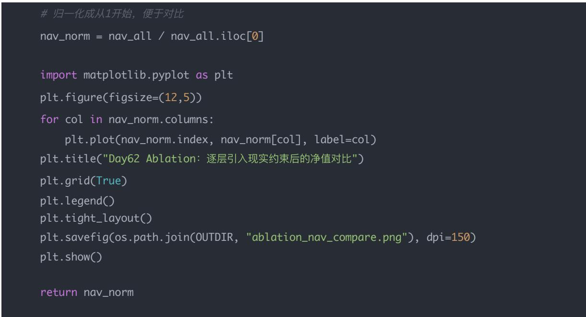
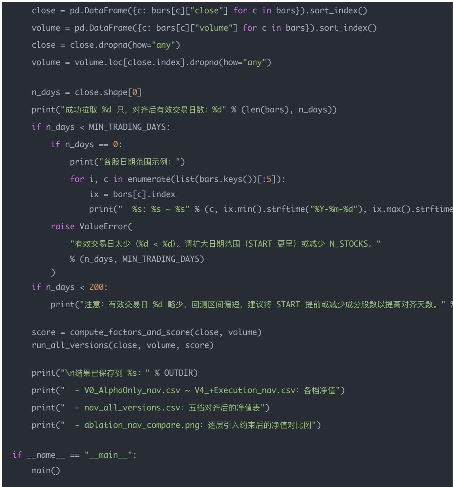

# 量化交易进阶:第62天 – 从 Alpha 到可交易组合的完整链路（四件套串联）

原创 逻辑与流 逻辑与流 2026年1月30日 18:08 北京 📞 听全文

本文系统讲解从 Alpha 到可交易组合的完整链路,深入剖析机构量化流水线中 Alpha、风险平价、波动率目标、流动性约束、执行成本四件套的串联逻辑与实现。详细阐述 0→1→2→3→4 分层架构的问题出现顺序与输入输出,揭示各层分工与衔接关系。通过完整的 Tushare 多因子回测引擎与 Ablation 五档对比,展示如何逐层开关验证、判读策略死因。帮助读者掌握从「理想化回测」到「接近实盘」的完整流水线,为策略诊断与实盘前压力测试奠定基础。

## 学习时间

- 理论学习: 25分钟

- 概念理解: 20分钟

- 代码实践: 30分钟

- 总计: 75分钟

## 学习目标

你今天要掌握机构量化流水线的完整串联方式：

把一个「可能赚钱的想法」，逐层加工成一个「能长期、稳定、可放大、可执行」的投资产品。

学完你能做到：

- 理解 $0 \to 1 \to 2 \to 3 \to 4$ 各层解决的问题与顺序

- 会在回测中串联 Alpha → RP → VolTarget → Liquidity → Execution

- 会用Ablation五档对比定位策略死因

- 能根据流程图与数据流图复现或改造引擎

## 一句话总结

先在理想世界里找方向（Alpha），再让风险在资产间公平分摊（Risk Parity），再把整体风险锁定在目标水平（Vol Target），再面对现实世界的流动性约束（Liquidity），最后用真实价格完成交易（Slippage & Impact）。

## 一、先给你一个「总视角」：机构到底在做什么？

机构做量化，不是在「找一个最牛的公式」，而是在做一件事：

把一个「可能赚钱的想法」，逐层加工成一个「能长期、稳定、可放大、可执行」的投资产品。

你可以把它理解为一个「标准机构流水线」：

你将看到的 $0 \to 1 \to 2 \to 3 \to 4$ ，不是随便分的，而是严格按「问题出现的顺序」分层的。

## 0) Alpha 层（你已经会）

—— 回答「买什么、相对买多少」(不考虑现实)

- 生成每只股票的因子得分 score（多因子/ML/GNN 都行）

- 得到「基础选股和偏好」 $\rightarrow$ 基础权重 $w^{(0)}$

- 例：等权 topN，或按 score 归一化权重

这一步解决：买谁、相对买多少（只回答「偏好」）

这一层只做一件事：

在「假设可以自由交易」的世界里，判断哪些资产「更值得持有」。

所以它的输入输出是：

- 输入：价格、财务、情绪、ML特征……

- 输出:

- 因子得分

- 排名

- 或一个「基础权重」 $w^{(0)}$

这一步刻意忽略：

- 成本

- 流动性

- 风险

- 规模

为什么要刻意忽略？

因为你要先验证想法是不是有方向性优势（Alpha）。

如果在「理想世界」里都不赚钱，后面再怎么风控、执行，都是浪费时间。

但 Alpha 层有一个致命问题

它只对「相对好坏」负责，不对结果负责：

- A 比 B 好

- C比D好

但它不关心：

- A 波动是不是巨大？

- A 和 B 是不是同涨同跌？

- 买A会不会让整个组合风险爆炸？

这就引出了第1层。

## 1) 风险平价层（Risk Parity）

——修正 Alpha 的「风险失真」

把 $w^{(0)}$ 变成「风险更均匀」的权重 $w^{RP}$ 。

- 近似版（工程最常用起步）： $w_{i} \propto \frac{1}{\sigma_{i}}$

- 协方差严格版（更专业）：让各资产 RC 相等（需要优化）

这一步解决：不要让高波动/高度相关资产绑架组合风险

1 这一层为什么一定要存在？

因为一个非常现实的事实：

Alpha 强 ≠ 对组合有利

举个直观例子：

- 股票 A:

- 因子得分高

- 但波动率 $60\%$ ，和所有股票高度相关

- 股票 B:

- 得分一般

- 波动率 $15\%$ ，和别人相关性低

如果你直接按 Alpha 权重买：

A 会在组合里 制造绝大部分风险

风险平价层在做什么？

它做的不是「否定 Alpha」，而是：

在不改变「谁更好」这个判断的前提下，让每只资产「背的风险包」差不多重。

所以你会看到：

- 高波动资产 $\rightarrow$ 自动被压低权重

- 低波动、分散资产 $\rightarrow$ 自动被抬高权重

这一层的输出是：

风险更均匀的权重 $w^{RP}$

为什么风险平价放在 Alpha 后面？

因为逻辑顺序是：

1. 先决定偏好 (Alpha)

2. 再校正偏好带来的风险结构

如果你反过来：

- 先做风险平价

- 再叠 Alpha

你会发现 Alpha 的信息被「抹平」。

但风险平价还有一个问题

风险平价只解决了一个问题：

「风险在资产之间怎么分」

它没有解决：

- 整个组合风险是高是低？

- 市场极端波动时怎么办？

这就必须引入第 2 层。

## 2) 波动率目标层（Vol Target Overlay）

—— 控制「整体风险旋钮」

在得到风险更均匀的 $w^{RP}$ 后，再把组合「整体放大或缩小」到目标风险：

$$
\sigma_ {p} = \sqrt {w ^ {T} \Sigma w}, \quad w ^ {V T} = w ^ {R P} \cdot \frac {\sigma_ {t a r g e t}}{\sigma_ {p}}
$$

并加上杠杆上限 max\_leverage 防止极端放大。

这一步解决：组合总风险恒定（市场波动大就降仓，平稳就加仓）

2 这一层在解决什么问题？

风险平价之后，你的组合可能是：

- 风险结构很均匀 √

- 但整体波动率：

- 有时 $8\%$

- 有时 $25\%$

- 有时 $40\%$

而机构投资产品不能这样。

基金经理必须回答一个问题：

「你这产品的风险水平大概是多少？」

波动率目标层的本质

它引入一个绝对标尺：

我希望这个组合长期年化波动率 $\approx 10\%$ （或 $8\%$ 、 $12\%$ ）

于是做一件非常关键的事：

- 市场波动上升 $\rightarrow$ 整体降仓

- 市场平稳 $\rightarrow$ 整体加仓

这一层不改变：

- 哪些资产重要

- 相对比例

只改变：

- 整体仓位大小

你可以把它理解为：

「风险的总音量旋钮」

为什么它必须在风险平价之后？

如果你先做 Vol Target，再做风险平价：

- 风险平价会再次打乱风险结构

- 你前面的风险控制失效

正确顺序永远是：

先把「内部风险结构」理顺 → 再调「整体风险强度」

到这里还有一个巨大假设

到目前为止，前 0/1/2 层都在假设一件事：

你算出来的权重，是「可以完整成交的」。

但现实世界马上打你脸。

这就进入第3层。

——从「想买多少」到「能买多少」

你算出来的目标仓位不一定能成交。

日频常用：

$$
Q _ {f i l l} = \min (| Q _ {o r d e r} |, \lambda \cdot A D V)
$$

这一步解决：你能不能买到/卖掉那么多（容量与规模）

3 为什么这一层是「生死线」？

因为现实市场里：

不是你想买多少，就能买多少。

尤其当你资金一放大：

- 小市值股票

- 冷门股票

- 高频换手策略

都会遇到一个问题：

市场接不住你。

成交量限制层在干什么？

它把你的目标下单量 $Q_{order}$ ，映射为一个现实可成交量 $Q_{fill}$ 。

例如：

- 你想买50万股

- 但这只股票20日ADV只有300万

- 你设定参与率 $10\%$

今天最多只能买30万股

剩下的：

- 要么不买

- 要么慢慢买（跨日执行）

这一步直接决定：

策略有没有容量（Capacity）

为什么它在 Vol Target 后面？

因为成交量限制关心的是：

- 绝对下单量（股数）

- 而不是权重比例

你必须先把：

- 权重 $\times$ NAV $\rightarrow$ 变成真实下单量

才能谈「能不能成交」。

即便成交量够，还有一个坑

即便你「能成交」:

成交价 $\neq$ 你用来算收益的价格

这就是最后一层。

## 4) 执行成本层：滑点 + 冲击成本（Slippage + Impact）

—— 把「理论价格」变成「真实成交价」

成交价不是 close，而是：

$$
P _ {e x e c} = P \cdot \left(1 + \operatorname{sign} \cdot \alpha \sqrt {\frac {Q}{A D V}} + \epsilon\right)
$$

- $\alpha \sqrt{Q / ADV}$ : 冲击成本（下单越大越贵）

- $\epsilon$ ：随机滑点（现实不确定性）

这一步解决：你用什么价格成交（收益不会虚高）

4 这一层在解决什么？

它解决的是：

你「用什么价格成交」

现实里你会遇到：

- 吃深度 $\rightarrow$ 价格变差

- 对手撤单

- 延迟

- 同时竞争

所以真实成交价一定是：

理论价 ± 成本

为什么它是最后一层？

因为只有在你知道：

- 买多少（成交量限制）

- 在什么时点买

之后，你才能估计：

- 冲击成本

- 随机滑点

这是执行层，不该污染前面的 Alpha / 风险判断。

## 最终你得到的是

- 可交易、可放大、可控风险的组合净值

而不是「只在研究里好看」的因子曲线。

## 二、把 0-4 串成一句「完整逻辑」

现在你可以把整条流水线浓缩成一句话：

先在理想世界里找方向（Alpha），再让风险在资产间公平分摊（Risk Parity），再把整体风险锁定在目标水平（Vol Target），再面对现实世界的流动性约束（Liquidity），最后用真实价格完成交易（Slippage & Impact）。

## 三、把这套流水线画成一张「结构图 + 数据流图」

## A. 结构图（模块分层图）

这张图强调：每一层解决什么问题、输入输出是什么

## B. 数据流图（「数据在管道里怎么流」）

这张图强调：你在回测里每个 rebalance 点具体算了什么

记忆诀窍：

- Alpha 决定「方向与偏好」;

- Risk（RP+VolTarget）决定「风险形状与总音量」；

- Liquidity+Execution 决定「现实世界能不能做到、做到要付多少钱」。

## 四、逐层「关掉」某一层，对比净值：Ablation Study（你亲眼看策略死在哪）

你想做的对比，本质是：同一套 Alpha，只改「现实约束层/风控层」，看看净值如何变化。

我们定义 5 个版本（从理想到现实）：

- V0: 只开 Alpha（理想世界）

- V1: Alpha + 风险平价 (RP)

- V2: V1 + 波动率目标 (VolTarget)

- V3: V2 + 成交量限制 (Liquidity)

- V4: V3 + 冲击/滑点 (Execution) ← 最接近真实

## 你会看到的典型现象（先给你「判读框架」）

- V0 很强，V3/V4 直接崩：策略靠「不可成交/无成本」在赚钱（典型虚高）

- V0→V1 回撤明显下降：你的 alpha 确实被高波动资产绑架过

- V2 比 V1 更稳但收益变慢：Vol Target 把爆仓/大波动期的风险压住了

- V3 之后收益腰斩：容量（参与率/ADV）不支持这个换手/股票池

- V4 再掉一截：冲击/滑点吃掉了边际 alpha（说明 alpha 太薄）

## 五、实战版：Tushare 多因子回测引擎（四件套已整合，可跑）

特点：

- 用 Tushare 拉取 沪深A股（示例用上证50成分）

- 日频回测（按月调仓，可改）

- 多因子示例（动量、波动率反向、成交量变化）

- 流水线：Alpha $\rightarrow$ RP $\rightarrow$ VolTarget $\rightarrow$ Liquidity $\rightarrow$ Slippage/Impact $\rightarrow$ 回测

- 输出：净值曲线、回撤、年化、夏普（简版）+关键中间量

你只要换掉 compute\_factors\_and\_score() 里的得分，就能接你的真实因子库/ML输出。

(代码见下一节完整版。)

## 六、你应该怎么用这套引擎（最关键的三点）

## 1) 你只需要替换一个函数

把你的「因子库/ML输出」接进来，只动这里：

• compute\_factors\_and\_score(close, volume)

输出一个 score[date x code] 就行。

2) 四件套每一层都能单独开关验证

你做研究时建议按顺序打开：

1. 只开 Alpha（不加成本/约束）

2. 风险平价（看是否降低回撤）

3. 波动率目标（看是否更稳）

4. 成交量限制（看容量是否崩）

5. 冲击/滑点（看收益是否「还能活」）

这样你能清楚知道：策略死在哪一层。

## 3) 参数要校准（否则会「误杀策略」）

- IMPACT\_ALPHA、RAND\_SIGMA、LAMBDA\_PART 对结果很敏感

- 真正做实盘前要用历史成交/滑点数据做回归校准

- 研究阶段你可以先用保守参数「压测」

## 七、代码：在你 Day62 引擎上加「开关」并跑 5 次画一张对比图

下面这段是「最小侵入式改造」：你只要把它合并到你那份 day62\_engine.py 里即可。

## A. 加一个配置开关（建议放在参数区）

LAYER\_PRESETS = {

"V0\_AlphaOnly": dict(use\_rp=False, use\_voltarget=False, use\_liquidity=False, use\_execu

"V1\_+RiskParity": dict(use\_rp=True, use\_voltarget=False, use\_liquidity=False, use\_execu

"V2\_+VolTarget": dict(use\_rp=True, use\_voltarget=True, use\_liquidity=False, use\_execu

"V3\_+Liquidity": dict(use\_rp=True, use\_voltarget=True, use\_liquidity=True, use\_execu

"V4\_+Execution": dict(use\_rp=True, use\_voltarget=True, use\_liquidity=True, use\_execu

## B. 在回测函数里接入开关（核心：4 个 if）

你在 backtest\_day62(...) 里调仓那段，做如下逻辑替换：

## 1）权重生成处：RP / VolTarget 开关

\# picks 已经选出

w0 = np.ones(len(picks)) / len(picks)

--- (1) Risk Parity: 开关 ---

if flags["use\_rp']:

w\_rp, \_ = inv\_vol\_risk\_parity\_weights(ret\_win)

else:

w\_rp = w0

--- (2) Vol Target: 开关 ---

```python
if flags["use_voltarget"]:
    w_final, sig_p, scale = vol_target_overlay(w_rp, cov, SIGMA_TARGET, MAX_LEVERAGE)
else:
    w_final = w_rp
    sig_p, scale = np.nan, 1.0
```

## 2）下单与成交处：Liquidity / Execution 开关

把你原来计算 q\_fill 与 px\_exec 的地方改成：

```python
q_order_abs = abs(delta_val) / px

# --- (3) Liquidity: 开关 ---
if flags["use_liquidity"]:
    q_fill = cap_fill(q_order_abs, adv_today[c], LAMBDA_PART)
else:
    q_fill = q_order_abs  # 假设100%可成交

if q_fill <= 0:
    continue

# --- (4) Execution: 开关 ---
if flags["use_execution"]:
    px_exec = exec_price(px, side_sign, q_fill, adv_today[c], IMPACT_ALPHA, RAND_SIGMA)
else:
    px_exec = px  # 理想成交价
```

## 你会发现：

Liquidity 负责「成交多少」，Execution 负责「什么价格成交」。

## C. 写一个「跑多次并画对比净值」的入口

## 在 main() 里把单次回测改成循环:

```python
def run_all_versions(close, volume, score):
    nav_dict = {}

    for name, flags in LAYER_PRESETS.items():
    print(f"\n=== Running {name} ===")
    nav_df, lev_df = backtest_day62(close, volume, score, flags=flags)  # 你需要把 flags
    nav_dict[name] = nav_df["nav"]
    nav_df.to_csv(os.path.join(OUTDIR, f"{name}_nav.csv"))
    nav_all = pd.DataFrame(nav_dict).dropna(how="any")
    nav_all.to_csv(os.path.join(OUTDIR, "nav_all_versions.csv"))
```



## 你需要做的一个小改动是：让 backtest\_day62 支持 flags 参数：

def backtest\_day62(panel\_close, panel\_volume, score, flags):

你跑完后，我教你「怎么一眼定位策略死因」

把 ablation\_nav\_compare.png 打开，你按这个顺序问：

1. V0 vs V1: RP 是否显著降低回撤/提高夏普?

- 是：说明之前风险集中很严重

2. V1 vs V2: VolTarget 是否在大波动阶段显著抑制回撤?

- 是：策略在极端行情更可靠

3. V2 vs V3: 一加 Liquidity 收益是否塌陷?

- 是：容量不够（换手太高/股票太小/参与率太保守）

4. V3 vs V4: 一加 Execution 是否再掉一大截?

- 是：alpha 太薄，被冲击/滑点吃光（或冲击参数过于保守，需要校准）

## 八、完整代码（四件套 + Ablation 五档）

(以下为完成之后的代码，可直接保存为脚本运行。)

import os

import numpy as np

import pandas as pd

import tushare as ts

import matplotlib.pyplot as plt

0）参数区：你主要改这里

INDEX\_CODE = "000016.SH"

\# 上证50

N\_STOCKS = 30

\# 取前N只成分股（先小一点，跑得快）

START = "20180101"

\# 拉长到 2018，对齐后有效交易日更多

END = pd.Timestamp.today().strftime("%Y%m%d")

MIN\_TRADING\_DAYS = 100

\# 有效交易日至少 100 天，否则报错；100\~200 会打警告

REBAL\_FREQ = "M"

\# 调仓频率：'M' 月末 / 'W' 周

TOP\_N = 10

\# 选股数量（多头）

LONG\_ONLY = True

\# True=只做多；False=多空(需要你扩展)

\# 风险平价 + vol target

VOL\_WINDOW = 20

\# 波动/协方差估计窗口（交易日）

SIGMA\_TARGET = 0.10

\# 目标年化波动率 (10%)

MAX\_LEVERAGE = 1.0

\# 最大总仓位 (1.0=不加杠杆; >1允许杠杆)

\# 流动性约束

ADV\_WINDOW = 20

LAMBDA\_PART = 0.10

\# ADV窗口

\# 最大参与率 (10%) -> 最大成交量 = 10% \* ADV

\# 交易成本

COMMISSION = 0.0003

\# 单边手续费（万三）

IMPACT\_ALPHA = 0.10

RAND\_SIGMA = 0.02

\# 冲击系数（经验参数，需校准）

\# 随机滑点强度（配合Q/ADV缩放）

INITIAL\_CASH = 1\_000\_000

TRADING\_DAYS = 252

\# 四件套逐层开关（做 ablation: 逐层打开验证）

LAYER\_PRESETS = {

"V0\_AlphaOnly": dict(use\_rp=False, use\_voltarget=False, use\_liquidity=False, use\_execu

"V1\_+RiskParity": dict(use\_rp=True, use\_voltarget=False, use\_liquidity=False, use\_execu

"V2\_+VolTarget": dict(use\_rp=True, use\_voltarget=True, use\_liquidity=False, use\_execu

"V3\_+Liquidity": dict(use\_rp=True, use\_voltarget=True, use\_liquidity=True, use\_execu

"V4\_+Execution": dict(use\_rp=True, use\_voltarget=True, use\_liquidity=True, use\_execu

OUTDIR = "day62\_output"

os.makedirs(OUTDIR, exist\_ok=True)

\# 1) Tushare 初始化

TOKEN = "3f21bb0ff0889eb10b050c7536ca4a55064af3397f22e43d74b7ccb0"

if not TOKEN:

raise ValueError("请先设置环境变量：export TUSHARE\_TOKEN='你的token'")

ts.set\_token(TOKEN)

plt.rcParams["font.sans-serif"] = ["SimHei", "Arial Unicode MS", "Noto Sans CJK SC", "DejaVu" plt.rcParams["axes.unicode\_minus"] = False

def \_to\_ts\_code(s):
    """con\_code 转为 pro.daily 需要的 ts\_code（补全 .SH/.SZ）"""
    s = str(s).strip()
    if s.endswith(".0") and s[:-2].isdigit():
    s = s[:-2]
    if "." in s and (s.endswith(".SH") or s.endswith(".SZ)):
    return s
    if len(s) < 6:
    return s
    return s + (".SH" if s[0] in ("6", "9") else ".SZ")

def get\_index\_constituents(index\_code, n, trade\_date):
    wdf = pro.index\_weight(index\_code=index\_code, trade\_date=trade\_date)
    if wdf.empty:
    fallback = (pd.to\_datetime(trade\_date) - pd.Timedelta(days=7)).strftime("%Y%m%d")
    wdf = pro.index\_weight(index\_code=index\_code, trade\_date=fallback)

"000858.SZ", "000333.SZ", "601288.SH", "601398.SH", "600276.SH",

"600887.SH", "601012.SH", "601857.SH", "600585.SH", "600309.SH",

return [\_to\_ts\_code(c) for c in raw[:n]]
wdf = wdf.sort\_values("weight", ascending=False)
col = "con\_code" if "con\_code" in wdf.columns else "code"
raw = wdf[col].dropna().astype(str).head(n \* 2).tolist()
return [\_to\_ts\_code(c) for c in raw[:n]]

def fetch\_daily\_bars(ts\_code, start, end):
    df = pro.daily(ts\_code=ts\_code, start\_date=start, end\_date=end,
    fields="ts\_code,trade\_date,open,high,low,close,vol")
    if df.empty:
    return df
    df = df.sort\_values("trade\_date")
    df["date"] = pd.to\_datetime(df["trade\_date"])
    df = df.set\_index("date")
    return df[['open", "high", "low", "close", "vol']].rename(columns={"vol":"volume"})

3）因子与得分（你可替换成你的因子库/ML输出）

def compute\_factors\_and\_score(panel\_close, panel\_volume):
    ret = panel\_close.pct\_change()
    mom20 = panel\_close / panel\_close.shift(20) - 1.0
    vol20 = ret.rolling(20).std() \* np.sqrt(TRADING\_DAYS)
    vchg5 = panel\_volume.pct\_change(5)

def zscore\_cs(df):
    m = df.mean(axis=1)
    s = df.std(axis=1).replace(0, np.nan)
    return df.sub(m, axis=0).div(s, axis=0)

mom\_z = zscore\_cs(mom20)
vol\_z = zscore\_cs(vol20)
vchg\_z = zscore\_cs(vchg5)
score = 0.6 \* mom\_z + (-0.3) \* vol\_z + 0.1 \* vchg\_z
return score

def inv\_vol\_risk\_parity\_weights(returns\_window: pd.DataFrame):
    vol = returns\_window.std() \* np.sqrt(TRADING\_DAYS)
    inv = 1.0 / np.maximum(vol.values, 1e-12)
    w = inv / inv.sum()
    return w, vol.values

def portfolio\_sigma(weights, cov):
    w = np.asarray(weights).reshape(-1, 1)
    return float(np.sqrt(w.T @ cov @ w))

def vol\_target\_overlay(weights, cov, sigma\_target, max\_leverage):
    sig = portfolio\_sigma(weights, cov)
    scale = (sigma\_target / sig) if sig > 1e-12 else 0.0
    scale = min(scale, max\_leverage)
    return weights \* scale, sig, scale

def calc\_adv(vol\_series: pd.Series, window=20):
    return vol\_series.rolling(window, min\_periods=1).mean()

def exec\_price(base\_price, side\_sign, qty\_abs, adv, alpha, rand\_sigma):
    adv = max(float(adv), 1e-12)
    x = float(qty\_abs) / adv
    impact = alpha \* np.sqrt(max(x, 0.0))
    eps = np.random.normal(0.0, rand\_sigma \* x)
    return base\_price \* (1.0 + side\_sign \* impact + eps)

def backtest\_day62(panel\_close, panel\_volume, score, flags=None):
    if flags is None:
    flags = dict(use\_rp=True, use\_voltarget=True, use\_liquidity=True, use\_execution=True)
    codes = list(panel\_close.columns)
    dates = panel\_close.index

ret = panel\_close.pct\_change()
adv = panel\_volume.apply(lambda s: calc\_adv(s, ADV\_WINDOW))
rebalance\_dates = panel\_close.resample(REBAL\_FREQ).last().index.intersection(dates)

cash = INITIAL\_CASH
pos\_shares = pd.Series(0.0, index=codes)
nav\_list = []
leverage\_list = []

for dt in dates:
    price\_today = panel\_close.loc[dt]
    vol\_today = panel\_volume.loc[dt]
    adv\_today = adv.loc[dt]

    holdings\_value = float((pos\_shares \* price\_today).sum())
    nav = cash + holdings\_value
    nav\_list.append((dt, nav))

    if dt in rebalance\_dates:
    if ret.loc[:dt].shape[0] < VOL\_WINDOW + 5:
    continue

    sc = score.loc[dt].dropna()
    if sc.empty:
    continue

    picks = sc.sort\_values(ascending=False).head(TOP\_N).index.tolist()

    w0 = np.ones(len(picks)) / len(picks)
    ret\_win = ret[picks].loc[:dt].tail(VOL\_WINDOW).dropna(how="any")
    if ret\_win.shape[0] < max(10, VOL\_WINDOW // 2):
    continue

if flags["use\_rp"]:
    w\_rp, \_ = inv\_vol\_risk\_parity\_weights(ret\_win)
else:
    w\_rp = w0.copy()

if flags["use\_voltarget"]:
    w\_final, sig\_p, scale = vol\_target\_overlay(w\_rp, cov, SIGMA\_TARGET, MAX\_LEVEL)
else:
    w\_final = w\_rp.copy()
    scale = 1.0
leverage\_list.append((dt, float(w\_final.sum())))

target\_value = pd.Series(0.0, index=codes)
for i, c in enumerate(picks):
    target\_value[c] = nav \* w\_final[i]

for c in codes:
    px = float(price\_today[c])
    if not np.isfinite(px) or px <= 0:
    continue

    cur\_sh = float(pos\_shares[c])
    cur\_val = cur\_sh \* px
    tgt\_val = float(target\_value[c])
    delta\_val = tgt\_val - cur\_val
    if abs(delta\_val) < 1e-6:
    continue

    side\_sign = 1.0 if delta\_val > 0 else -1.0
    q\_order\_abs = abs(delta\_val) / px

    if flags["use\_liquidity"]:
    q\_fill = cap\_fill(q\_order\_abs, adv\_today[c], LAMBDA\_PART)
    else:
    q\_fill = q\_order\_abs
    if q\_fill <= 0:
    continue

    if flags["use\_execution"]:
    px\_exec = exec\_price(px, side\_sign, q\_fill, adv\_today[c], IMPACT\_ALPHA,
    else:
    px\_exec = px

    trade\_val = q\_fill \* px\_exec
    fee = trade\_val \* COMMISSION

    if side\_sign > 0:
    total\_cost = trade\_val + fee
    if total\_cost > cash:
    ratio = cash / max(total\_cost, 1e-12)
    q\_fill2 = q\_fill \* ratio
    if q\_fill2 <= 0:

continue
    if flags["use\_execution"]:
    px\_exec2 = exec\_price(px, side\_sign, q\_fill2, adv\_today[c], IMPA
    else:
    px\_exec2 = px
    trade\_val2 = q\_fill2 \* px\_exec2
    fee2 = trade\_val2 \* COMMISSION
    cash -= (trade\_val2 + fee2)
    pos\_shares[c] += q\_fill2
    else:
    cash -= total\_cost
    pos\_shares[c] += q\_fill
    else:
    sell\_qty = min(q\_fill, cur\_sh)
    if sell\_qty <= 0:
    continue
    trade\_val = sell\_qty \* px\_exec
    fee = trade\_val \* COMMISSION
    cash += (trade\_val - fee)
    pos\_shares[c] -= sell\_qty

nav\_df = pd.DataFrame/nav\_list, columns=["date", "nav"]).set\_index("date")
nav\_df["ret"] = nav\_df["nav"].pct\_change().fillna(0.0)
return nav\_df, pd.DataFrame(leverage\_list, columns=["date", "gross\_exposure"]).set\_index(



## 九、这张图在说什么？

图名：Day62 Ablation：逐层引入现实约束后的净值对比

- 横轴：时间（回测区间内的每个交易日）

- 纵轴：归一化净值（起点都设为1，方便比较谁涨得多、谁跌得少）

- 每条曲线：一种「配置」——从只做 Alpha（V0）到四件套全开（V4），共 5 条。

## 五条曲线分别代表什么？

<table><tr><td>曲线</td><td>含义</td></tr><tr><td>V0_AlphaOnly</td><td>纯 Alpha:只选股、等权、不控风险、不限制成交量、不考虑冲击/滑点(理想化基准)</td></tr><tr><td>V1_+RiskParity</td><td>在 V0 基础上 + 风险平价(RP):权重按风险贡献调,降低单一资产主导</td></tr><tr><td>V2_+VolTarget</td><td>在 V1 基础上 + 波动率目标:整体仓位按目标波动率缩放,大波动时自动降仓</td></tr><tr><td>V3_+Liquidity</td><td>在 V2 基础上 + 流动性约束:单日成交量不能超过 ADV×参与率,模拟「不能一口气买太多」</td></tr><tr><td>V4_+Execution</td><td>在 V3 基础上 + 执行层:成交价考虑冲击成本和随机滑点(最接近实盘)</td></tr></table>

## 这张图能说明什么？

### 1. 策略「死」在哪一层

看从哪一条开始，曲线明显比上一条差一大截（收益掉下去、回撤变大）。那一层就是当前策略的「瓶颈」：要么在这一层上改（调参数/换约束），要么承认容量或执行成本把Alpha吃掉了。

### 2. 每层约束的代价

- V0→V1：加 RP 后，曲线若更平滑、回撤更小 → 说明之前风险太集中，RP 有用。

- V1→V2：加Vol Target后，若在大波动段明显少跌 $\rightarrow$ 说明控波动有效，策略更稳。

- V2→V3：一加 Liquidity，若收益明显塌下去 → 说明容量/换手/参与率有问题（要么股票太小，要么参与率设太严）。

- V3→V4：一加 Execution，若再掉一截 → 说明 Alpha 偏薄，被冲击/滑点吃掉了，或冲击参数设得偏保守（需要校准）。

### 3. 实盘预期

V4 最接近真实交易（有 RP、Vol Target、流动性限制、冲击滑点）。若 V4 曲线仍然明显高于 1、且回撤可接受，说明策略在「加完现实约束后」还有空间；若 V4 已经很平甚至往下，说明当前 Alpha 在实盘环境下可能不够用。

### 4. 研究顺序

图的设计就是「按顺序一层层加约束」：先看纯 Alpha（V0），再看加风险控制（V1、V2），再看容量（V3），最后看执行成本（V4）。这样你可以清楚知道：是风险控制、流动性还是执行成本在「杀」你的策略。

## 一句话总结

这张图就是在回答：从「理想化回测」到「接近实盘」的过程中，每加一层现实约束，收益和风险会变成什么样；以及你的策略主要是在哪一层被「打掉」的。用来做策略诊断和实盘前的压力测试最合适。

## 结论

先在理想世界里找方向（Alpha），再让风险在资产间公平分摊（Risk Parity），再把整体风险锁定在目标水平（Vol Target），再面对现实世界的流动性约束（Liquidity），最后用真实价格完成交易（Slippage & Impact）。

记忆诀窍：Alpha 决定「方向与偏好」；Risk（RP+VolTarget）决定「风险形状与总音量」；

Liquidity+Execution 决定「现实世界能不能做到、做到要付多少钱」。从「理想化回测」到「接近实盘」，每加一层现实约束都会改变收益与风险；用 Ablation 五档对比可以一眼定位策略死因，是做策略诊断和实盘前压力测试的合适工具。
