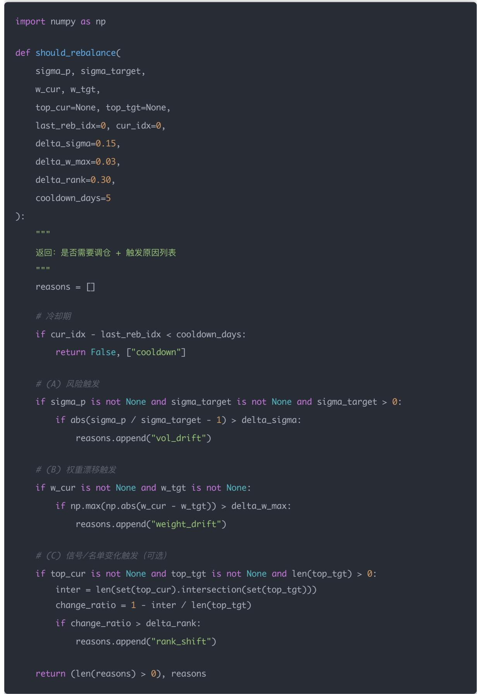

# 量化交易进阶:第63天 - 动态再平衡策略（触发式/定期调仓机制）(进阶阶段·回测框架篇)

原创 逻辑与流 逻辑与流 2026年2月1日 15:44 北京 听全文

本文系统讲解动态再平衡策略的核心原理与技术实现,深入剖析触发式与定期调仓机制的差异与设计方法。详细阐述定期调仓的简单稳定与动态再平衡按组合状态决策的优劣对比,揭示触发式调仓回答风险偏离、权重漂移、Alpha排名结构性变化三个核心问题。系统解析三类最常用触发条件的数学公式与过拟合防范,给出公司常用的组合触发器配方及冷却时间与最小交易阈值两个防抖器。通过可直接接入Day62引擎的Python调仓决策器实现,展示组合波动率、触发点标注、换手率三条关键可视化线。帮助读者将调仓从「每月/每周调一次」升级为研究员级的可控模块,掌握波动率目标、风险平价、成交量限制、滑点成本纳入调仓决策的完整框架。

## 学习时间

理论学习: 15分钟

概念理解: 15分钟

代码实践: 20分钟

## 学习目标

总计: 50分钟

今天要把「调仓」从一句话（每月/每周调一次）升级成研究员级的可控模块。

学完你能做到：

理解定期调仓 vs 触发式调仓到底差在哪

掌握触发条件怎么设计才不「过拟合

把波动率目标、风险平价、成交量限制、滑点成本一起纳入调仓决策

使用可直接接进 Day62 引擎的「动态再平衡框架代码

## 一句话总结

定期调仓解决「纪律」，触发式调仓解决「状态」。研究员级组合管理 = 用风险漂移做主触发，用权重漂移做辅助，用信号触发要克制。

## 一、概念讲解：为什么要「动态再平衡」？

## 传统做法：定期调仓

每周/每月固定换一次

好处：简单、稳定、容易复现

坏处：

市场在两次调仓之间「突变」你无能为力

有时该调不调（风险爆了）

有时不该调却强行调（白交手续费）

## 动态再平衡：触发式调仓

不按日历，而按「组合状态」决定是否需要调仓。

触发式调仓通常回答三个问题：

风险是否偏离 目 标？（vol target drift）

组合权重是否偏离太多？（allocation drift）

alpha 排名是否发生结构性变化？（signal regime shift）

## 二、数学/逻辑推导：三类最常用触发条件

下面每个触发条件都可以单独用，也可以组合。

## (A) 风险触发： 目 标波动率偏离（Vol Drift Trigger）

你在 Day60 学过：

$$
\sigma_ {p, t} = \sqrt {w _ {t} ^ {T} \Sigma_ {t} w _ {t}}
$$

目标是 $\sigma _ { t a r g e t }$

触发条件：

$$
\left| \frac {\sigma_ {p , t}}{\sigma_ {t a r g e t}} - 1 \right| > \delta_ {\sigma}
$$

$\delta _ { \sigma }$ 常用 10%\~20%

直觉：组合风险偏离太多就必须重配

优点：有明确金融意义，最不容易过拟合

缺点：可能在大震荡期频繁触发（要加冷却时间）

## (B) 权重漂移触发：仓位偏离阈值（Weight Drift Trigger）

定义目标权重 $w ^ { t a r g e t }$ ，当前权重 $w ^ { c u r }$

触发条件（最大偏离）：

$$
\max _ {i} | w _ {i} ^ {c u r} - w _ {i} ^ {t a r g e t} | > \delta_ {w}
$$

或（总偏离 L1）：

$$
\sum_ {i} | w _ {i} ^ {c u r} - w _ {i} ^ {t a r g e t} | > \delta_ {L 1}
$$

优点：简单、可控交易次数

缺点：不直接关心风险，只关心「离目标多远

## (C) 信号触发：Alpha 排名变动（Rank / Score Trigger）

如果你的多因子每天下发 score，常用触发是：

TopN 名单变化超过阈值

$$
\frac {| T o p N _ {t} \Delta T o p N _ {t - 1} |}{N} > \delta_ {r a n k}
$$

或 score 发生「结构性变化」（例如 IC 崩溃、分布漂移）

优点：更贴合 $\Gamma _ { \mathrm { a l p h a } }$ 有效性

缺点：最容易过拟合（必须加交易成本与稳定性约束）

## 三、实战推荐：公司常用的「组合触发器」配方

给你一个很实用的组合逻辑（你可以直接用）：

触发式调仓 = 风险触发为主 + 权重漂移为辅 + 信号触发为慎用

典型配置：

风险偏离超过 15% → 必调

权重最大偏离超过 3% → 调

TopN 换血超过 30% → 调（但加「冷却时间」）

并加两个「防抖器」：

防抖器 1：冷却时间（cooldown）

触发后至少间隔 cooldown\_days 才能再次触发（例如 5\~10 个交易日）

防抖器 2：最小交易阈值（no-trade band）

如果调仓带来的净变化太小（例如换手 < 5%），就不调——因为成本会吃掉收益。

## 四、Python 实现（可接 Day62 引擎）

下面是一套「调仓决策器」：输入当前状态，输出 True/False 是否调仓。

## 五、做动态调仓最关键的可视化是三条线

1. 组合波动率 $\sigma _ { p , t }$ 与 $\sigma _ { t a r g e t }$

2. 触发点标注（rebalance marker）

3. 换手率随时间变化（turnover）

这样你能直观看到：

是风险触发多？还是排名触发多？

调仓是否过于频繁？

成本是否导致净值变差？

## 六、今日小练习（含参考答案）

Q1

为什么「触发式调仓」容易过拟合？你如何防止？

## 答案要点：

触发条件如果依赖太多超参数（阈值、窗口、排名变化）会拟合历史噪声

防止方法：

加交易成本、滑点、流动性约束

加 cooldown（冷却期）

用 out-of-sample 验证

触发条件优先用「有金融意义」的风险漂移，而不是纯信号波动

## Q2

## 为什么「风险漂移触发」通常比「排名触发」更稳健？

## 答案要点：

风险漂移是组合层的硬约束（波动上升必然影响回撤）

排名变化可能只是噪声（尤其多因子 日频得分每天抖动）

风险触发不依赖具体因子形态，更可迁移

Q3

如果触发式调仓让换手率翻倍，但收益只提升一点点，你该怎么决策？

## 答案要点：

算「净 alpha」：收益提升是否覆盖新增交易成本（手续费+滑点+冲击）

观察风险调整后指标：夏普 $^ \circ ,$ /回撤是否明显改善

若收益不覆盖成本，应该：

提高触发阈值

增加冷却期

加 no-trade band

或回到定期调仓（更稳健）

## 结论

定期调仓解决「纪律」，触发式调仓解决「状态」。

研究员级组合管理 = 用风险漂移做主触发，用权重漂移做辅助，用信号触发要克制。
