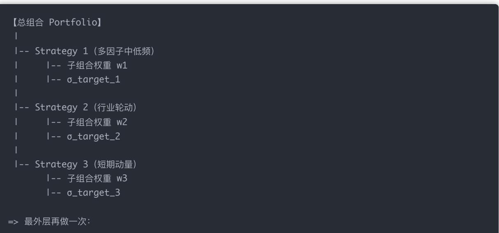
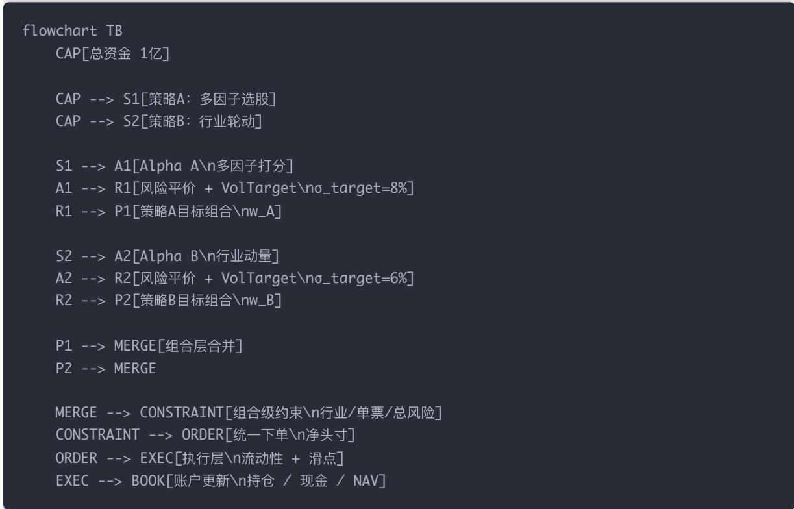

## 量化交易进阶:第64天 - 多标的管理系统（多股票组合 + 多策略组合管理）(进阶阶段·回测框架篇)

原创 逻辑与流 逻辑与流 2026年2月 12 日 20:56 北京 1人

本文系统讲解多标的管理与多策略组合管理(Portfolio of Portfolios)的核心思想与机构实践。纠正「多标的=股票多一点、多策略=策略多一点」的常见误解,明确本质是多个风险与收益来源的协同管理。解析多标的多子组合划分、多策略三层结构(策略级/策略间分配/组合级约束)、真实公司三条铁律,并通过完整案例展示资金/风险/下单在系统内的逐步流动。帮助读者形成「多层风险分配与执行系统」的系统级直觉。

## 一、先纠正一个非常常见的误解

很多人以为：

多标的管理 = 股票多一点

多策略管理 = 策略多一点

这是不对的。

正确理解是：

多标的 / 多策略 = 多个「风险与收益来源」的协同管理问题

你不是在管股票，也不是在管策略，而是在管：

风险暴露（Risk Exposure）

资金分配（Capital Allocation）

相关性（Correlation）

执行冲突（Execution Conflict）

## 二、系统全景：Day64 在整个流水线里的位置

## 把你已经学过的内容串起来：

单因子 / 单策略

多因子策略（Day43–Day55）

单组合风控（RP + VolTarget + Liquidity + Slippage）← Day62

动态调仓（Day63）

多标的 + 多策略组合管理（Day64）

Day64 的核心变化只有一句话：

你不再只有一个「目标组合」，而是「多个子组合同时存在」。

## 三、多标的管理：不是「股票更多」，而是「风险来源更多

## 1️⃣ 什么叫「多标的」？

常见多标的结构：

股票（A 股 / 港股 / 美股）

指数（ETF、期货）

债券

商品

外汇

但在股票量化里，更常见的是：

一个股票池里，不同「子池」代表不同风险特征

例如：

大盘价值

小盘成长

行业主题（医药 / 新能源）

高波动 vs 低波动

## 2️⃣ 为什么不能把它们「直接混在一起」？

因为它们的：

波动率水平不同

换手率不同

流动性不同

因子有效性周期不同

如果你直接合并，只会出现两种结果：

高波动 / 高频部分「吞噬」风险

低波动 / 低频部分「看起来没用

## 3️⃣ 正确做法：多标的 = 多「子组合

真实机构里是这样分的：

## 每一个子组合，本身都是一个完整的 Day62 流水线：

有 自 己的 Alpha

有 自 己的 RP / VolTarget

有自 己的调仓节奏

有自 己的容量上限

## 四、多策略管理：核心不是「策略多」，而是「别互相打架

## 1️⃣ 什么叫「多策略」？

例如你现在可能同时有：

策略 A：多因子中低频（换手月级）

策略 B：行业轮动（周级）

策略 C：短期动量（日级）

策略 D：对冲/防守策略

关键问题不是「能不能同时跑」，而是：

它们的风险是不是高度重合？

## 2️⃣ 多策略管理的三层结构（非常重要）

## 第一层：策略级（Strategy Level）

每个策略：

自 己算信号

自 己做 RP / VolTarget

自 己满足可执行性

先保证「单策略是健康的」。

## 第二层：策略间分配（Allocation Level）

你要决定：

给策略 A 多少钱？

给策略 B 多少风险？

## 常见分配方式：

等资金

等风险（非常常见）

按 IR / 夏普 动态分配

按策略稳定性（ICIR、回撤）

## 第三层：组合级约束（Portfolio Level）

企业用工保障新选择，雇主责任险护航安全生产！（见链接）

  
众安企业团险

查看详情

即便策略本身 OK，加在一起也可能出问题：

行业暴露叠加

风格暴露叠加

同一只股票被多策略同时买

## 这一层负责：

行业中性

风格中性

单票上限

总杠杆 / 总换手约束

## 五、一个「标准机构结构图」（文字版）

你可以用这个 mental model：

【总组合 Portfolio】

|-- Strategy 1（多因子中低频）

|-- 子组合权重 w1

|-- σ\_target\_1

|-- Strategy 2（行业轮动）

|-- 子组合权重 w2

|-- σ\_target\_2

|-- Strategy 3（短期动量）

|-- 子组合权重 w3

|-- σ\_target\_3

=> 最外层再做一次：

注意一个关键点：

Risk Parity / Vol Target 可以在「策略层」和「组合层」各做一次

## 六、为什么 Day64 是「系统工程」，不是「加个 for 循环

如果你只用 for 循环堆策略，会发生什么？

策略 A、B 同时买同一只票 → 风险被低估

两个策略在同一天对同一只股票一买一卖 → 换手暴涨

一个高频策略把流动性吃光，低频策略完全成交不了

这不是策略问题，是系统问题。

## 七、真实公司的三条铁律（非常重要）

## 铁律 1：

所有策略输出的，最终必须转成「风险预算

不是「买多少股」，而是：

占多少波动率

占多少 VaR

占多少风险贡献

## 铁律 2：

任何策略，都不能假设自 己「独占市场流动性

所以：

流动性约束要在「组合层」统一算

执行冲突要集中处理

铁律 3：

组合层永远有权「否决」策略层

即：

策略说买

组合说不行（风险/行业/流动性超限）

就不能买

## 八、Day64 的「最终产物」应该是什么？

学完这一讲，你的目标不是「写出一个很复杂的系统」， 而是你脑子里要形成这句话：

我管理的不是股票、不是策略，

而是一个「多层风险分配与执行系统」。

下面我用一个完整、具体、可落地的例子，把：

多因子策略 + 行业轮动策略

在一个真实的量化系统里

「资金 / 风险 / 下单」是如何一步一步流动的

彻底串给你看清楚。

我会分三层来讲：① 直觉故事 → ② 结构图 → ③ 数据流（逐步发生了什么）

## 完整案例：直觉故事、结构图与数据流

## 一、先给你一个「真实可想象的场景

假设你现在在管理一个 1 亿人民币的股票量化账户。

你同时运行 两套策略：

## 策略 A：多因子选股（中低频）

股票池：全 A 股

调仓频率：月度

Alpha 来源：价值 + 动量 + 质量

风格特点：分散、换手低、容量大

你给它的 目标风险预算：年化波动率 8%

## 策略 B：行业轮动（中频）

股票池：行业 ETF / 行业龙头

调仓频率：周度

Alpha 来源：行业动量、景气度

风格特点：集中、换手较高、波动偏大

你给它的 目标风险预算：年化波动率 6%

注意：

你此时不是说「给 A 多少钱、给 B 多少钱」，而是说：A 占 8% 风险，B 占 6% 风险。这已经是 机构思维了。

下面这张 Mermaid 结构图，你可以直接复制到支持 Mermaid 的 Markdown 里看。

结构图：多策略组合系统  

三、现在我们「让时间动起来」：系统里到底发生了什么？

下面是假设 某一个调仓日，系统从早到晚发生的全过程。

Step 0：市场数据进入系统

系统此刻已经有：

历史价格

微信支付宝二合收款音响免手机，大音量

微信支付宝二合一收款音箱，大音量防逃单

收款音响企业店

去逛逛

成交量

行业分类

指数行情

所有策略共享同一份市场数据。

Step 1：策略 A、B 各自算 Alpha（互不干扰）

策略 A（多因子）：

对全市场股票打分

选出 Top 50

得到一个 相对权重：

w ,(0) 贵州茅台 招商银行

策略 B（行业轮动）：

对行业打分

选出 Top 3 行业（如：医药 / 电新 / 白酒）

映射到龙头或 ETF：

w ,(0) = {医药ETF 40\%, 电新ETF 35\%, 白酒ETF 25\%}

此时没有资金、没有下单，只有「偏好」。

Step 2：策略级风控（各管各的）

策略 A 内部：

用股票收益算协方差

做风险平价

再做 Vol Target（8%）

输出：策略 A 目标组合 （整体仓位 ≈ 65%）

策略 B 内部：

行业波动很大

风险平价后

Vol Target 到 6%

输出：策略 B 目标组合 （整体仓位 ≈ 35%）

重要：这一步之后，你已经知道：策略 A、B 各自「最多应该承担多少风险」。

Step 3：进入组合层（第一次「冲突出现」）

现在系统有两个「合法的子组合」：

策略 A 要买：招行 + 贵州茅台 + …

策略 B 要买：医药 ETF → 间接重仓 恒瑞医药

冲突点出现了：

两个策略 同时重仓医药

总行业暴露可能超限

Step 4：组合级约束（非常关键）

组合管理器开始「行使否决权」：

行业医药暴露 > 30% ❌

单票恒瑞权重 > 8% ❌

总组合波动率 > 12% ❌

于是：

按比例缩减策略 B 的医药权重

或压缩策略 B 的整体规模

或把策略 A 中的医药票削掉一部分

得到 最终组合目标权重 $w _ { f i n a l } .$ o

Step 5：从「目标权重」 → 「净下单

系统现在做的事是：不是分别下两套单子，而是把所有策略的目标合并成一个「净目标」。

例如：

<table><tr><td>股票</td><td>当前持仓</td><td>目标持仓</td><td>净下单</td></tr><tr><td>贵州茅台</td><td>1.0%</td><td>1.2%</td><td>+0.2%</td></tr><tr><td>恒瑞医药</td><td>1.5%</td><td>1.1%</td><td>-0.4%</td></tr></table>

这一步非常重要：

避免 A 买、B 卖的「自相残杀

大幅降低换手与成本

Step 6：执行层（现实世界最后一关）

现在才开始考虑：

成交量限制（ADV × 参与率）

冲击成本

随机滑点

如果今天医药 ETF 流动性不足：只成交一部分，剩余留到下次。

Step 7：账簿更新 & 归因

系统记录：

每个策略：贡献了多少收益、用了多少风险

组合层：实际波动率、实际行业暴露、执行成本

你现在可以回答：

「今天是策略 A 赚钱，还是策略 B 赚钱？还是执行把利润吃掉了？

## 四、你现在应该形成的「系统级直觉

我帮你总结成 4 句话（非常重要）：

1. 策略不直接交易，组合才交易

2. 策略输出的是「风险请求」，不是「股票订单

3. 组合层负责「协调冲突」，不是增强 Alpha

4. 执行层永远在最后，且可能否定前面所有美好设想

## 五、你已经站在什么水平？

如果你能完整理解这一节，其实你已经站在：

买方量化 / 量化私募 / 公募量化

「组合管理与系统设计」这一层

而不是「刷因子、调参数」的层级。

## 结论

我管理的不是股票、不是策略，而是一个「多层风险分配与执行系统」。

策略不直接交易，组合才交易；策略输出的是「风险请求」，不是「股票订单」；组合层负责「协调冲突」，不是增强 Alpha；执行层永远在最后，且可能否定前面所有美好设想。如果你能完整理解这一节，你已经站在买方量化 / 量化私募 / 公募量化「组合管理与系统设计」这一层，而不是「刷因子、调参数」的层级。
