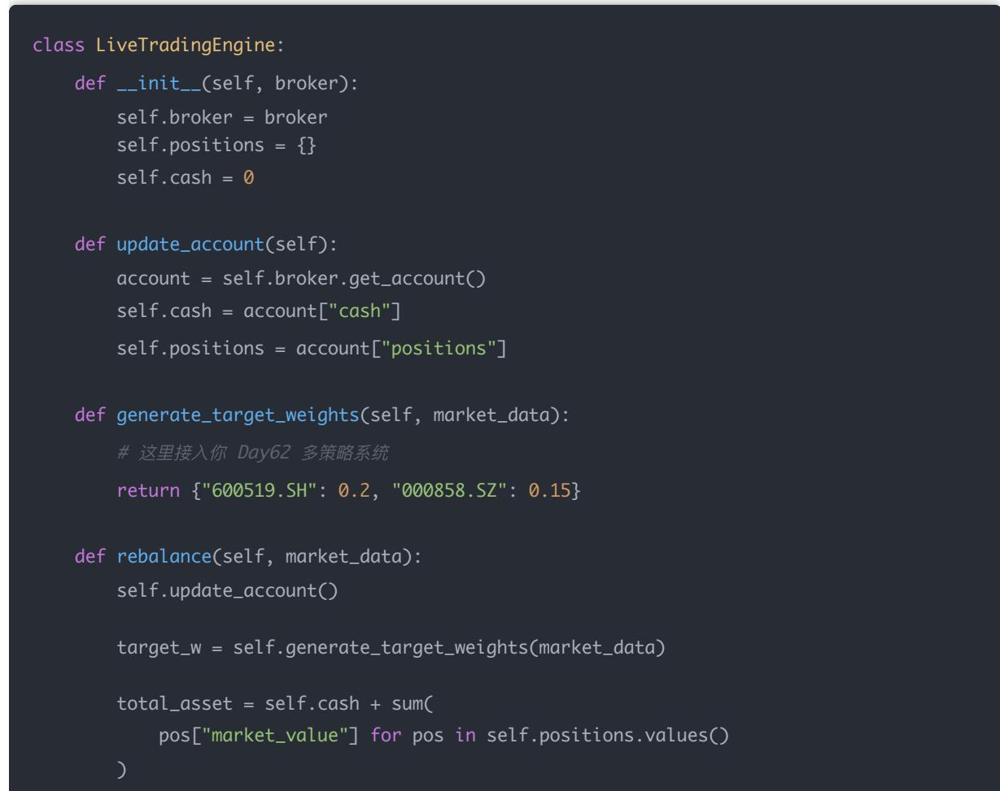
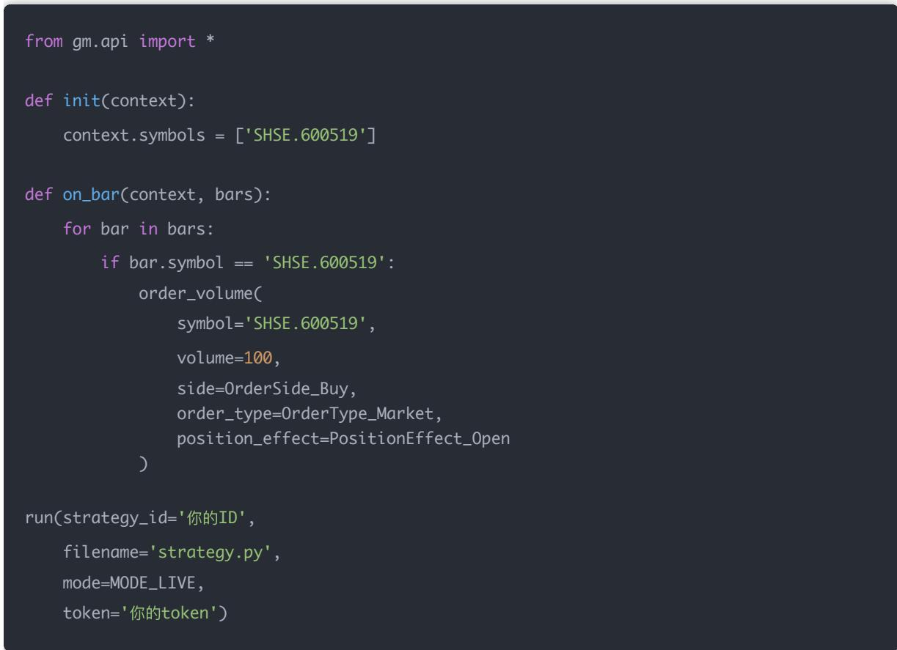
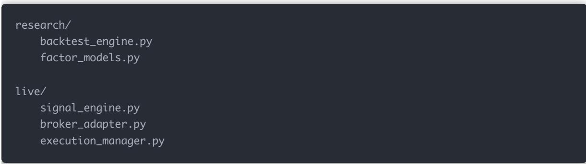

## 量化交易进阶:第65天 - 实盘交易接入（掘金/聚宽/Tushare Pro 实盘接口演示）(进阶阶段·回测框架篇)

原创 逻辑与流 逻辑与流 2026年2月 13 日 18:19 北京 听全文

本文系统讲解实盘交易接入的核心架构与主流接口 对比研究系统与实盘系统的本质差异,解析实盘系统七大核心模块,明确 Day62\~64 所学属于信号+风控 今日接入订单+成交+账户 详解掘金 聚宽Tushare Pro 三种接口的定位与适用场景,梳理实盘流程八步核心逻辑,给出平台无关的 LiveTradingEngine最小框架与掘金/聚宽示例代码 揭示实盘与回测三大差异(延迟 部分成交 账户状态不同步)及幂等机制与状态校验的必要性,指出 research/ 与 live/ 分离的正确姿势及实盘前五条必做测试

## 一、实盘系统架构（先讲清楚结构）

你现在的研究系统是：

历史数据 → 因子 → 权重 → 回测 → 净值

实盘系统是完全不同的：

实时数据 → 信号 → 风控 → 下单 → 交易所 → 成交回报 → 账户更新

区别在于：

<table><tr><td>回测</td><td>实盘</td></tr><tr><td>可以用未来数据(不小心)</td><td>绝对不能</td></tr><tr><td>成交价是假设</td><td>成交价真实</td></tr><tr><td>滑点可控</td><td>滑点不可控</td></tr><tr><td>延迟忽略</td><td>延迟致命</td></tr></table>

## 二、实盘系统核心模块（你必须理解）

一个标准实盘系统包含： 一个标准实盘系统

1. 数据模块2. 信号模块3. 风控模块4. 订单模块5. 成交回报模块6. 账户状态模块

### 7. 日志与监控模块

你在 Day62\~64 学的东西，其实都属于：

## 信号 + 风控

今天我们接入：

订单 + 成交 + 账户

## 三、三种实盘接口对比

## 1 掘金（GM / GmTrade）

专业量化接口

支持实盘

API 完整

延迟低

支持多账户

## 适合：真正要跑实盘的人

## 2 聚宽（JoinQuant）

云端策略

支持模拟盘

支持实盘（券商对接）

企业用工保障新选择，雇主责任险护航安全生产！（见链接）

  
众安企业团险

查看详情

## 易用

适合：快速部署 + 云端运行

## 3 Tushare Pro

## 注意：

Tushare 主要是数据接口，不是交易接口。

你不能直接用 Tushare 下单。

但可以：

用 Tushare 拉实时行情

自 己对接券商 API

## 四、实盘流程核心逻辑

真实交易流程是这样的：

1. 到达调仓时间

2. 获取最新行情

3. 计算目标权重

4. 获取当前持仓

5. 计算净下单

6. 发送订单

7. 等待成交回报

8. 更新账户

## 五、实盘最小框架示例（通用版）

我们先写一个「平台无关」的框架：

## 六、掘金 API 示例

示例（简化版）：

## 七、聚宽示例

## 八、实盘与回测最大差异

## 1 延迟

回测：今天收盘算 → 明天开盘成交（假设）

实盘：

微信支付宝二合收款音响免手机，大音量

微信支付宝二合一收款音箱，大音量防逃单

收款音响企业店

去逛逛

9:30:01 下单

9:30:01.300 进入券商

9:30:02.100 成交

行情已变。

## 2 部分成交

回测：假设全部成交

实盘：只成交一半，剩余挂单

## 3 账户状态不同步

成交回报延迟

API 调用失败

网络波动

必须设计：幂等机制 + 状态校验

## 九、实盘接入正确姿势

你现在的系统应分为两部分：

backtest\_engine.py

factor\_models.py

live/

signal\_engine.py

broker\_adapter.py

execution\_manager.py

## 十、实盘前的「必做测试

1. 模拟盘跑至少 1 个月2. 打印所有订单与成交日志3. 对比理论持仓 vs 实际持仓4. 校验滑点模型5. 统计未成交率

## 十一、Day65 总结

回测是「数学问题」，实盘是「系统工程问题」。

真正难的不是因子，而是：

延迟

流动性

成交管理

账户同步

## 结论

回测是「数学问题」，实盘是「系统工程问题」。真正难的不是因子，而是：延迟、流动性、成交管理、账户同步。
