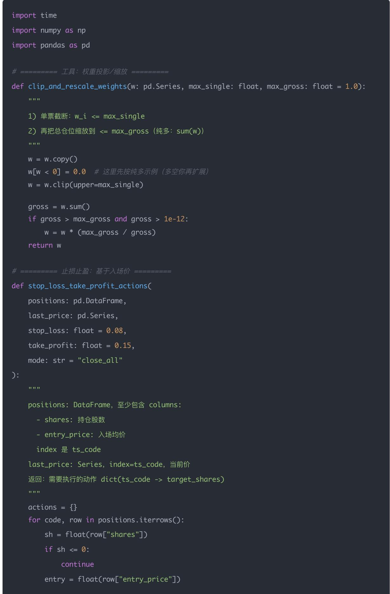
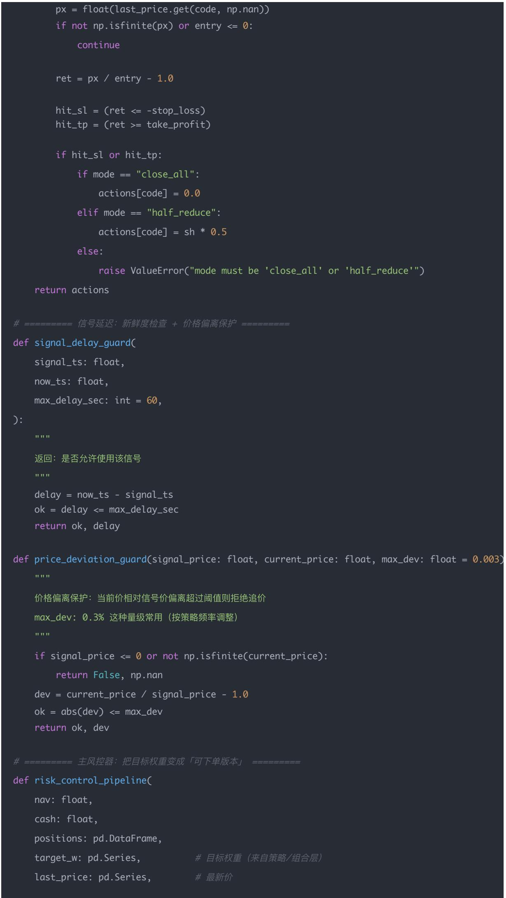
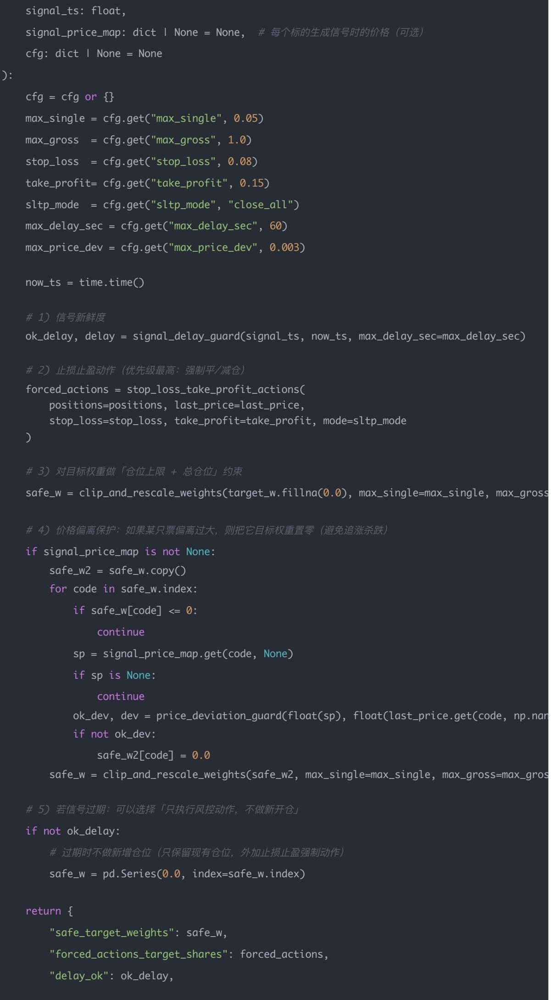
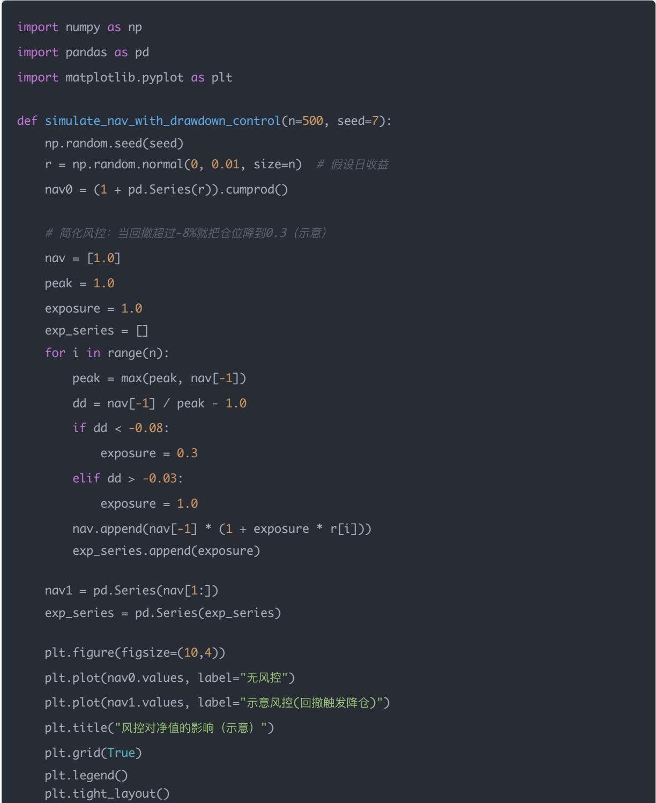

## 量化交易进阶:第66天 - 实盘风控模块（止损止盈 仓位上限 信号延迟）(进阶阶段·回测框架篇)

原创 逻辑与流 逻辑与流 2026年2月 17 日 22:58 北京 听全文

本文系统讲解实盘风控的三大支柱:事前/事中/事后风控的位置,止损止盈与仓位上限的数学形式,信号延迟的建模与实务应对。用实盘视角讲清 NAV、单票权重、总仓位、可行域投影及从 w\_safe 到订单的链路,并给出可插拔风控管道骨架与示意图表。

## 一、概念讲解：实盘风控的「位置

现在做实盘，最容易死的不是 Alpha，而是三件事：

1. 风险失控（单票/行业/总仓位超限，回撤一波带走）

2. 止损止盈形同虚设（触发了但执行不了/执行太慢）

3. 信号延迟（你以为按 A 的价格下单，其实价格早变了）

今天把这三件事做成一个「可插拔的风控模块」。

把 Day62–Day65 的系统串起来，实盘里风控应该在两处：

事前风控（Pre-trade）：下单前拦截/削减订单

仓位上限、单票上限、行业上限、最大换手、资金不足、流动性不足

事中风控（In-trade）：订单在市场里时的处理

部分成交、撤单重挂、价格偏离保护

事后风控（Post-trade）：成交后账户是否仍满足约束

总杠杆、最大回撤、日内亏损、异常波动

今天重点做：止损止盈（可看作事后触发→事前强制减仓）、仓位上限（事前）、信号延迟（贯穿全链路）

## 二、数学/逻辑推导：三类风控规则如何「可计算

## A. 止损止盈（以「入场均价」为锚）

对每个持仓 i，维护：

入场均价 $P _ { i } ^ { e n t r y }$

当前价

触发条件：

止损： $\begin{array} { r } { \frac { { P _ { t } } } { { P _ { i } ^ { e n t r y } } } - 1 \leq - L ( \mathfrak { H } \mathbb { L } { \mathsf { L } } { = } 8 \% ) } \end{array}$

止盈： $\begin{array} { r } { \frac { P _ { t } } { P _ { i } ^ { e n t r y } } - 1 \geq + T } \end{array}$ （如 $\scriptstyle { \mathsf { T } } = 1 5 \% )$

触发动作（常见三种）：

1. 全部平仓（最硬）

2. 减仓到某比例（更平滑）

3. 进入「冷却期」（避免刚止损又立刻买回）

实务里「止损」更偏风控，「止盈」更像交易系统的一部分，是否用要看策略风格。

## B. 仓位上限（单票/行业/总仓位）

定义：

总资产 $\begin{array} { r } { N A V _ { t } = C a s h + \sum _ { i } P o s i t i o n V a l u e _ { i } } \end{array}$

单票权重 $\begin{array} { r } { w _ { i } = \frac { P o s i t i o n V a l u e _ { i } } { N A V _ { t } } } \end{array}$

总仓位 $\begin{array} { r } { \mathrm { ( g r o s s \ e x p o s u r e ) } G E = \sum _ { i } \left| w _ { i } \right| } \end{array}$ （多空才用绝对值；纯多就是 $\sum w _ { i } )$

约束例子：

单票上限： $w _ { i } \leq w _ { m a x } ( \ngeq 1 , 5 \% )$

行业上限： $\begin{array} { r } { \sum _ { i \in s e c t o r ( s ) } w _ { i } \leq s _ { m a x } } \end{array}$ （如 30%）

总仓位上限： $G E \leq G E _ { m a x }$ （如 1.0，不加杠杆）

落地方式（很关键）：

先算目标权重 $w ^ { t a r g e t }$

风控模块把它投影到可行域得到 $w ^ { s a f e }$

再由 $w ^ { s a f e }$ 生成订单

## C. 信号延迟（Delay）如何影响「有效性

实盘里经常发生：

你在 t 时刻生成信号

到 才真正成交

价格变了，信号「过期

一种简单建模：

信号对未来收益的有效性随延迟衰减： ${ \mathrm { e f f e c t i v e } } \backslash { \mathrm { - s c o r e } } = { \mathrm { s c o r e } } \cdot e ^ { - \Delta / \tau }$

或者更直接：延迟越大，允许的调仓力度越小（降低换手/降低仓位）

实务最常用的两种「延迟风控」：

1. 价格偏离保护：下单时价格相对信号价偏离超过阈值就撤/不追

2. 信号新鲜度：信号超过 X 秒/分钟未成交则作废

下面把里面出现的每一个「公式元素」，

用 实盘视角 + 数值例子 帮你彻底讲清楚。

## 三、公式元素：实盘视角与数值例子

## 一、先明确一句话（核心理解）

这一段本质在做一件事：

把策略想买的仓位 → 变成 → 市场允许你承受的仓位

这就是：

w\_target → 风控层 → w\_safe

下面逐个拆。

## 二、总资产 NAV（净值）

公式

$$
N A V _ {t} = C a s h + \sum_ {i} \text { PositionValue } _ {i}
$$

中文解释

当前账户一共有多少钱

构成：

<table><tr><td>项目</td><td>含义</td></tr><tr><td>Cash</td><td>现金</td></tr><tr><td>PositionValue</td><td>持仓市值</td></tr></table>

实例

你账户：

<table><tr><td>项目</td><td>数值</td></tr><tr><td>现金</td><td>200 万</td></tr><tr><td>茅台</td><td>300 万</td></tr><tr><td>招行</td><td>500 万</td></tr></table>

那么：

$$
N A V = 2 0 0 + 3 0 0 + 5 0 0 = 1 0 0 0 \text {万}
$$

这是所有风险计算的「分母」。

## 三、单票权重 （最重要的量）

公式

$$
w _ {i} = \frac {\text {PositionValue} _ {i}}{N A V _ {t}}
$$

中文解释

某一只股票占你全部资产的比例

实例

茅台 300 万，占 1000 万：

$$
w _ {\mathrm{茅台}} = 30
$$

为什么单票权重如此重要？

因为：所有风险的第一来源 = 集中度

真实机构非常敏感的指标就是：

单票 5% 是否超限？

单票 10% 是否爆仓风险？

## 四、总仓位（Gross Exposure）

这个很多人第一次接触会懵。

公式

$$
G E = \sum_ {i} | w _ {i} |
$$

情况 1：纯多策略（你现在大概率是）

$$
G E = \sum w _ {i}
$$

情况 2：多空策略

必须用绝对值。

## 纯多例子

你持仓：

<table><tr><td>股票</td><td>权重</td></tr><tr><td>茅台</td><td>30%</td></tr><tr><td>招行</td><td>50%</td></tr></table>

$$
G E = 80\%
$$

说明：你还有 20% 现金

多空例子（进阶）

<table><tr><td>标的</td><td>权重</td></tr><tr><td>茅台 多</td><td>+50%</td></tr><tr><td>恒指空</td><td>-30%</td></tr></table>

$$
G E = | 0. 5 | + | 0. 3 | = 80 \%
$$

但净敞口只有 20%。

为什么总仓位要限制？

因为：总仓位 = 杠杆的影子

常见规则：

<table><tr><td>类型</td><td>GE 上限</td></tr><tr><td>公募</td><td>≤1.0</td></tr><tr><td>私募多头</td><td>0.8~1.0</td></tr><tr><td>对冲基金</td><td>1~3</td></tr></table>

## 五、单票上限（Single Name Limit）

公式

$$
w _ {i} \leq w _ {m a x}
$$

例如： $w _ { m a x } = 5 \%$

含义

再看好一只票，也不能 All in

## 为什么要有单票上限？

防止三种灾难：

1. 黑天鹅风险：财报爆雷、停牌、退市

2. 流动性风险：跌停卖不出去

3. 非系统性风险：公司特有风险

## 真实机构经验值

<table><tr><td>机构类型</td><td>单票上限</td></tr><tr><td>公募</td><td>5%</td></tr><tr><td>私募多头</td><td>5~10%</td></tr><tr><td>高频</td><td>更低</td></tr></table>

## 六、行业上限（Sector Limit）

公式

$$
\sum_ {i \in s e c t o r} w _ {i} \leq s _ {m a x}
$$

中文解释

一个行业不能占太多仓位

实例

假设医药行业：

<table><tr><td>股票</td><td>权重</td></tr><tr><td>恒瑞</td><td>10%</td></tr><tr><td>药明</td><td>8%</td></tr><tr><td>迈瑞</td><td>7%</td></tr></table>

行业权重：医药 = 25%

如果行业上限 = 30%，OK

如果上限 = 20%，超限 ❌

为什么行业限制非常重要？

因为：行业 = 隐含风险因子

你以为买了 10 只股票很分散，

但如果都是新能源，其实高度相关。

公式

$$
G E \leq G E _ {m a x}
$$

常见： $G E _ { m a x } = 1 . 0$

含义

不允许加杠杆

或者： $G E _ { m a x } = 0 . 8$ ，保守型产品。

总仓位上限 vs 波动率目标

很多人混淆这两个：

<table><tr><td>项目</td><td>控制什么</td></tr><tr><td>GE 上限</td><td>杠杆</td></tr><tr><td>Vol Target</td><td>风险</td></tr></table>

你可以： ，但波动率只有 6%，说明买的是低波动资产。

## 八、最关键一句：投影到可行域（Projection）

你提到的这句话：

把 w\_target 投影到可行域得到 w\_safe

这是量化里一个非常核心的思想。

什么叫「可行域」？

就是：所有合法组合的集合

例如：单票 ≤ 5%、行业 ≤ 30%、总仓位 ≤ 1.0

这些约束形成一个「空间」。

投影是什么意思？

假设策略给出：

w\_target：茅台 15%，招行 12%

明显违法（单票 > 5%）

风控做的事情就是：把这个点拉回合法区域

得到：

w\_safe：茅台 5%，招行 5%，其他股票补上

## 数学直觉

类似：你走出了操场边界，风控把你拉回围栏内。这就是「投影」。

## 九、从 w\_safe 到订单

最后一步： $w _ { s a f e }$ 订单

公式：

$$
\text {订单股数} = \frac {N A V \cdot \left(w _ {i} ^ {\text {safe}} - w _ {i} ^ {\text {current}}\right)}{\text {价格}}
$$

实例

你现在：

<table><tr><td>股票</td><td>当前</td><td>目标</td></tr><tr><td>茅台</td><td>3%</td><td>5%</td></tr></table>

${ \mathsf { N A V } } = 1 0 0 0 ~ \mathbf { \mathcal { F } }$ ，价格 = 2000 元

需要增加：差值 $= 2 \% \times 1 0 0 0 \overline { { \mathcal { H } } } = 2 0 \overline { { \mathcal { H } } }$

股数 = 20万 / 2000 = 100 股

## 十、总结一句话（非常重要）

这一整套公式，其实在回答一个问题：

你「想买多少」，必须先问：市场允许你「承受多少」。

## 十一、你现在应该建立的直觉

以后看到组合时，你脑子里要自动浮现：

这组合：单票集中吗？

行业集中吗？

总仓位高吗？

这就是实盘思维。

四、Python 实现（可运行的「风控模块骨架」）

下面是一套可直接接你 Day62 引擎的风控器：

输入：当前账户、目标权重、最新行情、信号时间戳

输出：安全目标权重 + 需要强平/减仓的指令 + 订单前检查结果

代码里尽量中文注释清晰，可以后续把它改成类/服务。

signal\_price\_map: dict | None = None,  # 每个标的生成信号时的价格 （可选）

cfg: dict | None = None

cfg = cfg or {}

max\_single = cfg.get("max\_single", 0.05)

max\_gross  = cfg.get("max\_gross", 1.0)

stop\_loss  = cfg.get("stop\_loss", 0.08)

take\_profit= cfg.get("take\_profit", 0.15)

sltp\_mode  = cfg.get("sltp\_mode", "close\_all")

max\_delay\_sec = cfg.get("max\_delay\_sec", 60)

max\_price\_dev = cfg.get("max\_price\_dev", 0.003)

now\_ts = time.time()

#1）信号新鲜度 ok\_delay, delay = signal\_delay\_guard(signal\_ts, now\_ts, max\_delay\_sec=max\_delay\_sec)

forced\_actions = stop\_loss\_take\_profit\_actions( positions=positions, last\_price=last\_price, stop\_loss=stop\_loss, take\_profit=take\_profit, mode=sltp\_mode

#4)价格偏离保护：如果某只票偏离过大，则把它目标权重置零(避免追涨杀跌)

for code in safe\_w.index:

if safe\_w[code] <= 0:

sp = signal\_price\_map.get(code, None)

#5）若信号过期：可以选择「只执行风控动作，不做新开仓」

#过期时不做新增仓位（只保留现有仓位，外加止损止盈强制动作)

safe\_w = pd.Series(0.0, index=safe\_w.index)

"safe\_target\_weights": safe\_w,

"forced\_actions\_target\_shares": forced\_actions,

"delay\_ok": ok\_delay,

## 五、图表展示与解释（一个「风控效果可视化」的最小示例）

做实盘风控，最该画三张图（哪怕先用模拟数据）：

1. 净值曲线：有风控 vs 无风控

2. 总仓位（gross exposure）随时间：看 vol target / 上限是否生效

3. 触发次数：止损触发频率、延迟拒单次数

下面一段「示意代码」（用随机收益模拟），能看到形状差异，后续换成回测引擎输出即可：

plt.figure(figsize=(10,3)) plt.plot(exp\_series.values) plt.title("总仓位/风险开关（示意）") plt.grid(True) plt.tight\_layout() plt.show()

simulate\_nav\_with\_drawdown\_control()

## 六、今日思考题（附参考答案）

Q1：为什么止损止盈在实盘里必须和「延迟/成交状态」一起设计？

答：因为实盘里触发≠立刻成交。若延迟大/流动性差，止损可能变成「越止越亏」。必须结合：价格偏离保护、撤单重挂、部分成交、冷却期，以及在极端行情用更强硬的「降仓开关」。

Q2：为什么「仓位上限」比「止损」更稳健？

答：仓位上限是事前控制，能阻止风险堆起来；止损是事后补救，往往发生在波动已经很大时，且会受到滑点/缺口影响。机构更依赖事前约束（上限、风险预算），止损更多是兜底。

Q3：信号延迟会以哪些方式「吃掉你的 alpha」？

答：

1. 价格已移动（你追高/卖低）

2. 信号过期（该买时没买到，买到时逻辑已不成立）

3. 触发频率变高（因为执行慢导致偏离，反复修正产生额外成本）

解决：信号新鲜度、价格偏离保护、减少调仓频率、改用更稳健信号、把执行延迟纳入回测。

## 结论

实盘风控不是「加几个 if」，而是让策略在延迟、滑点、部分成交的世界里仍然可控。
