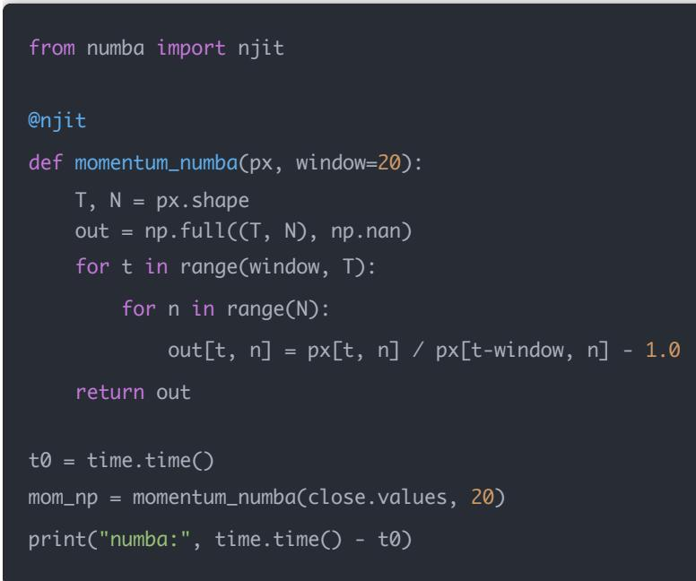
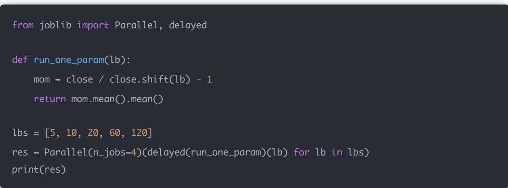

# 量化交易进阶:第67天 - 向量化加速、Numba、并行化（让你的引擎从「能跑」到「可规模化」）

原创 逻辑与流 逻辑与流 2026年2月 18 日 22:49 北京 听全文

本文系统讲解回测性能优化的核心原则与三条技术路线：向量化、Numba、并行化。明确性能瓶颈所在与「把循环搬出 Python、把重复搬出主循环」的落地思路，给出可运行的三种实现对比与并行示例，并结合回测引擎给出四档优先级建议及 Numba 的适用与限制。

## 一、概念讲解：性能瓶颈到底在哪？

你现在做多因子/多策略/多标的以后，回测最常见的痛点会变成：

股票多（3000+）

因子多（几十上百）

窗口多（滚动回测、参数网格）

频率高（分钟级、撮合、滑点）

Day67 的目标：把回测从「慢到等死」变成「工程可用」。

## 回测典型耗时分布（经验）

1. 数据 I/O：重复拉取、重复读写（最浪费）

2. Python 循环：逐 日 逐股 for（最慢）

3. 频繁 groupby / apply：隐形慢

4. 重复计算：窗口 rolling、协方差、rank 每次重算

5. 回测逻辑：撮合/成交/风控每步都做 Python 对象操作

## 性能优化的核心原则：

把「循环」搬出 Python，把「重复」搬出主循环。

## 二、数学/逻辑推导：为什么向量化能快？

## Python for 循环慢的原因：

每次循环都有解释器开销

pandas 的 apply/groupby 也经常退化成 Python loop

## 向量化快的原因：

底层是 C/Fortran 的连续内存运算

一次操作一整块数组（SIMD/缓存友好）

## 简化理解：

for 循环：1e8 次「小操作

向量化：1 次「大矩阵操作

复杂度不变，但常数差几个数量级。

## 三、Python 实现（可运行）：三条路线

下面给你一个「同一件事」用三种方式实现： 计算每只股票的 20 日动量，并按横截面 rank 得到score。

## 数据准备（模拟 2000 股票 × 1000 天）

import numpy as np

import pandas as pd

import time

np.random.seed(7)

T, N = 1000, 2000

prices = 100 \* np.cumprod(1 + 0.001\*np.random.randn(T, N), axis=0)

close = pd.DataFrame(prices, columns=[f"S{i}" for i in range(N)])

3.1 方式一：纯 Python 循环（最慢，别这么写）

t0 = time.time() mom = pd.DataFrame(index=close.index, columns=close.columns, dtype=float) for i in range(20, len(close)): mom.iloc[i] = close.iloc[i] / close.iloc[i-20] - 1 score = mom.rank(axis=1, pct=True) print("loop:", time.time() - t0)

### 3.2 方式二：pandas 向量化（常用 最省心）

t0 = time.time()

mom = close / close.shift(20) - 1

score = mom.rank(axis=1, pct=True)

print("vectorized pandas:", time.time() - t0)

### 3.3 方式三：Numba（当你必须写循环时）

## 适合：

## 撮合逻辑

部分成交

队列

tick/minute 回测

  
注意：Numba 第一次会编译较慢，第二次开始非常快。

## 四、并行化：什么时候用、怎么用？

并行化最适合：

参数网格（不同参数互不依赖）

滚动回测（不同时间段独立）

多策略并行（策略之间独立）

多股票池并行（池之间独立）

Joblib 并行（最常用）



## 五、性能优化「落到你的回测引擎」怎么做？

结合你 Day62/63 的引擎，我建议你按优先级做：

## 优先级 1：避免重复计算（收益、因子、ADV、波动）

把这些全部预先算好（DataFrame/ndarray）

主循环里只做索引读取

优先级 2：减少 pandas 对象操作

回测核心循环内部尽量用 ndarray

DataFrame 只用于输入输出

优先级 3：撮合/成交逻辑用 Numba

fi ll 模型

冲击成本

部分成交队列

优先级 4：并行跑「策略/参数/窗口

单次回测先跑快

再并行拉吞吐量

## 六、图表展示与解释（性能对比图）

你可以画一个简单柱状图对比耗时：

loop

pandas vectorized

numba

parallel

（你自 己跑完打印时间就行，画图可选）

## 七、Numba 深入理解

## 一句话理解 Numba

## Numba = 让 Python 代码变成接近 C 速度的工具

它的核心作用是：

普通 Python 循环 → 编译成机器码

所以：

写法还是 Python

速度接近 C/C++

## 为什么需要 Numba？

## 你现在的量化代码里，最慢的通常是：

for 循环

撮合逻辑

tick 回测

滑点模型

成交队列模拟

这些地方：不好向量化、pandas 很慢，但又必须循环。这就是 Numba 的主战场。

## Numba 的本质（稍微技术一点）

## 正常 Python 执行：

Python代码

解释器逐行执行（慢）

## Numba 执行：

Python代码

JIT 编译（即时编译）

机器码执行（快）

JIT = Just-In-Time Compilation

## 一个最直观的速度对比

## 普通 Python

def slow\_sum(n):

s = 0

for i in range(n):

s += i

return s

## 运行 1e7 次可能要：几秒

## 加上 Numba

```python
from numba import njit
@njit
def fast_sum(n):
    s = 0
    for i in range(n):
    s += i
    return s
```

```python
from numba import njit
@njit
def calc_momentum(px):
    T, N = px.shape
    out = np.zeros((T, N))
    for t in range(20, T):
    for n in range(N):
    out[t, n] = px[t, n] / px[t-20, n] - 1
    return out
```

速度：快几十倍甚至上百倍

## 为什么量化特别适合 Numba？

因为量化里很多逻辑是：时间 × 股票 的双重循环

例如：

for t in range(T):

for stock in universe:

更新仓位

判断止损

模拟成交

这是 Numba 的完美应用场景。

## Numba 最常见用法


最简单：@njit

就这一行： @njit 就能提速。

## 非常适合：

1. 回测核心循环

调仓

更新仓位

PnL 累计

### 2. 撮合模拟

部分成交

排队成交

VWAP 模型

### 3. 高频策略

tick 级回测

盘口模拟

### 4. 风控逻辑

止损扫描

风险贡献计算

## Numba 不适合什么？（很重要）

## Numba 不适合：

<table><tr><td>对象</td><td>说明</td></tr><tr><td>pandas</td><td>df.apply(...)不支持</td></tr><tr><td>Python 对象</td><td>dict、list(复杂嵌套)、class</td></tr><tr><td>I/O</td><td>读文件、网络请求</td></tr></table>

## Numba 的限制（你必须知道）

## 1 第一次运行会慢

因为需要编译：第一次慢（编译），后面飞快。

2 只能用「数值型代码

最好用：numpy arrays、float/int。

## 3 调试不方便

报错会比较「硬核」。

## Numba vs 向量化 vs 并行

## 这是 Day67 的核心关系：

<table><tr><td>技术</td><td>适用场景</td></tr><tr><td>向量化</td><td>能矩阵化的因子计算</td></tr><tr><td>Numba</td><td>必须写循环的逻辑</td></tr><tr><td>并行</td><td>多任务同时跑</td></tr></table>

## 一句话总结：

能向量化就别 Numba

必须循环就上 Numba

需要吞吐再并行

## 八、今日思考题（附参考答案）

Q1：为什么「向量化 + 预计算」通常比「多线程」更重要？

因为 Python 多线程受 GIL 限制，且并行会引入数据拷贝/调度开销；而向量化直接把大量运算交给底层 C，收益更稳定、实现更简单。

Q2：什么场景最适合 Numba？

需要复杂 if/for 逻辑、但又必须高频运行的部分：撮合、部分成交、滑点模型、tick/minute 级事件循环。因子计算能向量化就优先向量化。

Q3：并行化最容易踩的坑是什么？

数据复制导致内存爆炸

每个进程重复加载数据（I/O 被放大）

任务粒度太小（调度开销 > 收益）

解决：共享只读数据、粗粒度任务、先把单次回测优化快，再并行。

## 结论

先向量化/预计算，再用 Numba 加速「不得不循环」的部分，最后用并行提高吞吐。
