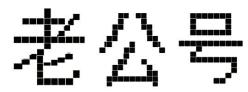
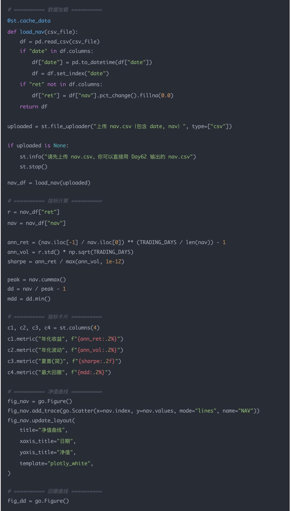
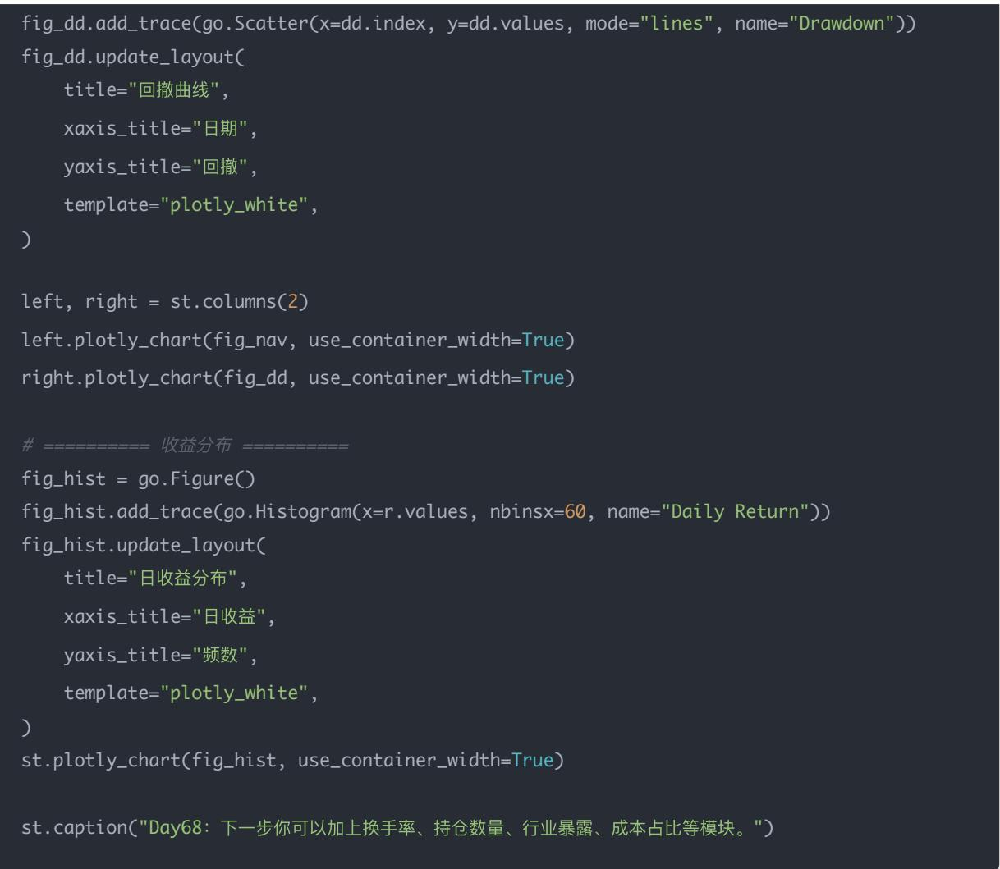

# 量化交易进阶:第68天 - 回测可视化仪表盘——Plotly / Streamlit 实时展示净值曲线（研究员级「看盘」能力）

原创 逻辑与流 逻辑与流 2026年2月19日 20:20 北京 📐 1人

本文讲解回测结果可视化成仪表盘：从MVP（净值 $+$ 回撤 $+$ 指标卡片 $+$ 参数选择）入手，统一净值与回撤的数学口径，给出基于nav.csv的Streamlit+Plotly可运行仪表盘代码，并说明如何读图及后续升级方向。

你现在已经有了回测引擎（Day62+），也开始做性能优化（Day67）。Day68 要做的是把结果「可视化成仪表盘」，让你像机构研究平台一样：

- 一眼看净值、回撤、波动、换手

- 能切换不同版本（Ablation / 不同参数）

- 回测跑完自动刷新图表（近似实时）

## 一、概念讲解：仪表盘要展示什么才有价值？

一个合格的量化回测仪表盘至少要有 4 块：

1. 净值曲线（NAV）：策略是否赚钱、何时赚钱

2. 回撤曲线（Drawdown）：最坏时刻能抗住吗

3. 收益分布 & 风险指标：年化、波动、夏普、偏度峰度

4. 交易行为：换手率、持仓数量、行业暴露、成本占比

先从最小可用版本（MVP）开始：净值 + 回撤 + 指标卡片 + 参数选择。后面再扩展到持仓/行业/因子归因。

## 二、数学/逻辑推导：净值与回撤如何计算（仪表盘必须统一口径）

给定日收益 $r_t$ ：

净值

$$
N A V _ {t} = N A V _ {0} \prod_ {k = 1} ^ {t} (1 + r _ {k})
$$

回撤（相对历史最高点）

$$
D D _ {t} = \frac {N A V _ {t}}{\max _ {k \leq t} N A V _ {k}} - 1
$$

## 常用指标（仪表盘卡片）

- 年化收益： $(NAV_{T} / NAV_{0})^{252 / T} - 1$

特惠靓号发售！三连、四连号任挑，尽显独特魅力！

165 🤨 🤨 66666 162 🤨 🤨 88888

167 99999 170 00000

171 22222 165 33333

165 77777 167 55555
\*具体号码以实际领取为准 资费说明详见广告内页，该号卡为移动通信转售营业厅提供服务

九图手机靓号商城

立即咨询

- 年化波动： $\sigma (r)\sqrt{252}$

- 夏普：年化收益 / 年化波动（简化版）

- 最大回撤： $\min (DD_t)$

## 三、Python 实现（可运行）：Streamlit + Plotly 仪表盘

下面给你一个可直接跑的最小仪表盘，输入只需要一个nav.csv。

nav.csv 结构建议：

- index: date

- 列：nav（净值）

- 可选：ret（收益率）

### 3.1 先准备 nav.csv（如果你用 Day62 引擎）

你之前已经保存过 nav.csv，格式类似：

date, nav, ret

2024-01-02,1000000,0

...

### 3.2 Streamlit 仪表盘代码（保存为 app.py）

import streamlit as st

import pandas as pd

import numpy as np

import plotly.graph\_objects as go

TRADING\_DAYS = 252

st.set\_page\_config(page\_title="回测仪表盘", layout="wide")

st.title("回测可视化仪表盘（Day68）")

### 3.3 运行方式

## 回撤曲线

- 最大回撤是否可接受

- 回撤恢复时间（回撤后多久回到新高）

## 收益分布

- 是否偏态（靠少数大赚日）

- 是否长尾（说明极端风险）

## 后续升级：

- 支持同时上传 nav\_all\_versions.csv (V0\~V4)

- 下拉选择版本 / 多版本叠加

- 自动生成指标对比表

- 增加换手率、持仓数量、成本占比图

## 结论

仪表盘的价值不是「画图」，而是把你的研究过程变成「可复盘、可对比、可迭代」的系统。

## 五、今日思考题（附参考答案）

Q1：为什么仪表盘必须展示回撤，而不是只展示净值？

因为净值只告诉你「赚没赚」，回撤告诉你「最坏能扛多久」。实盘能不能长期跑，回撤比收益更重要。

Q2: 为什么用 Plotly 而不是 matplotlib?

Plotly 交互强：缩放、悬停、选择区间、动态更新，更适合做「研究平台式」的分析。

Q3: 怎样把 Day62 的 Ablation（V0\~V4）集成进仪表盘？

把每条版本净值都存成 csv，然后在 Streamlit 用下拉框选择列/版本，或多条曲线叠加；再增加一个表格展示各版本年化/波动/夏普/最大回撤。

量化交易入门指南·目录≡

<上一篇

量化交易进阶:第67天 - 向量化加速、

下一篇>

Numba、并行化（让你的引擎从「能跑」到...

量化交易进阶:第69天 - 阶段小项目——自己实现一个 Backtrader 策略模块（从「会用...

白雪吞没城市，火炉

还在燃烧，你能带大

家撑到天亮吗？

点击了解更多>

白雪吞没城市，火炉还在燃烧，你能带大家撑到天亮吗？

无尽冬日-3亿玩家推荐

$\mathcal{S}$ 进入小游戏
