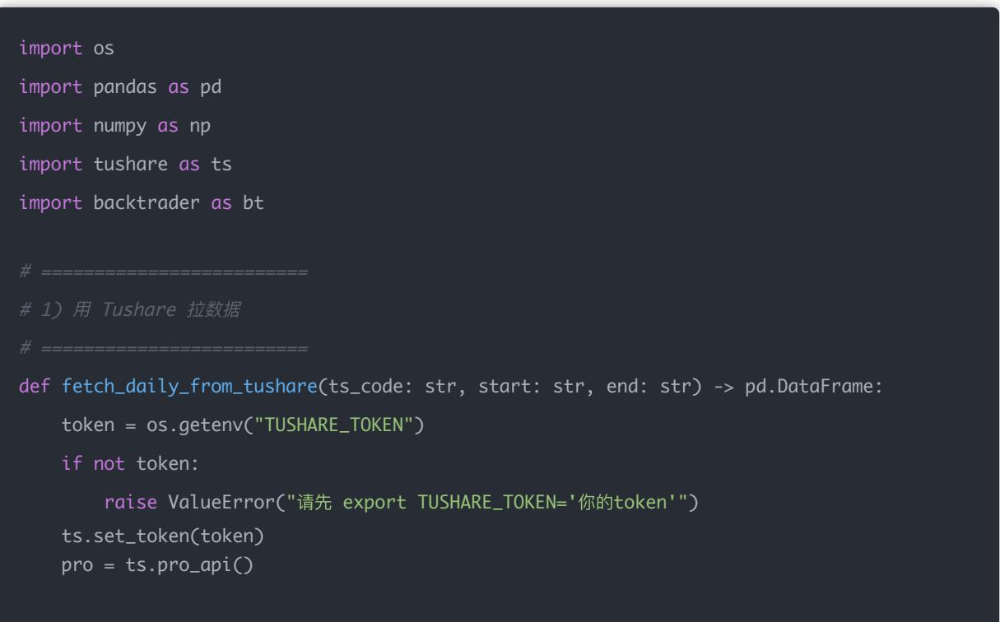
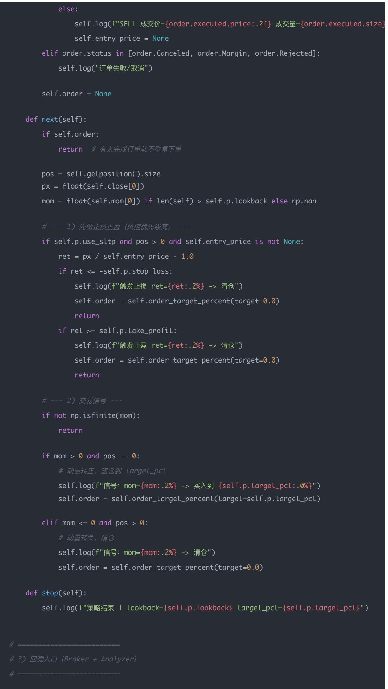

# 量化交易进阶:第69天 - 阶段小项目——自 己实现一个 Backtrader策略模块（从「会用」到「能扩展」）

原创 逻辑与流 逻辑与流 2026年2月 20 日 20:54 北京 听全文

本文通过一个小而完整的项目：亲手实现 Backtrader 策略模块，做到可复用、可配置、可评估、可接Tushare 真数据；给出从数据拉取到回测、绩效输出的可运行骨架，并说明如何看图与后续升级方向。

今天我们做一个小而完整的项目： 亲手实现一个 Backtrader 策略模块，并且做到：

可复用（像公司里的策略组件）

可配置（参数化）

可评估（输出交易记录 + 指标）

可接数据（Tushare 真数据）

之前要求「实战可跑」，今天就写一份能直接跑的骨架，后续往里塞多因子/风控/滑点即可。

## 一、概念讲解：Backtrader 的策略模块是啥？

Backtrader 的核心是 4 个对象：

1. DataFeed：行情数据（OHLCV）

2. Strategy：你的交易逻辑（今天实现）

3. Broker：资金、手续费、滑点

4. Analyzer/Observer：绩效分析、可视化

今天的「策略模块」本质是：

一个继承 bt.Strategy 的类

只要实现：什么时候买、什么时候卖、买多少

## 二、逻辑推导：一个「可复用策略模块」必须具备什么？

我们用一个标准的「因子/动量类」策略模板：

信号层：用指标生成信号

例：均线金叉 / 动量排名 / RSI

仓位层：目标仓位（固定比例 or 波动率缩放）

执行层：下单（市价/限价）、手续费/滑点

风控层：止损止盈、最大回撤、单票上限

今天为了「完成闭环」，我们做一个清晰可验证的版本：

## 单标的动量策略（可改成多标的）

20 日 动量 = close/close[-20]-1

动量>0 买入（持有 90% 仓位）

动量<=0 清仓

可选：止损 8%、止盈 15%

## 三、Python 实现（可运行）：Tushare → Backtrader → 绩效输出

3.1 安装依赖

pip install backtrader tushare pandas matplotlib

export TUSHARE\_TOKEN="你的token"

### 3.2 完整可跑代码（保存为 day69\_bt\_strategy.py）

import os

import pandas as pd

import numpy as np

import tushare as ts

import backtrader as bt

\# 1) 用 Tushare 拉数据

def fetch\_daily\_from\_tushare(ts\_code: str, start: str, end: str) -> pd.DataFrame:

token = os.getenv("TUSHARE\_TOKEN")

if not token:

raise ValueError("请先 export TUSHARE\_TOKEN='你的token'")

ts.set\_token(token)

pro = ts.pro\_api()

df = pro.daily(ts\_code=ts\_code, start\_date=start, end\_date=end,

fields="trade\_date,open,high,low,close,vol")

if df.empty:

raise ValueError(f"{ts\_code} 无数据")

df = df.sort\_values("trade\_date")

df["datetime"] = pd.to\_datetime(df["trade\_date"])

df = df.set\_index("datetime")

\# backtrader 默认列名: open high low close volume openinterest

df = df.rename(columns={"vol": "volume"})

df["openinterest"] = 0

return df[["open", "high", "low", "close", "volume", "openinterest"]]

2）你的策略模块（今天的主角）

class MomentumModule(bt.Strategy):

params = dict(

lookback=20,

\# 动量窗口

target\_pct=0.90,

\# 目标仓位比例 （90%）

stop\_loss=0.08,

\# 止损阈值 （8%）

take\_profit=0.15,

\# 止盈阈值 （15%）

use\_sltp=True,

\# 是否启用止损止盈

printlog=False

def log(self, txt):

if self.p.printlog: dt = self.datas[0].datetime.date(0) print(f"{dt} | {txt}")

def \_\_init\_\_(self): self.close = self.datas[0].close # 动量：close / close[-lookback] - 1 self.mom = self.close / self.close(-self.p.lookback) - 1.0

\# 记录入场价用于止损止盈

self.entry\_price = None

self.order = None

def notify\_order(self, order):

if order.status in [order.Submitted, order.Accepted]:

return

if order.status in [order.Completed]:

if order.isbuy():

self.entry\_price = order.executed.price

self.log(f"BUY 成交价={order.executed.price:.2f} 成交量={order.executed.size}"

self.log(f"SELL 成交价={order.executed.price:.2f} 成交量={order.executed.size} self.entry\_price = None

elif order.status in [order.Canceled, order.Margin, order.Rejected]: self.log("订单失败/取消")

def next(self):if self.order:return # 有未完成订单就不重复下单

pos = self.getposition().size px = float(self.close[0]) mom = float(self.mom[0]) if len(self) > self.p.lookback else np.nan

--1）先做止损止盈（风控优先级高） if self.p.use\_sltp and pos > 0 and self.entry\_price is not None: ret = px / self.entry\_price - 1.0 if ret <= -self.p.stop\_loss: self.log(f"触发止损 ret={ret:.2%} -> 清仓") self.order = self.order\_target\_percent(target=0.0) return if ret >= self.p.take\_profit: self.log(f"触发止盈 ret={ret:.2%} -> 清仓") self.order = self.order\_target\_percent(target=0.0) return

if not np.isfinite(mom): return

if mom > 0 and pos == 0: # 动量转正，建仓到 target\_pct self.log(f"信号：mom={mom:.2%} -> 买入到 {self.p.target\_pct:.0%}") self.order = self.order\_target\_percent(target=self.p.target\_pct)

elif mom <= 0 and pos > 0: # 动量转负，清仓 self.log(f"信号：mom={mom:.2%} -> 清仓") self.order = self.order\_target\_percent(target=0.0)

def stop(self): self.log(f"策略结束 | lookback={self.p.lookback} target\_pct={self.p.target\_pct}")

df = fetch\_daily\_from\_tushare(ts\_code, start, end)

data = bt.feeds.PandasData(dataname=df)

cerebro = bt.Cerebro() cerebro.adddata(data)

#初始资金 cerebro.broker.setcash(1\_000\_000)

\# 手续费（示例：万三） cerebro.broker.setcommission(commission=0.0003)

\# 可选：滑点（示例：千分之一) cerebro.broker.set\_slippage\_perc(perc=0.001)

## # 加策略

cerebro.addstrategy( MomentumModule, lookback=20, target\_pct=0.90, stop\_loss=0.08, take\_profit=0.15, use\_sltp=True, printlog=False

#分析器：夏普、回撤、年化收益等 cerebro.addanalyzer(bt.analyzers.SharpeRatio, \_name="sharpe", timeframe=bt.TimeFrame.Da cerebro.addanalyzer(bt.analyzers.DrawDown, \_name="dd") cerebro.addanalyzer(bt.analyzers.Returns, \_name="ret")

print("初始资产:", cerebro.broker.getvalue()) results = cerebro.run() strat = results[0] print("结束资产:", cerebro.broker.getvalue())

print("Sharpe:", strat.analyzers.sharpe.get\_analysis()) print("DrawDown:", strat.analyzers.dd.get\_analysis()) print("Returns:", strat.analyzers.ret.get\_analysis())

\# 画图（会弹窗）cerebro.plot(style="candlestick")

## 四、图表展示与解释（你跑完应该看什么）

1. 净值是否长时间横盘：说明信号太少/太慢

2. 回撤是否集中在某几段行情：策略适用市场状态

3. 滑点/手续费开关对策略影响：判断 alpha 是否够厚

可以做一个小实验：

把 set\_slippage\_perc(0.001) 改成 0

看净值差别，会立刻感受到「成本杀伤力」。

结论  

亲手实现一个可复用、可配置、可评估且能接 Tushare 真数据的 Backtrader 策略模块，今天就完成了从「会用」到「能扩展」的闭环。

## 五、今日思考题（附参考答案）

Q1：为什么策略模块里要把「信号逻辑」和「仓位目标」分开写？

因为信号决定方向，仓位目标决定风险。未来接 Day62 的 RP/VolTarget 时，只替换仓位层即可，不用动信号层。

Q2：为什么止损止盈要放在 next() 最前面？

实盘里风控优先级最高。宁可错过一次入场，也不要在触发止损时还继续加仓或不作为。

Q3：Backtrader 的 order\_target\_percent 有什么好处？

它是「目标仓位式下单」，自动帮你算需要买/卖多少股，更符合组合思维（目标权重 → 订单），也更容易对接你前面学的风控投影 w\_safe。

## 六、Day69 小项目交付标准（今天完成什么算过关）

今天的「阶段项目」完成标准：

能从 Tushare 拉取数据并跑通

策略模块参数化（lookback、target\_pct、止损止盈）

输出基本绩效指标（Sharpe、回撤、收益）

能画图观察

下一步可以把它升级成真正「多因子策略模块」（前面 Day62 那套）：

多股票池（上证50 / 沪深300 / 全A）

每次调仓选 TopN

风控：单票/行业/总仓位上限

成交量限制 + 冲击成本
