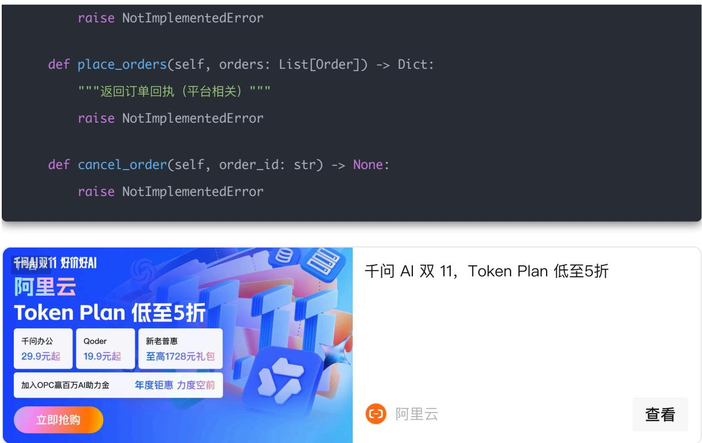
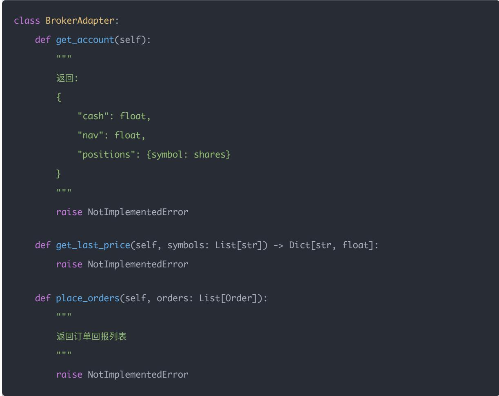
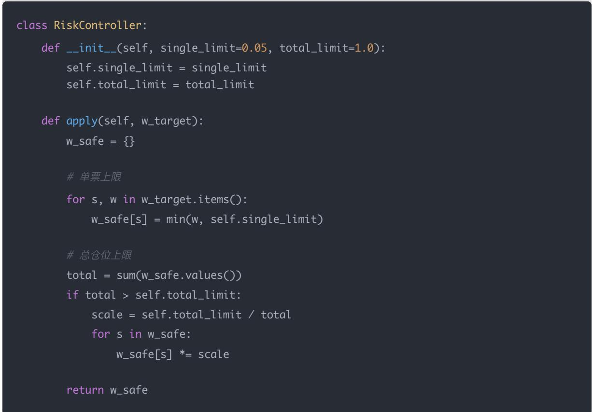

# 量化交易进阶:第70天 - 连接券商/平台 API（掘金 米筐 雪球与实盘接入分层）

原创 逻辑与流 逻辑与流 2026年2月 24 日 11:42 北京 听全文

本文理清掘金(MyQuant/GM)、米筐(RiceQuant)、雪球与 Tushare 的定位，给出实盘接入的标准分层（策略/风控/Broker）与通用 BrokerAdapter 设计，并提供一个平台无关的最小可用实盘 Demo 骨架及三平台接入要点。

## 非常结论

先把结论说清楚，避免走弯路：

掘金量化（MyQuant/GM）：有成熟的「策略运行 + 行情 + 交易」体系，实盘常用。其文档也明确区分了gm（含行情/交易）与 gmtrade（只做仿真/实盘交易，不做回测）。

米筐（RiceQuant）：更像「云端量化平台 + 策略 API」，按它的策略生命周期（init / before\_trading /handle\_bar 等）写策略即可。

Tushare Pro：是数据接口，不是交易接口（不能直接下单）。

雪球：没有查到「官方、公开、用于真实下单」的券商交易 API 文档；常见是做数据抓取/社区/组合展示（很多库需要手动拿网页 token/cookie，属于非官方方式，稳定性与合规风险都高）。

下面按学习路线的风格，把「接入实盘」的通用方法讲透：先搭架构，再给三套最小示例。

## 一、概念讲解：实盘接入的标准分层（以后不会写乱）

无论用掘金还是米筐，工程上都建议把系统拆成 3 层：

## A. Strategy（策略层）

输入：最新行情/特征

输出： 目 标权重 w\_target 或 目 标仓位 position\_target

注意：策略层不要直接调用下单 API（否则多策略会打架）

## B. Risk（风控层）

输入：w\_target、当前持仓、限制规则（单票/行业/总仓位/止损止盈/延迟保护）

输出：w\_safe

Day66 学的「投影到可行域」就在这里。

把 w\_safe → 订单列表（净下单）

下单 / 撤单 / 查成交 / 更新账户

## 二、数学/逻辑推导：为什么「平台接入」最终都归一成两件事？

## (1) 把目标权重变成订单（净下单）

核心公式已经见过：

$$
\Delta v a l u e _ {i} = N A V \cdot (w _ {i} ^ {s a f e} - w _ {i} ^ {c u r})
$$

$$
\Delta s h a r e s _ {i} \approx \frac {\Delta v a l u e _ {i}}{p r i c e _ {i}}
$$

## (2) 处理「实盘不确定性

延迟：信号 → 下单 → 成交有时间差

部分成交：成交量/盘口限制

失败重试：网络/风控拒单/资金不足

状态一致性：成交回报晚到，账户不同步

所以我们要做「适配器」，把平台差异隔离。

## 三、Python 实现：通用 BrokerAdapter 接口（强烈建议这样写）

把掘金/米筐/未来券商 API 都塞进同一套接口里：

```python
from dataclasses import dataclass
from typing import Dict, List

@dataclass
class Order:
    symbol: str
    shares: int  # A股通常 100 股一手
    side: str  # "BUY" / "SELL"
    order_type: str = "MKT"  # "MKT" / "LMT"
    limit_price: float | None = None

class BrokerAdapter:
    def get_account(self) -> Dict:
    """返回 cash, positions({symbol: shares}), nav 等"""
    raise NotImplementedError

    def get_last_price(self, symbols: List[str]) -> Dict[str, float]:
```

raise NotImplementedError def place\_orders(self, orders: List[Order]) -> Dict: """返回订单回执（平台相关） raise NotImplementedError def cancel\_order(self, order\_id: str) -> None: raise NotImplementedError



## 四、三个平台「最小接入示例」怎么写？

## A) 掘金量化（MyQuant/GM）：策略运行 + 下单

掘金的文档里有「快速开始/策略结构」等；另有 FAQ 提到 gmtrade 是交易接口，只用于仿真/实盘，不能回测。

可以把它理解为：平台替你提供了运行时、行情推送、下单通道。

写策略时常见入口是 init / on\_bar 这类生命周期函数（文档示例里也有）。

实盘时，风控层最好在下单前统一过一遍，然后再调用掘金的下单函数（如 order\_volume /order\_target\_percent 等，具体以账号权限与品种为准）。

## B) 米筐（RiceQuant）：写在它的策略 API 生命周期里

米筐的策略 API 文档明确了策略生命周期与调用方式（init / handle\_bar 等）。

可以把「策略层/风控层」写成纯 Python 函数，在 handle\_bar 里调用，最后用米筐提供的下单 API 执行。

## C) 雪球：更适合「数据/研究展示」，不要当作实盘券商通道

这次检索到的「雪球 API」更多是非官方方式：例如开源库需要手动获取雪球网页 token/cookie 才能访问接口。

这类方式一般用于：

拉取行情/资讯/组合信息

做研究/看板/监控

但不建议用它来做「真实下单」，因为：

合规与稳定性风险高

接口变动会导致系统随时挂

## 五、真·机构级「最小可用实盘 Demo 骨架

## 它满足你要的 5 件事：

读取持仓 / 资金

计算 w\_target

风控 → w\_safe

生成净下单

下单 + 成交回报 + 日志闭环

## 而且——平台无关（只需写一个 BrokerAdapter 即可接入掘金/米筐）。

## 整体结构（以后就按这个写）

main()

├── broker = XXXBrokerAdapter()

├── strategy = Strategy()

├── risk = RiskController()

├── trader = TraderEngine(broker, strategy, risk)

└── trader.run\_once()

## 二、核心数据结构

from dataclasses import dataclass

from typing import Dict, List

import logging

import math

logging.basicConfig(level=logging.INFO)

logger = logging.getLogger("LIVE")

## 三、订单对象

@dataclass

class Order:

symbol: str



## 四、Broker 抽象层（平台无关）

## 五、示例：PaperBroker（本地仿真券商）

## 可以用它先跑通流程。

```python
class PaperBroker(BrokerAdapter):
    def __init__(self):
    self.cash = 1_000_000
    self.positions = {}
    self.price = {}

    def set_price(self, price_dict):
    self.price = price_dict

    def get_account(self):
    nav = self.cash
    for s, sh in self.positions.items():
    nav += sh * self.price[s]

    return {
    "cash": self.cash,
    "nav": nav,
```

## "positions": self.positions.copy()

def get\_last\_price(self, symbols): return {s: self.price[s] for s in symbols}

if o.side == "BUY":

else:

self.positions[o.symbol] -= o.shares self.cash += value

"price": px,

})

return results

## 六、Strategy 层（输出 w\_target）

class Strategy:

def compute\_target\_weights(self, account):

示例：简单等权

symbols = ["600519.SH", "000858.SZ", "601318.SH"]

w = 1 / len(symbols)

return {s: w for s in symbols}




## 七、Risk 层（投影到可行域）

## Day66 学过的逻辑：

```python
class RiskController:
    def __init__(self, single_limit=0.05, total_limit=1.0):
    self.single_limit = single_limit
    self.total_limit = total_limit

    def apply(self, w_target):
    w_safe = {}

    # 单票上限
    for s, w in w_target.items():
    w_safe[s] = min(w, self.single_limit)

    # 总仓位上限
    total = sum(w_safe.values())
    if total > self.total_limit:
    scale = self.total_limit / total
    for s in w_safe:
    w_safe[s] *= scale

    return w_safe
```

## 八、核心：生成净下单（真正实盘核心）

```python
def generate_orders(w_safe, account, prices):
    nav = account["nav"]
    cur_pos = account["positions"]
    orders = []
# 当前权重
w_cur = {}
for s, sh in cur_pos.items():
    w_cur[s] = sh * prices[s] / nav
symbols = set(w_safe.keys()) | set(w_cur.keys())
```

for s in symbols:

target\_w = w\_safe.get(s, 0)

cur\_w = w\_cur.get(s, 0)

delta\_value = nav \* (target\_w - cur\_w) delta\_shares = math.floor(delta\_value / prices[s] / 100) \* 100

if delta\_shares > 0: orders.append(Order(s, delta\_shares, "BUY"))

elif delta\_shares < 0: orders.append(Order(s, abs(delta\_shares), "SELL"))

return orders

## 九、TraderEngine（整条流水线）

class TraderEngine:

def \_\_init\_\_(self, broker, strategy, risk): self.broker = broker self.strategy = strategy self.risk = risk

def run\_once(self):

logger.info("===== 开始一次调仓 =====")

account = self.broker.get\_account() logger.info(f"当前 NAV: {account['nav']:.2f}")

w\_target = self.strategy.compute\_target\_weights(account) logger.info(f" 目 标权重: {w\_target}")

w\_safe = self.risk.apply(w\_target) logger.info(f"风控后权重: {w\_safe}")

prices = self.broker.get\_last\_price(list(w\_safe.keys())) orders = generate\_orders(w\_safe, account, prices)

logger.info(f"生成订单: {orders}")

results = self.broker.place\_orders(orders)

logger.info("成交回报:")

for r in results: logger.info(r)

logger.info("===== 调仓结束

"000858.SZ": 200,

## 十一、接入掘金 / 米筐时，只需要改哪里？

PaperBroker → GMAdapter / RiceQuantAdapter

例如：

class GMAdapter(BrokerAdapter):

def get\_account(self):

pass

def place\_orders(self, orders):

\# 调 gm 下单函数

pass

十二、最关键：为什么这才叫「实盘闭环」？

## 真正的实盘系统必须具备：

1. 状态读取2. 目标生成3. 风控裁剪4. 净下单计算5. 成交回报确认

缺任何一个都可能：重复下单爆仓权重漂移持仓与系统不一致

Q1：为什么「交易接口接入」最重要的是抽象出 BrokerAdapter？

答：因为不同平台下单/撤单/查成交的 API 千差万别，但策略/风控逻辑应该保持不变。抽象层能让「换平台不换策略」。

Q2：为什么 Tushare Pro 不能算「实盘交易接口」？

答：它提供的是数据（行情/财务等），不负责把你的订单送去券商/交易所，也没有成交回报与账户状态闭环。

Q3：为什么很多「网页 token/cookie 的接口」不适合做实盘？

答：稳定性差（随时变）、合规性不确定、异常处理困难；实盘需要的是明确 SLA、账户体系、回报链路与权限控制。

## 结论：接下来最合适的一步

## 用哪个平台先落地？

如果目标是真实下单：优先掘金（GM/MyQuant）（它的交易/行情/运行环境一体化，且 FAQ 明确 gmtrade面向仿真/实盘）。

如果想快速云端跑策略：米筐（按它的策略 API 生命周期写）。
