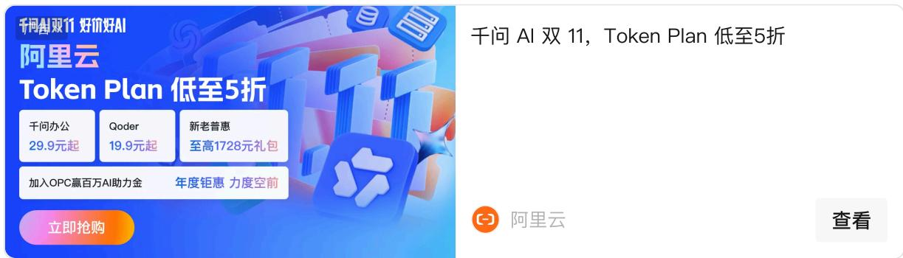
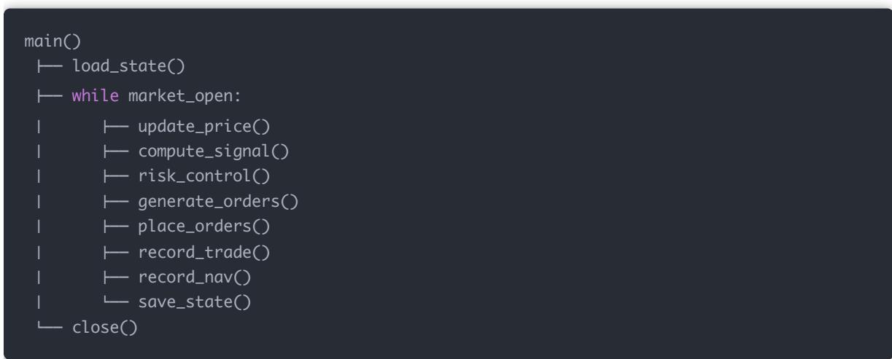
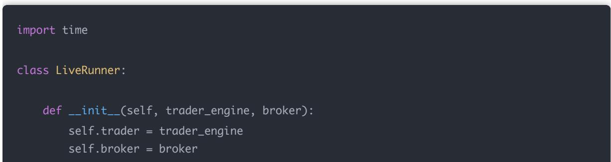
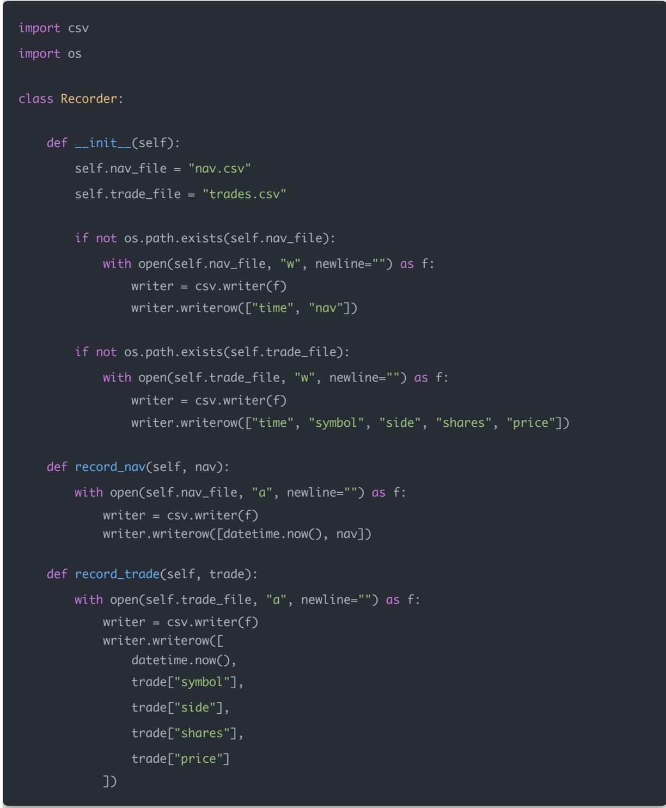
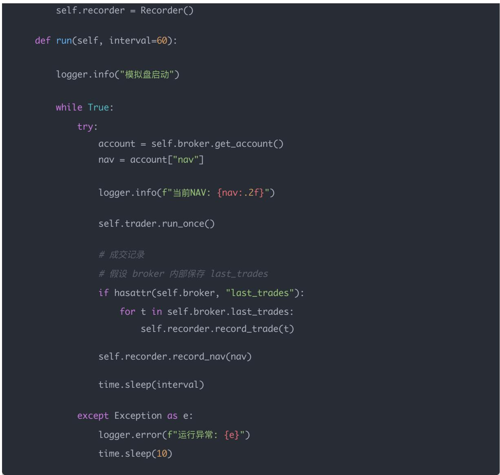
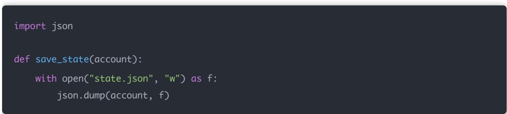
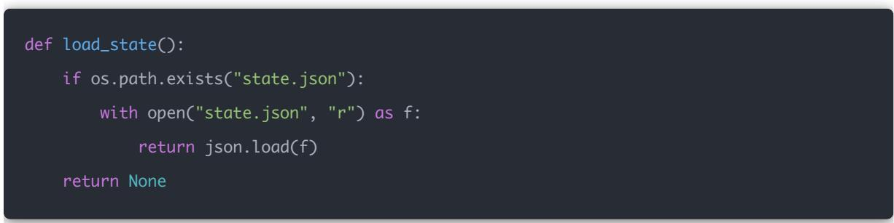

## 量化交易进阶:第71天 - 策略实盘测试（模拟盘实时运行与数据记录）

原创 逻辑与流 逻辑与流 2026年2月 27 日 22:54 北京 听全文

今天我们做一件非常关键的事情：把你的策略从「研究代码」升级为「可持续运行的交易系统」。很多人卡在回测漂亮、实盘乱、账户对不上、无 日志、崩了无法恢复。本文给出机构级「模拟盘实时运行框架」：实时循环、数据持久化（日志+交易记录）、每日净值记录、异常保护与可恢复状态；并说明实盘测试的核心是验证「系统会不会崩、崩了能不能自动恢复」。

## 非常结论

实盘测试的目标不是赚钱，而是验证：系统是否在任何异常情况下都「不会失控」。真正的量化不在模型，而在稳定性、恢复能力、记录能力与风险控制。

今天我们做一件非常关键的事情：

把你的策略从「研究代码」升级为「可持续运行的交易系统」。

很多人卡在这里：

回测很漂亮

实盘一跑就乱

账户对不上

日志没有

崩了无法恢复

我们今天做一个：机构级「模拟盘实时运行框架

包含：

实时循环运行

数据持久化（日志 + 交易记录）

每日净值记录

异常自动保护

可恢复状态

## 一 实盘测试 vs 回测的本质区别

<table><tr><td>回测</td><td>模拟盘</td></tr><tr><td>数据完整</td><td>数据实时到达</td></tr><tr><td>无延迟</td><td>有网络/成交延迟</td></tr><tr><td>无崩溃</td><td>会断网/异常</td></tr><tr><td>无状态恢复</td><td>必须保存状态</td></tr></table>

## 实盘测试的核心问题只有两个：

### 1. 系统会不会崩

### 2. 崩了能不能自动恢复

## 二 标准机构级运行结构

## 三 实时运行骨架代码（可直接用）

### 1. 日志系统

import logging

from datetime import datetime

logging.basicConfig(

filename="live.log",

level=logging.INFO,

format="%(asctime)s %(levelname)s %(message)s"

### 2. 数据记录器（核心）

## 四 实时运行引擎

import time

class LiveRunner:

def \_\_init\_\_(self, trader\_engine, broker):

self.trader = trader\_engine

self.broker = broker

## 五 自动状态恢复（关键）

## 保存状态：

import json

## 启动时恢复：

def load\_state():

if os.path.exists("state.json"):

with open("state.json", "r") as f:

return json.load(f)

return None

真实实盘必须有这个。

否则：系统崩一次，你的持仓状态就丢失。

六 模拟盘 vs 真券商模拟盘  

<table><tr><td>本地 PaperBroker</td><td>券商模拟盘</td></tr><tr><td>快速验证逻辑</td><td>测试真实撮合</td></tr><tr><td>无真实盘口</td><td>有真实成交规则</td></tr><tr><td>可控</td><td>更贴近实盘</td></tr></table>

1. 本地 PaperBroker

2. 掘金模拟盘

3. 小资金实盘

## 七 真实实盘需要额外考虑

### 1. T+1 资金冻结

A股卖出资金不能立即使用

### 2. 成交延迟

不能假设立即成交

### 3. 部分成交

订单可能只成交一部分

### 4. 交易时间控制

只在 9:30–11:30、13:00–15:00 运行下单逻辑

## 八 现在拥有的能力层级

Day60–70 学的是：因子、风险、组合、执行。

Day71 开始你进入：交易系统工程。

真正的量化不在模型，而在：

稳定性

恢复能力

记录能力

风险控制

## 九 今天的关键认知

实盘测试的目标不是赚钱。

而是验证：系统是否在任何异常情况下都「不会失控」。
