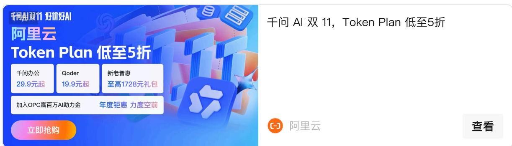
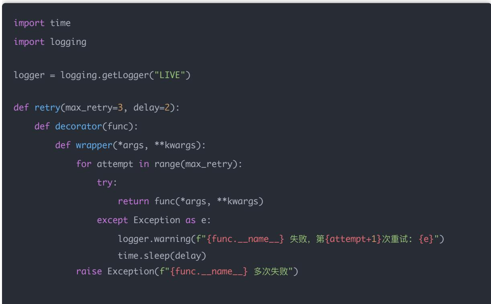
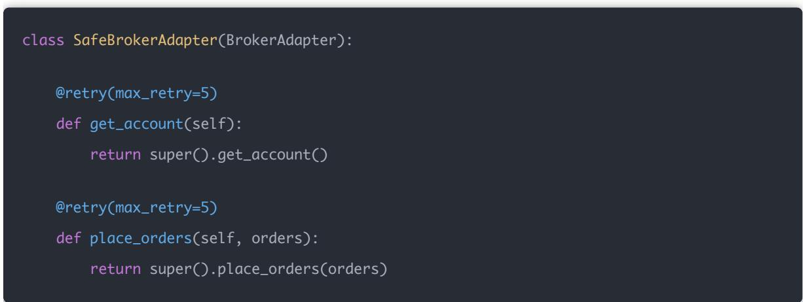
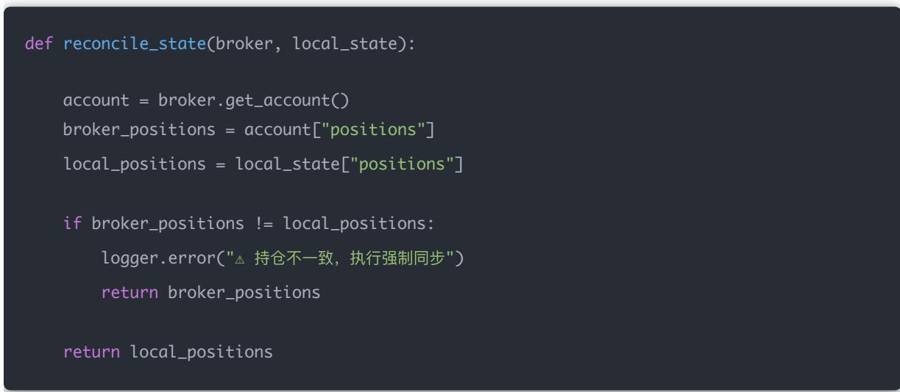
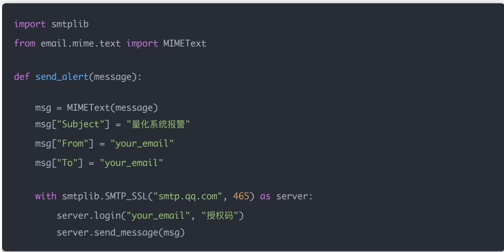
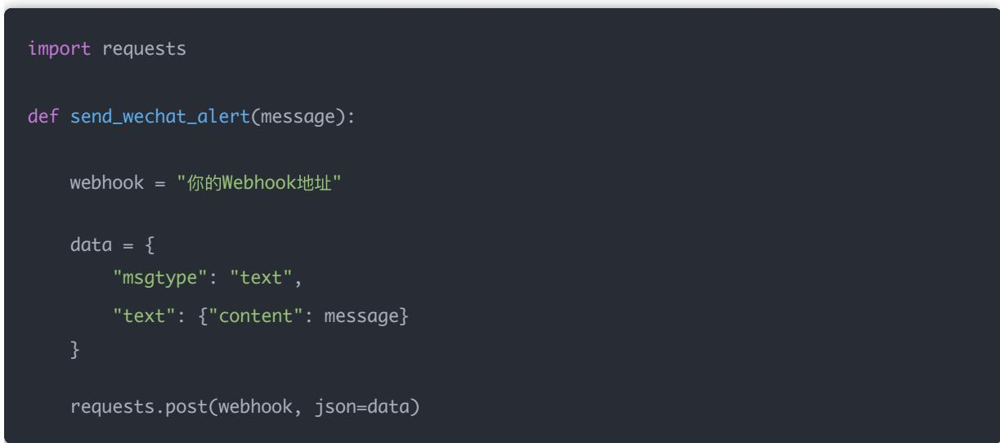
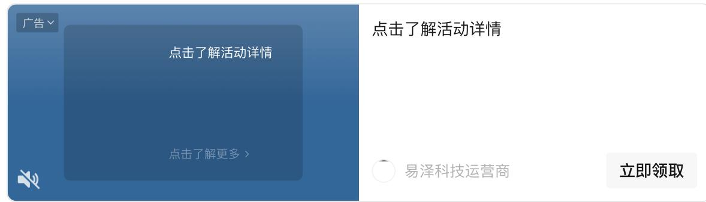
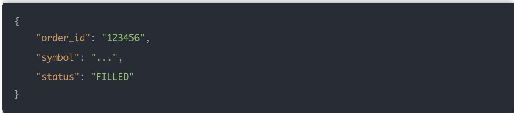
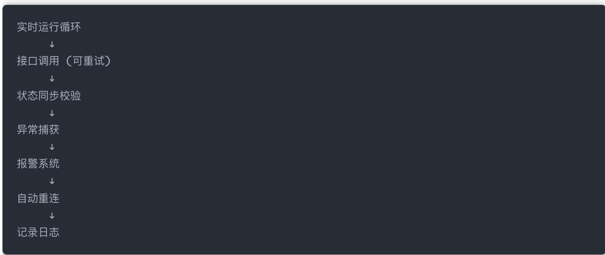

## 量化交易进阶:第72天 - 异常处理与重启机制（实盘断连恢复/异常自动报警）

原创 逻辑与流 逻辑与流 2026年3月1日 11:48 北京 听全文

回测拼模型，实盘拼稳定性。真正的机构系统不是「预测能力更强」，而是不会因网络抖动爆仓、不会因程序重启重复下单、不会因接口异常导致仓位失控，出问题能立刻报警。本文给出实盘级「异常处理 +自动恢复 + 报警」完整框架。

模型不会杀死你。系统失控才会。

今天这一课，非常关键。

回测拼模型，实盘拼稳定性。

真正的机构系统不是「预测能力更强」，而是：

不会因为网络抖动爆仓

不会因为程序重启重复下单

不会因为接口异常导致仓位失控

出问题能立刻报警

我们今天做一套：

实盘级「异常处理 + 自动恢复 + 报警」完整框架

## 一 实盘异常的真实来源

1 网络异常

券商 API 超时

心跳丢失

DNS 问题

断网

2 交易异常

资金不足

拒单

价格超限

风控拦截

3 系统异常

程序崩溃

内存溢出

数据损坏

重启后状态丢失

## 二 机构级异常分层模型

异常系统分为三层：

千问 AI 双 11，Token Plan 低至5折

L1：接口重试层

L2：状态校验层

L3：人工报警层

## 三 L1：接口重试机制（自动修复）

核心原则：

所有外部 API 调用都必须可重试。

通用重试装饰器

import time

import logging

logger = logging.getLogger("LIVE")

def retry(max\_retry=3, delay=2):

def decorator(func):

def wrapper(\*args, \*\*kwargs):

for attempt in range(max\_retry):

try:

return func(\*args, \*\*kwargs)

except Exception as e:

logger.warning(f"{func.\_\_name\_\_} 失败，第{attempt+1}次重试: {e}")

time.sleep(delay)

raise Exception(f"{func.\_\_name\_\_} 多次失败")

应用到 Broker

class SafeBrokerAdapter(BrokerAdapter):

@retry(max\_retry=5)

@retry(max\_retry=5)

def place\_orders(self, orders):

四 L2：状态一致性校验（防止重启错乱）

实盘最大的风险：

程序认为持仓是 A券商账户实际持仓是 B

必须每次启动做：启动一致性校验

def reconcile\_state(broker, local\_state):

account = broker.get\_account()

broker\_positions = account["positions"]

local\_positions = local\_state["positions"]

if broker\_positions != local\_positions:

logger.error("⚠ 持仓不一致，执行强制同步")

return broker\_positions

return local\_positions

启动流程必须这样写：

## 五 L3：异常自动报警系统

## 1 邮件报警（最简单）

## 2 企业微信 / 钉钉 Webhook 报警（推荐）

## 在异常捕获里触发

trader.run\_once()

## 六 断连自动恢复机制

## 真实券商 API 都有：

心跳检测

登录失效

点击了解活动详情

点击了解活动详情

点击了解更多

易泽科技运营商

立即领取

## 我们模拟一个心跳机制：

def heartbeat\_check(broker):

try:

broker.get\_account()

return True

except:

return False

## 自动重连逻辑

def ensure\_connection(broker):

if not heartbeat\_check(broker):

logger.warning("连接失效，尝试重连")

broker.reconnect()

if not heartbeat\_check(broker):

send\_wechat\_alert("券商连接恢复失败！")

## 七 防止重复下单（重启陷阱）

## 最大坑：

重启后又重新发了一次昨天的订单。

解决方法：

所有订单必须记录 order\_id

## 启动时：

open\_orders = broker.get\_open\_orders()

if open\_orders:

logger.warning("存在未完成订单，暂停策略")

## 八 真正机构会做什么？

他们会增加：

进程守护（supervisor）

Docker 自 动重启

多机备份

主从切换

交易前预检查

九 完整异常体系结构图  

## 十 现在已经进入什么阶段？

现在已经进入：

机构级量化系统工程

真正的实盘核心认知：

模型不会杀死你。系统失控才会。
