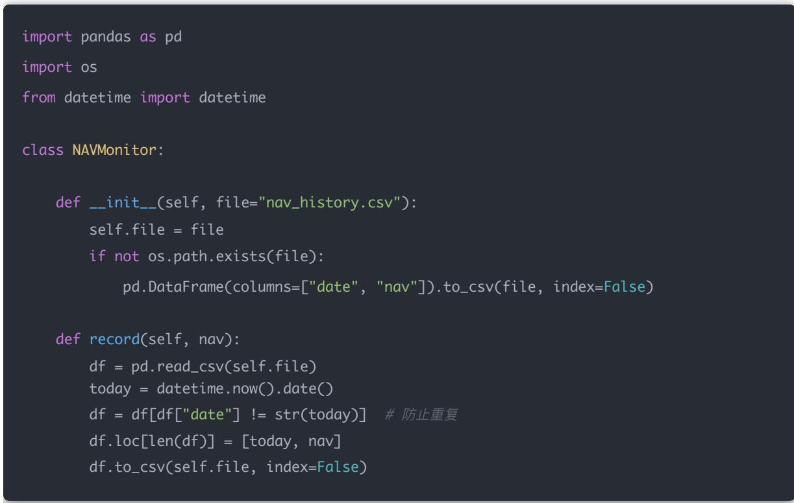
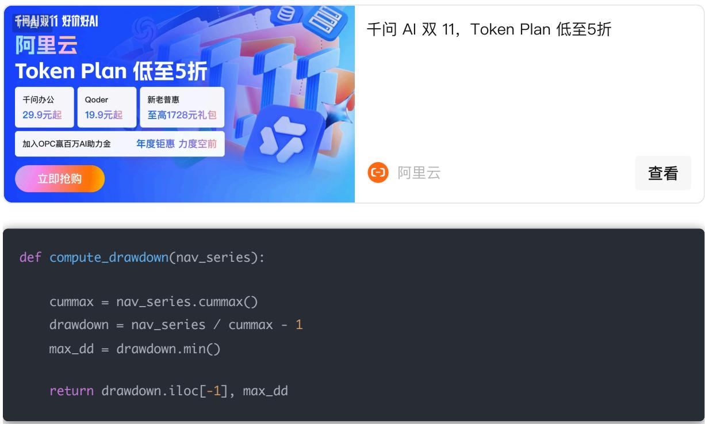
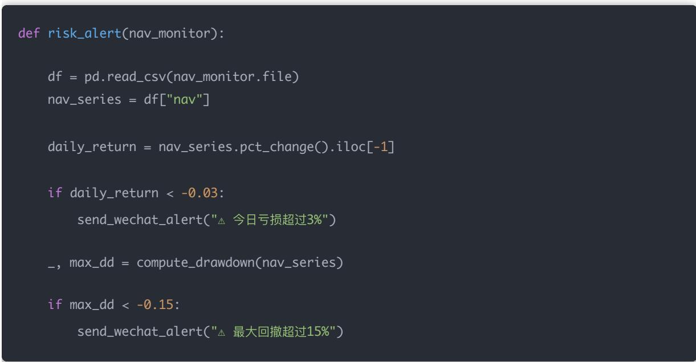
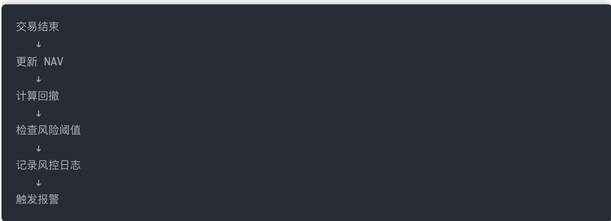
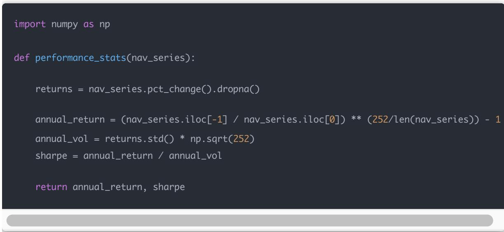
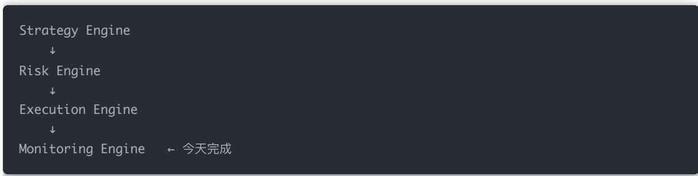

## 量化交易进阶:第73天 - 策略表现监控（每日净值更新+风控日志体系）

原创 逻辑与流 逻辑与流 2026年3月4日 10:37 北京 听全文

策略层 风控层 执行层 异常恢复都已具备，缺的是可观测性 机构量化系统永远有一个核心模块：Strategy Monitor 本文构建每日净值记录 实时回撤计算 风控日志 自动风险告警与绩效统计的机构级监控框架。

你现在已经有：

策略层

风控层

执行层

异常恢复

但缺一件非常关键的东西：

可观测性（Observability）

机构量化系统永远有一个核心模块：

Strategy Monitor（策略监控系统）

今天我们构建：

1. 每日净值记录系统

2. 实时回撤计算

3. 风控日志记录

4. 自动风险告警

5. 绩效统计计算

## 一 监控系统的核心目标

## 监控系统解决 4 个问题：

<table><tr><td>问题</td><td>解决方式</td></tr><tr><td>今天赚多少钱?</td><td>净值记录</td></tr><tr><td>是否异常回撤?</td><td>实时回撤计算</td></tr><tr><td>是否触发风控?</td><td>风控日志</td></tr><tr><td>是否超出风险预算?</td><td>自动报警</td></tr></table>

## 二 每日净值记录模块

## NAV 记录器

## 三 实时回撤监控（核心风险指标）

机构最关注：

最大回撤（MDD）

计算回撤

def compute\_drawdown(nav\_series):

查看

cummax = nav\_series.cummax()

max\_dd = drawdown.min()

return drawdown.iloc[-1], max\_dd

集成到 Monitor

def check\_risk(self):

df = pd.read\_csv(self.file)

nav\_series = df["nav"]

current\_dd, max\_dd = compute\_drawdown(nav\_series)

print(f"当前回撤: {current\_dd:.2%}")

print(f"历史最大回撤: {max\_dd:.2%}")

## 四 风控日志系统（非常关键）

真正的机构不会只记录交易日志

他们还记录：

每次风控裁剪

每次仓位上限触发

每次止损触发

每次异常保护

## 风控日志类

import logging

risk\_logger = logging.getLogger("RISK")

risk\_logger.setLevel(logging.INFO)

handler = logging.FileHandler("risk.log")

risk\_logger.addHandler(handler)

## 在风控模块中加入日志

class RiskController:

def apply(self, w\_target):

w\_safe = {}

for s, w in w\_target.items():

if w > 0.05:

risk\_logger.info(f"{s} 触发单票上限 5%")

w\_safe[s] = 0.05

else:

## 五 自动风险报警机制

例如：

当 日 亏损 > 3%

总回撤 > 15%

单票暴露 > 10%

daily\_return = nav\_series.pct\_change().iloc[-1]

if daily\_return < -0.03:send\_wechat\_alert("⚠ 今 日 亏损超过3%")

\_, max\_dd = compute\_drawdown(nav\_series)

send\_wechat\_alert("⚠ 最大回撤超过15%")

## 六 机构级完整监控流程

## 七 每日绩效统计（进阶）

可以计算：

年化收益

夏普比率

波动率

卡玛比率

## 示例：年化收益 & 夏普

## 八 实盘中最重要的 3 个指标

机构实盘通常只盯三件事：

1. 净值曲线 2. 当前回撤 3. 风险暴露

模型 alpha 排在后面

## 九 你现在的系统结构

完整的量化交易系统

## 十 为什么大多数人失败？

因为他们：

有策略

有回测

甚至有实盘

但没有：

监控系统

没有监控 = 黑箱运行

结论

把净值 回撤 风控日志和报警都做齐，系统才可观测 可追溯 可告警，实盘才能放心跑
