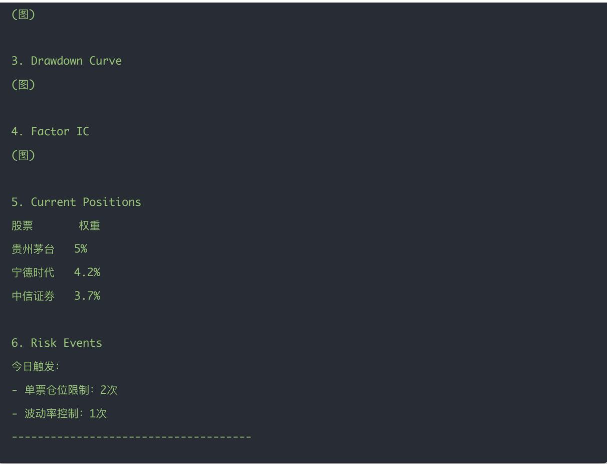
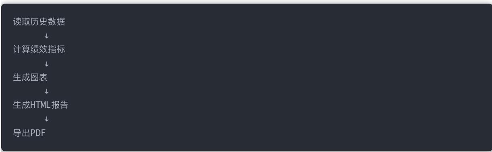
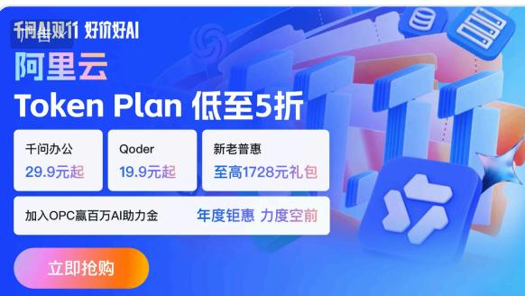
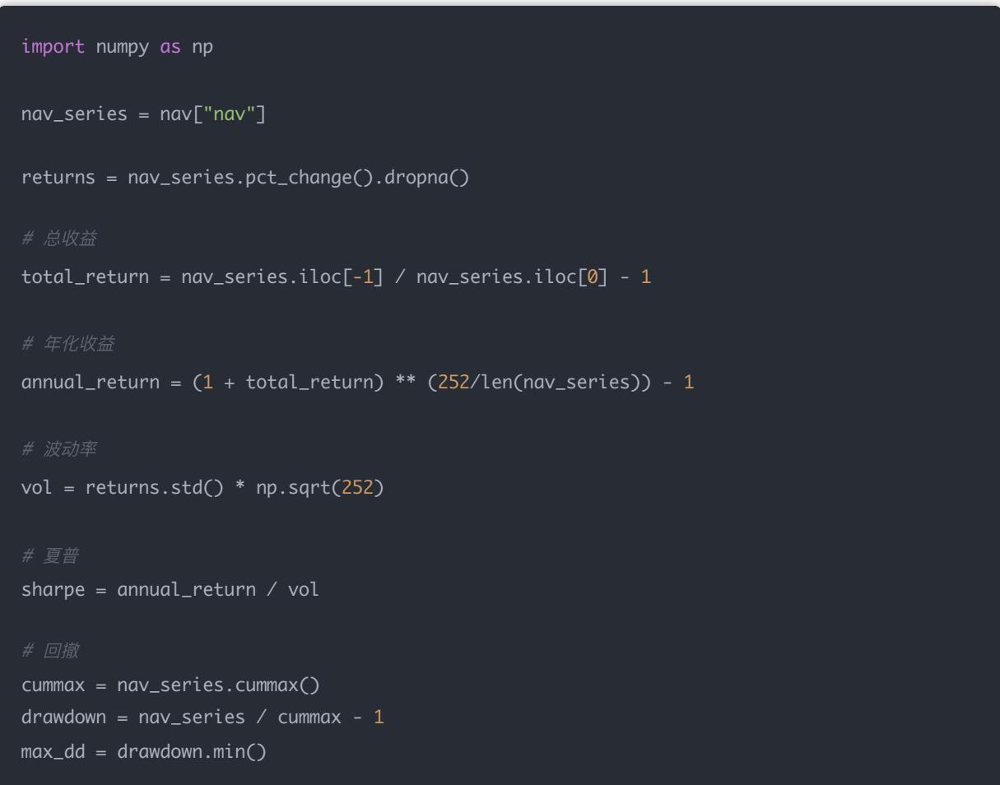
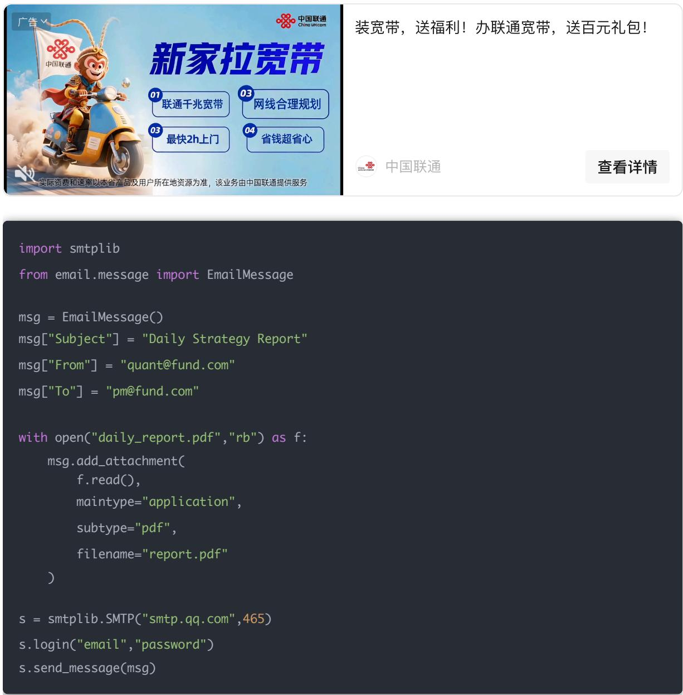
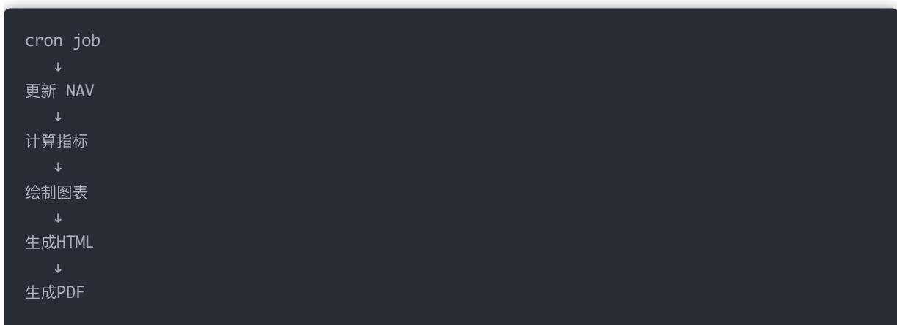
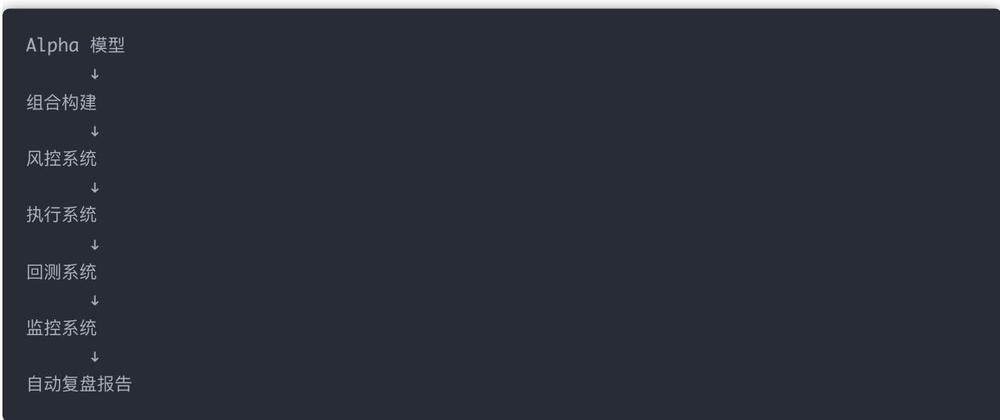

## 量化交易进阶:第74天 - 自动复盘报告（每日 自动生成量化策略报告PDF）

原创 逻辑与流 逻辑与流 2026年3月7日 12:09 北京 听全文

机构量化团队每天收盘后自动生成 Daily Strategy Report，含净值曲线 回撤 因子 IC 持仓与风控记录，并导出 PDF 发送邮箱或企业微信 本文按读数据→算指标→画图→HTML→PDF→发送的流程，实现完整自动复盘系统

自动复盘报告是机构量化流程的最后一环；从 Alpha 组合 风控 执行 回测 监控到每日报告闭环跑通，就是完整机构量化框架

机构量化团队每天都会自动生成 Daily Strategy Report。 这份报告通常在 收盘后自动生成，内容包括：

净值曲线

回撤曲线

当日收益

因子 IC / RankIC

持仓结构

风控触发记录

最后自动导出为 PDF，发送到邮箱 / 企业微信

今天我们实现一个 完整自动复盘系统

## 一 最终自动报告长什么样

## 一个典型的量化日报：

Strategy Daily Report

Date: 2026-03-07

1. Portfolio Performance

Today's Return: 0.42%

Total Return: 18.4%

Max Drawdown: -7.2%

Sharpe Ratio: 1.42

2. NAV Curve

宁德时代   4.2%

## 二 实现流程

每日 自动生成报告分为 5 步：

## 三 读取策略数据

## 假设我们已有：

nav\_history.csv

positions.csv

factor\_ic.csv

risk.log

千问 AI 双 11，Token Plan 低至5折

查看

import pandas as pd nav = pd.read\_csv("nav\_history.csv") positions = pd.read\_csv("positions.csv") ic = pd.read\_csv("factor\_ic.csv")

## 四 计算策略表现指标

## 五 绘制报告图表

## 1 净值曲线

plt.figure(figsize=(8,4))

plt.plot(nav["date"], nav\_series)

plt.title("NAV Curve")

plt.xticks(rotation=45)

plt.tight\_layout()

plt.savefig("nav\_curve.png")

2 回撤曲线

plt.figure(figsize=(8,4))

plt.plot(nav["date"], drawdown)

plt.title("Drawdown")

plt.xticks(rotation=45)

plt.tight\_layout()

plt.savefig("drawdown.png")

3 IC 曲线

plt.figure(figsize=(8,4))

plt.plot(ic["date"], ic["ic"])

plt.title("Factor IC")

plt.xticks(rotation=45)

plt.tight\_layout()

plt.savefig("ic\_curve.png")

## 六 读取风控日志

with open("risk.log") as f:

risk\_events = f.readlines()[-10:]

## 七 生成 HTML 报告

先生成 HTML，再转 PDF（这是业界标准）

html = f"""

<h1>Strategy Daily Report</h1>

<h2>Performance</h2>

<ul>

<li>Total Return: {total\_return:.2%}</li>

<li>Annual Return: {annual\_return:.2%}</li>

<li>Sharpe: {sharpe:.2f}</li>

<li>Max Drawdown: {max\_dd:.2%}</li>

</ul>

<h2>NAV Curve</h2>

<h2>Drawdown</h2>

<h2>Factor IC</h2>

<h2>Positions</h2>

{positions.to\_html(index=False)}

<h2>Risk Events</h2>

<pre>

{''.join(risk\_events)}

</pre>

with open("report.html","w") as f: f.write(html)

## 八 HTML 转 PDF

推荐工具：

WeasyPrint

安装：

pip install weasyprint

from weasyprint import HTML

## 九 自动发送邮件

装宽带，送福利！办联通宽带，送百元礼包！

中国联通

查看详情

import smtplib from email.message import EmailMessage

msg = EmailMessage() msg["Subject"] = "Daily Strategy Report" msg["From"] = "quant@fund.com" msg["To"] = "pm@fund.com"

with open("daily\_report.pdf","rb") as f: msg.add\_attachment( f.read(), maintype="application", subtype="pdf", filename="report.pdf" ) s = smtplib.SMTP("smtp.qq.com",465) s.login("email","password") s.send\_message(msg)

## 十 最终自动化流程

## 每天收盘执行：

## 十一、机构版报告还会包含

真实基金报告通常还有：

## 因子分析

RankIC Mean

RankIC IR

IC decay

## 组合结构

行业分布

市值分布

因子暴露

## 风险指标

VaR

Beta

Tracking Error

## 十二 现在已经完成的系统

  
这已经是一个：完整机构量化框架

## 结论

从读取数据 计算指标 绘制图表 生成 HTML 转 PDF 到自动发送，闭环跑通后即为每日 自动生成的机构级策略日报；与 Alpha 组合 风控 执行 回测 监控一起，构成完整机构量化框架

## 量化交易入门指南 · 目录

## 上一篇

量化交易进阶:第73天 - 策略表现监控（每日净值更新+风控日志体系）

阅读 116

寒冬没有退路 合理分配每份资源才能守住营地

点击了解更多

## 下一篇

Day75：量化交易进阶:第75天 - 阶段项目（构建一个完整的「多股票实盘交易系统」（

寒冬没有退路，合理分配每份资源才能守住营地

无尽冬日-3亿人都在玩

立即体验
