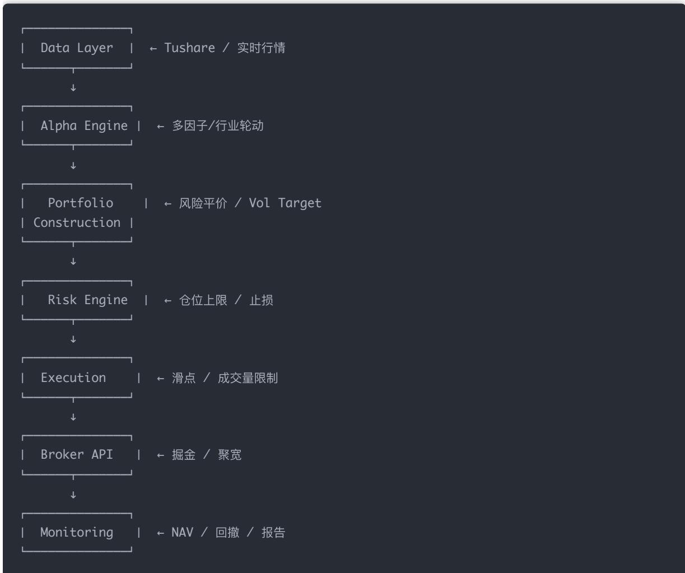
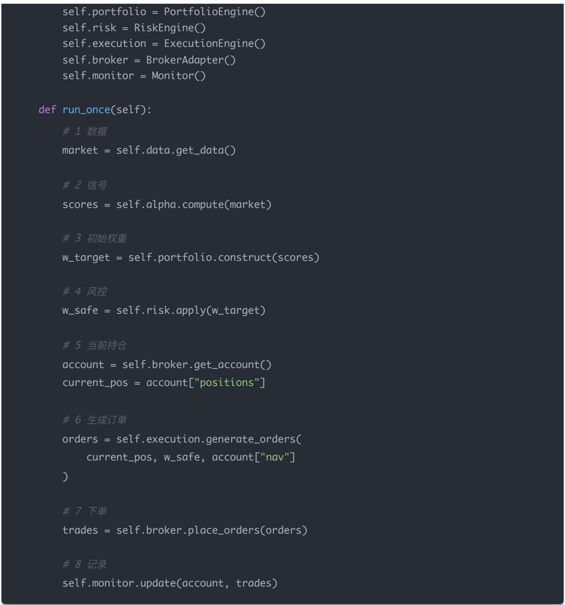
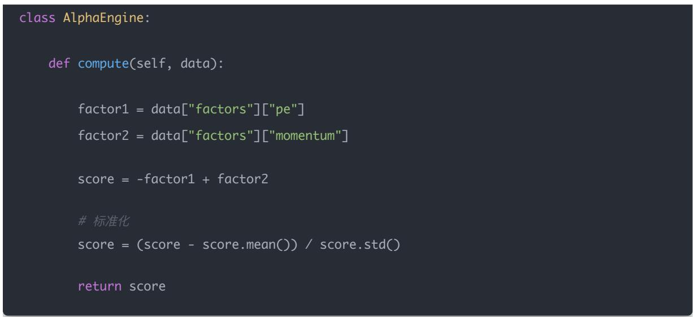
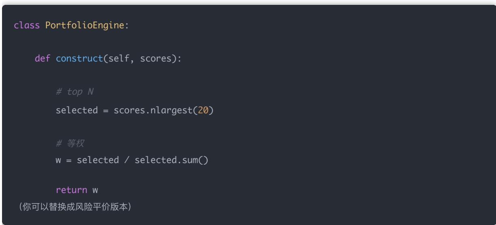
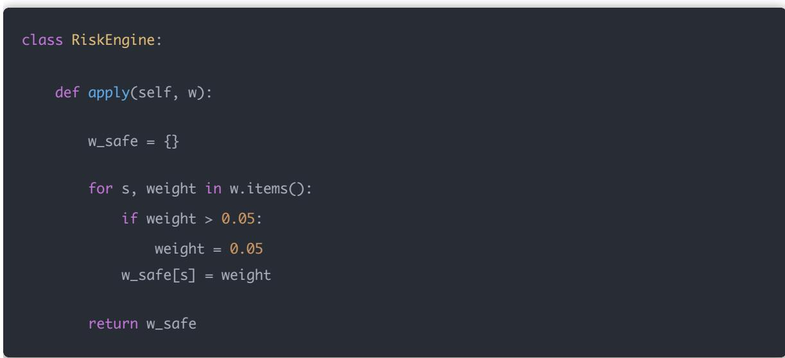
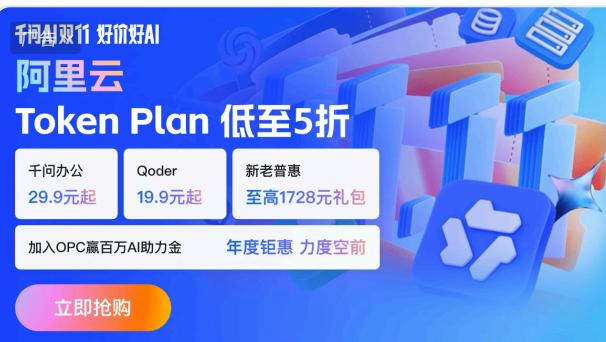
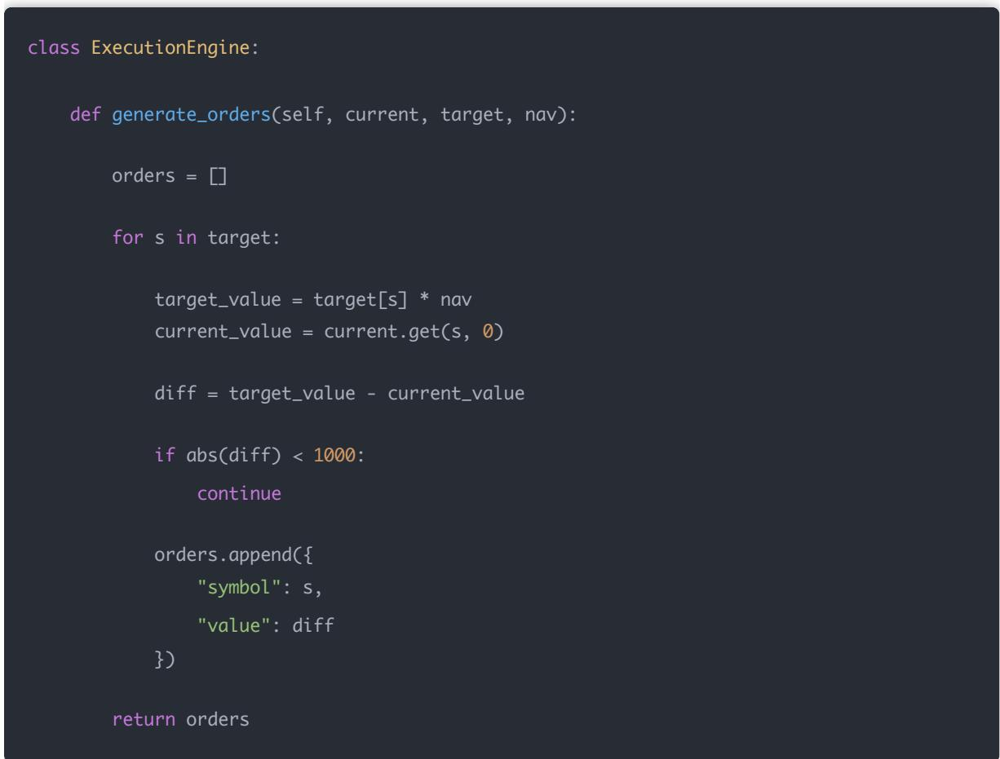
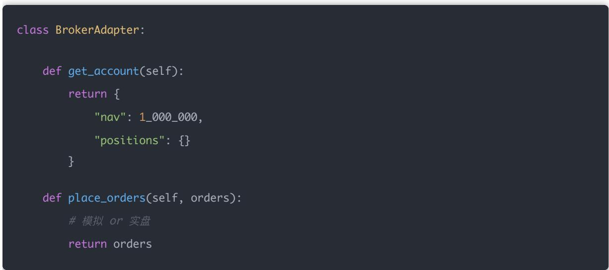
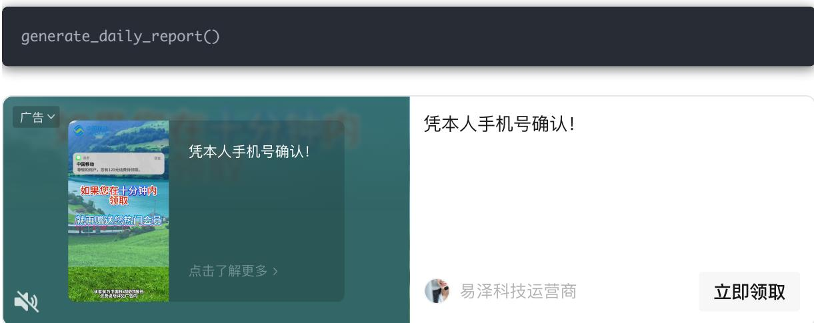

## Day75：量化交易进阶:第75天 - 阶段项目（构建一个完整的「多股票实盘交易系统」（机构级骨架））

原创 逻辑与流 逻辑与流 2026年3月 19 日 10:27 北京 听全文

这一节，我们把 Day60 → Day74 的所有模块 真正“拼成一个系统”。

不是再讲零散模块，而是：

一套可以跑模拟盘 / 接券商实盘的完整系统架构

## 一 最终你要做出的系统（全景）

## 二 系统核心：统一调度引擎

所有模块必须统一入口：

class TradingSystem:

def \_\_init\_\_(self):

self.data = DataEngine()

self.alpha = AlphaEngine()

def run\_once(self):

\# 1 数据

market = self.data.get\_data()

\# 2 信号

scores = self.alpha.compute(market)

\# 3 初始权重 w\_target = self.portfolio.construct(scores)

\# 4 风控

w\_safe = self.risk.apply(w\_target)

\# 5 当前持仓 account = self.broker.get\_account() current\_pos = account["positions"]

\# 6 生成订单 orders = self.execution.generate\_orders( current\_pos, w\_safe, account["nav"]

\# 7 下单 trades = self.broker.place\_orders(orders)

\# 8 记录 self.monitor.update(account, trades)

## 三 模块逐个落地（最小可用实现）

## 1 DataEngine（数据层）

class DataEngine:

def get\_data(self):

\# Tushare ／ 实时行情

return {

"prices": ...,

"volumes": ...,

"factors": ...

}

## 2 AlphaEngine（多因子）

3 PortfolioEngine（组合构建）

风险平价 + 波动率目标

4 RiskEngine（风控层）  
  
5 ExecutionEngine（执行层）  
核心：不能“理想成交”

千问 AI 双 11，Token Plan 低至5折

千问办公

Qoder

新老普惠至高1728元礼包

加入OPC赢百万AI助力金

年度钜惠 力度空前

阿里云

查看

## class ExecutionEngine:

def generate\_orders(self, current, target, nav):

orders = []

for s in target:

target\_value = target[s] \* nav current\_value = current.get(s, 0)

diff = target\_value - current\_value

if abs(diff) < 1000: continue

orders.append({ "symbol": s, "value": diff

return orders

## 6 BrokerAdapter（券商接口）

class BrokerAdapter:

## 7 Monitor（监控系统）

class Monitor:

def update(self, account, trades):

nav = account["nav"]

print(f"NAV: {nav}")

for t in trades:

print("成交:", t)

## 四 主运行程序（实盘入口）

import time

system = TradingSystem()

while True:system.run\_once()time.sleep(60)

五、你必须加的 5 个“实盘增强”

否则系统不安全：

1 异常处理（Day72）

try: system.run\_once() except Exception as e: send\_alert(e)

2 状态持久化（防崩）

save\_state(account)

3 成交回报校验

assert broker\_positions == local\_positions

4 风险报警（Day73）

if drawdown < -0.1:

send\_alert("回撤过大")

5 每 日 自动报告（Day74）

六 完整系统运行流程（你要理解这个）

开盘 ↓ 数据更新 ↓ 信号生成 ↓ 组合构建 ↓ 风控裁剪 ↓ 订单生成 ↓ 执行 ↓ 记录 & 监控 ↓ 收盘报告

七 真实机构 vs 你现在的系统

<table><tr><td>模块</td><td>你现在</td><td>机构</td></tr><tr><td>Alpha</td><td>√</td><td>更复杂</td></tr><tr><td>风控</td><td>√</td><td>多层</td></tr><tr><td>执行</td><td>√</td><td>更精细</td></tr><tr><td>监控</td><td>√</td><td>实时</td></tr><tr><td>报告</td><td>√</td><td>自动</td></tr><tr><td>稳定性</td><td>△</td><td>极强</td></tr></table>

你已经完成了：

80% 的核心能力

结论

八 这一阶段最重要的认知

你现在不是在“写策略”，而是在：

管理一个自动交易系统

核心不是收益，而是： • 稳定运行 • 风险可控 • 行为可解释

最后一句非常重要

你现在这套系统：

## 已经可以接实盘了（小资金）

## 但请记住：

## 第一目标不是赚钱 第一目标是 不出事故
