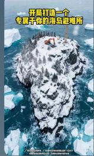

## 量化交易进阶:第77天 - 股票池（Universe）设计：先定义可交易的市场，再谈选股

原创 逻辑与流 逻辑与流 2026年3月 31 日 21:05 北京 1人

很多人做量化选股时，第一反应是： 「那我就全市场跑因子，机会最多。

这在回测里看起来很合理，但在实盘里往往会死得很快。真正的关键不在于你用什么因子、什么模型，而在于你允许自 己在哪个“可交易的市场”里做决策——这就是 Universe（股票池）。

句话结论：不是从「所有股票」里选，也不是只从「某一个板块」里选；正确做法是先定义股票池（Universe），再在这个池子里选股与构建组合。

为什么必须先做 Universe：全市场会带来流动性灾难、噪声污染、风险暴露失控，以及计算/执行成本爆炸；只做单一行业则把问题变成“主题押注”而非通用量化。

机构怎么做：全市场 →（流动性/风险硬过滤）→ Universe → 在 Universe 内做因子与组合 → 再加组合级风控与容量约束。

更进一步：Universe 可以被形式化为一个优化问题：在满足流动性/容量/行业/市值分布等约束下，最大化因子有效性（alpha/IC）。Universe 本身就是策略，并且可以动态化与多Universe组合。

## 一 先给你结论（非常重要）

你在做的不是：

从「所有股票」里选

或者只从「某一个行业」里选

真正的做法是：

先定义“股票池（Universe）”，再在这个池子里选股

接下来我们先把「为什么」讲清楚：为什么不能直接全市场选？为什么也不能只选一个行业？把这两条路都讲透，你就会自然接受 Universe 才是第一性问题。

## 二 为什么不能直接“全市场选股”？

直觉上你会觉得： 「全市场选不是机会最多吗？

但实盘里这样做通常会非常痛苦，主要有四个原因。

1 流动性问题（最致命）

A 股 5000+ 股票里，很多标的：

成交额极低

一天几十万成交

买不进去 / 卖不出来

于是你会出现典型断层：

回测里“可以买”（默认成交、或滑点很小）

实盘里“滑点爆炸 + 成交失败 + 组合被迫偏离目标”

这不是收益的小波动，而是策略是否能活下去的问题。

## 2 噪声极大（模型容易学到垃圾信号）

小票常见特征：

波动大

信息不透明

更容易被资金操控

你把它们无差别丢给模型，模型很容易“学到”： 短期偶然性、微结构噪声、甚至操纵痕迹——这些信号回测看起来像 alpha，实盘往往是灾难。

## 3 风控不可控（暴露会变得很奇怪）

如果你全市场直接选：

很容易集中在某些“奇怪标的”（低流动性、极端风格、题材驱动）

行业分布混乱

风险暴露不可控（行业、大小盘、波动、拥挤度）

最后你以为你在做“因子策略”，实盘却变成了“无意间的风格押注”。

## 4 计算与执行成本爆炸

5000 只股票 × 多因子 × 多窗口 → 计算很重

实盘调仓 × 大数量标的 → 成交成本与冲击成本巨大

更关键的是：你承担了成本，但并没有等比例换来可交易的 alpha。

## 三 那是不是只选一个行业？

也不对。

如果只做一个行业（例如医药/新能源/白酒），确实有优点：

更专注

因子更稳定

短期 alpha 可能更强

但缺点同样明显：

行业风险巨大

一旦行业下行 → 组合整体一起亏

这本质上是主题策略，而不是通用的量化选股框架。

所以问题不是“全市场 vs 单行业”，而是你要回到更本质的一层：先把可交易 可控风险 可规模化的决策空间定义出来。

## 四 真实机构是怎么做的？（核心流程）

机构更接近这样的标准流程：

全市场

↓

过滤（流动性 / 风险 / 可交易性）

↓

股票池（Universe）

↓

在池子里做选股、组合构建与风控

换句话说：Universe 不是“选股之前的小步骤”，而是决定你后面所有因子 风控 执行能否成立的地基。

## 五 股票池（Universe）为什么是核心？

你真正要思考的不是： 「选全部还是选行业？

而是：

怎么定义一个好的 Universe？

因为同样的因子、同样的选股逻辑，在不同 Universe 里会呈现完全不同的效果与风险画像。

六 常见的 4 种 Universe（按实盘经验排序）

1 指数成分股池（主流机构最常见）

例如：

沪深 300

中证 500

中证 1000

特点：

优点：流动性好、风险可控、容易成交、可复现实盘

缺点：alpha 往往更弱（市场更有效、拥挤度更高）

## 2 流动性筛选池（最常用）

例如： 过去 20 日平均成交额 1 亿（ADV 门槛）

典型结果： 5000 → 约 1000 只左右

这类 Universe 的意义是：先剔除“根本不能做”的标的，把问题变成“在可交易集合中竞争”。

## 3 风格池（大盘 / 中小盘分层）

例如：

小盘池（更激进）

大盘池（更稳）

用于把“风格选择”显性化：你到底是在追求更强 alpha，还是更稳定容量。

## 4 行业池（主题策略）

例如：

医药

新能源

白酒

适用场景：

行业轮动

专项策略（主题押注）

## 七 一个真实可落地的机构做法

下面给你一套可以直接落地的方案。

## Step 1：构建 Universe（硬过滤）

条件：

1. 剔除 ST

2. 剔除停牌

3. 成交额（ADV） 1 亿

4. 上市 1 年

得到：约 1000 只股票

## Step 2：因子选股（在 Universe 内）

在这 1000 只里：

计算 PE / PB / ROE / 动量

排序

选 Top 50

## Step 3：组合构建

Top 50：

等权，或

风险平价（Risk Parity）

## Step 4：组合风控（把“能赚钱”变成“能活”）

单票权重

行业权重

总仓位控制（或总波动目标）

## 八 一个非常关键的认知（你一定要理解）

Universe 本身就是一种“策略”

举例：同样的因子，在不同 Universe 下会完全变样：

全市场 → 噪声巨大

沪深 300 → 更稳定但更弱

中证 1000 → alpha 可能更强但波动更大、容量更敏感

不是因子变了，是 Universe 改变了你面对的市场结构。

## 九 进阶：多 Universe（机构玩法）

真正机构通常不会只用一个池子：

策略 A：沪深 300（稳）

策略 B：中证 1000（进攻）

策略 C：行业轮动（主题）

然后把它们再组合成一个系统，这就是你在 Day64 学的： 多策略组合系统。

## 十 你现在该怎么做（非常具体建议）

基于你当前课程学习的能力，按三阶段走最稳。

## 第一阶段（现在就做）

用这个 Universe：

成交额（ADV）(>) 1 亿

剔除 ST

## 第二阶段（做对比实验）

对比三个 Universe：

全市场

沪深 300

中证 1000

看三件事：

收益

回撤

稳定性

## 第三阶段（进阶）

做：

多 Universe

多策略组合

## 十一 最后一句（最重要）

你之前一直在想： 「怎么选股票？

但真正的问题是：

你允许自 己在哪个市场里做决策？

这就是 Universe。

当你开始把 Universe 当成可设计、可优化、可组合的对象，你的策略上限才会真正打开。

## 十二、进阶：如何设计“最优 Universe”（量化优化）

你提到的四点：

流动性 vs alpha

市值分层

行业中性

容量限制

本质上可以统一成一个问题：

在满足交易约束的前提下，最大化因子有效性（alpha）。

## 十三 形式化表达（机构真实思路）

把 Universe 设计成一个优化问题：

目标函数（你想最大化的）：

$$
\max _ {U} \quad \operatorname{Alpha} (U)
$$

约束条件（现实世界限制）：

$$
\operatorname{Liquidity} (U) \geq L _ {\min}
$$

$$
\mathbf {C a p a c i t y} (U) \geq C _ {t a r g e t}
$$

$$
\mathrm{SectorBalance} (U) \approx \mathrm{Market}
$$

$$
\text { Size   Distribution } (U) \in [ S m a l l, M i d, L a r g e ]
$$

翻译成人话就是： 在保证能买卖 能容纳资金 风险暴露可控的情况下，让因子最有效

## 十四 四个维度逐个拆解（非常细）

## 1 流动性 vs Alpha（最核心矛盾）

现实规律（非常重要）：

<table><tr><td>股票类型</td><td>流动性</td><td>Alpha</td></tr><tr><td>大盘股</td><td>高</td><td>弱</td></tr><tr><td>小盘股</td><td>低</td><td>强</td></tr></table>

为什么小盘 alpha 可能更强？

信息不充分 → inefficiency

机构不愿意参与 → 定价不充分

但代价是：

买不进去

卖不出来

数学化表达：

定义：

$\mathrm { A D V } _ { i }$ ：平均成交额

$\alpha _ { i } \mathbf { : }$ 因子带来的预期收益能力

你实际在做：

$$
\max \sum_ {i \in U} \alpha_ {i}
$$

但受限于成交约束：

$$
\text { Trade   Size } _ {i} \leq \lambda \cdot \mathrm{ADV} _ {i}
$$

实务做法（关键）不是“选最流动的”，而是：

剔除最差流动性（例如底部 20%），保留中高流动性

## 2 市值分层（Size Bucketing）

为什么必须做？ 因为市值本身就是一个因子。

如果不控制，你的策略很可能“被动变成”：

全小盘策略（高收益高风险）

或全大盘策略（稳但没 alpha）

标准做法： 把股票分成 Small / Mid / Large 三组，然后：

方法 1：分层选股：每一层选 Top N

方法 2：分层标准化：在每个市值组内做 z-score

目标是去掉“市值偏见”，让你做的是真正的目标因子。

## 3 行业中性（非常关键）

如果不做行业控制，你的策略很可能变成： 「新能源策略」，而不是量化策略。

行业问题的本质是相关性聚集：

$$
\mathbb {E} [ \operatorname{corr} (r _ {i}, r _ {j}) \mid \text {same sector} ] > \mathbb {E} [ \operatorname{corr} (r _ {i}, r _ {j}) \mid \text {different sectors} ]
$$

标准做法：

方法 1：行业内排名：每个行业选 Top K

• 方法 2:行业中性化：Factor = Factor — Industry Mean

方法 3：行业权重约束：行业权重

## 4 容量限制（最实盘的东西）

策略最多能承载多少资金，本质取决于成交额与参与率。

核心公式：

$$
Q _ {f i l l} = \lambda \cdot A D V
$$

解释：

ADV = 平均成交额

= 参与率（常见 5%–10%）

直观例子：

如果策略资金 = 1 亿，而某股票 ADV = 2000 万：

最大可买 ≈ 2000 万 × 10% = 200 万

只能买到 0.2% 的资金规模

所以 Universe 必须“足够大”，才能容纳资金；否则你所谓的 alpha 根本无法规模化。

## 十五 完整 Universe 构建流程（可落地版本）

## Step 1：初筛（硬过滤）

剔除：

ST

停牌

上市 1 年

价格 2 元

Step 2：流动性筛选

$$
\mathrm{ADV} > 1 \mathrm{亿}
$$

$$
5 0 0 0 \to 1 0 0 0
$$

Step 3：市值分层

按市值分三组（示例比例）：

小盘（30%）

中盘（40%）

大盘（30%）

## Step 4：行业均衡

每个行业最多保留前 20%（或设置行业权重/数量上限）

Step 5：容量过滤

确保组合规模不超过单票可成交上限，例如： 组合单票目标交易量

Step 6：最终 Universe

大约：300–800 只股票

十六 机构级进阶：动态 Universe 与直接优化 Universe

## 动态 Universe（重点）

Universe 不必固定：

牛市：可以适度扩大 Universe

熊市：收缩 Universe、提高流动性门槛

市场流动性变差：提高 ADV 门槛或降低参与率假设

直接把 Universe 当成优化对象

更“机构”的表达是直接优化：

$$
\max _ {U} I C (U) - \lambda \cdot R i s k (U)
$$

也就是：Universe 本身就是 alpha 的一部分，并且可以被系统性地优化。

## 结论

量化选股的第一性问题不是“怎么选股票”，而是先定义你允许自 己在哪个可交易市场里做决策：先构建Universe，再做因子、组合与风控。

全市场直接选股会在实盘里踩中流动性、噪声、风险暴露与执行成本四个坑；单一行业池则把策略变成主题押注。机构的通用做法是：全市场 → 硬过滤 → Universe → 因子选股 → 组合构建 → 组合级约束与容量控制。

更进一步，Universe 可以被形式化为“在交易约束下最大化 alpha/IC”的优化问题；同一个因子在不同Universe 上效果完全不同，Universe 本身就是策略。当你开始做动态 Universe 与多 Universe 组合，你就从“做一个策略”走向了“搭一个可扩展的多策略系统”。

## 量化交易入门指南 · 目录

上一篇

量化交易进阶:第76天 - AI时代对量化开发的影响（竞争方式 Alpha挤压与真正值钱的

阅读 138

广告

白雪吞没城市，火炉

还在燃烧，你能带大

家撑到天亮吗？

点击了解更多

下一篇

量化交易进阶:第78天 - 多Universe组合策略：并行 alpha 来源 子策略合并与组合级

白雪吞没城市，火炉还在燃烧，你能带大家撑到天亮吗？

无尽冬日-3亿玩家推荐

进入小游戏
