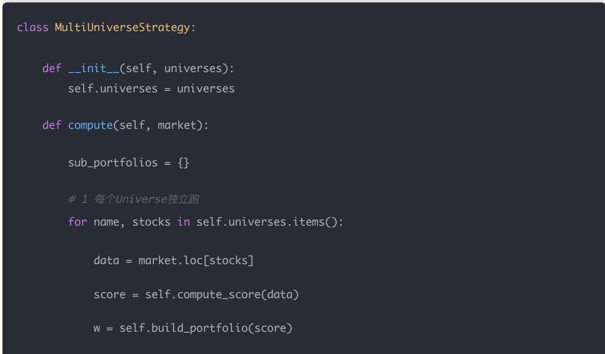
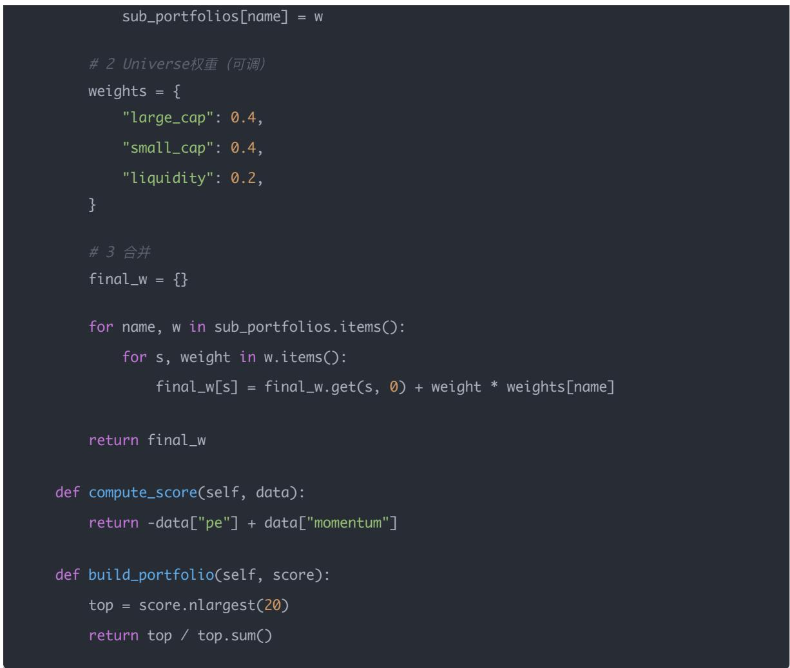

# 量化交易进阶:第78天 - 多Universe组合策略：并行 alpha 来源 子策略合并与组合级风控的完整设计

原创 逻辑与流 逻辑与流 2026年4月2日 11:55 北京 听全文

一句话：多Universe = 多个「市场视角」的并行 alpha 来源；每个 Universe 像一块独立的小市场，子策略层产出权重后，再用 Universe 级分配与组合级风控合成总组合。

系统结构：Universe A/B/C… → 各池独立算分、建组合 → Universe 权重（等权 / 风险平价 / 按IC·Sharpe·回撤动态）→ 合并为 w\_final → 单票、行业、总仓位等「冲突消解层」。

为什么强：分散 alpha、降低单一风格崩盘时的回撤、在独立信息源下往往提升组合 Sharpe；机构还会对Universe 本身做牛熊或 IC 驱动的动态调权。

你现在可做：先选沪深300、中证1000、流动性筛选三池，同一因子分池回测 IC/收益/回撤，再对比等权与风险平价合成，把「一个策略选股票」升级为「多个市场同时交易」。

先把认知锚定，再看整体架构与落地步骤；中间会穿插代码骨架与机构习惯做法，最后收束到可执行的实验顺序。

## 一 一句核心认知（最重要）

## 多Universe = 多个「市场视角」的并行 alpha 来源。

它不是简单「多股票池」的并列，而是：每个池子对应一种不同的资金结构、博弈方式与 alpha 形态。用一张表把直觉钉死：

<table><tr><td>Universe</td><td>本质(可理解为)</td></tr><tr><td>沪深300</td><td>稳定资金主导</td></tr><tr><td>中证500</td><td>中盘机构博弈</td></tr><tr><td>中证1000</td><td>小盘 alpha 更突出</td></tr><tr><td>行业池</td><td>主题与轮动驱动</td></tr></table>

可以记一句：每个 Universe ≈ 一个「不同的市场」——你在做的是市场分层建模，而不是在同一个市场里多开几条腿而已。

有了「多市场并行」这根轴，下面用一张结构图把数据流和职责一次说清楚。

## 二 系统整体结构（机构级）

Universe A (沪深300)   ─┐

子策略层：在每个 Universe 内完成因子/打分与组合构建；权重分配层：决定 A、B、C… 在总组合中的占比；总组合再进入统一风控与执行。接下来把每一层拆成可执行的步骤。

## 三 设计拆解（一步一步）

## 1 定义多个 Universe（非常关键）

示例字典化表达：

universes = {

"large\_cap": hs300\_list,

"mid\_cap": zz500\_list,

"small\_cap": zz1000\_list,

"liquidity": liquidity\_filtered\_list,

## 实务建议（可直接照做起步）

Universe A：沪深300（稳、容量好）

Universe B：中证1000（alpha 往往更强、波动更大）

Universe C：流动性筛选池（通用底仓或执行友好层）

池子定义清楚之后，关键原则是：每个池子内部的数据与约束一致，再谈跨池合并；否则 IC 对比会失去可比性。

## 2 每个 Universe 独立做策略（核心）

映射关系可以写死在心里：

Universe A → Strategy A

Universe B → Strategy B

Universe C → Strategy C

统一因子、不同池子是最干净的 ablation 起点——你能分离「因子本身」与「池子带来的结构差异」。

def compute\_score(data):

return -data["pe"] + data["momentum"] + data["roe"]

scores\_A = compute\_score(data\_A)

scores\_B = compute\_score(data\_B)

scores\_C = compute\_score(data\_C)

进阶时可以为不同 Universe 换参数或换子模型；但第一步建议先固定 compute\_score ，把问题收敛在「分层市场是否值得并行」。

## 3 每个 Universe 内部构建组合

例如在各自池内做 top-N 并归一化权重：

def build\_portfolio(scores, top\_n=20):

selected = scores.nlargest(top\_n)

return selected / selected.sum()

得到：

w\_A ：沪深300 子组合

w\_B ：中证1000 子组合

w\_C ：流动性池子组合

到这一步为止，你手里是多个互不重叠或部分重叠的「子组合向量」；真正的总组合还没有诞生——下一节才是「核心中的核心」。

## 4 Universe 之间的权重分配（核心中的核心）

方法1：等权（最简单）

$$
w _ {\mathrm{total}} = \frac {1}{3} w _ {A} + \frac {1}{3} w _ {B} + \frac {1}{3} w _ {C}
$$

方法2：风险平价（推荐起步）

目标：让各 Universe 贡献的风险大致相当，例如约束思想为：

$$
\sigma_ {A} \approx \sigma_ {B} \approx \sigma_ {C}
$$

实务上通过估计各子组合的波动或边际风险，反推 Universe 权重，示意：

```txt
weights = { "A": 0.4, "B": 0.3, "C": 0.3 } # 数值仅作示例，需用历史数据估计
```

方法3：按表现动态分配（进阶）

根据 rolling IC、Sharpe、最大回撤等，例如：

$$
\mathrm{weight} _ {i} \propto \mathrm{Sharpe} _ {i}
$$

（需配合换手惩罚与上下限，避免权重跳变过大。）

## 5 合并成最终组合

对全市场股票集合做加权汇总（未出现在某子组合中的股票权重为 0）：

```python
w_final = {}
for s in all_stocks:
    w_final[s] = (
    w_A.get(s, 0) * alpha_A
    + w_B.get(s, 0) * alpha_B
    + w_C.get(s, 0) * alpha_C
)
```

其中 alpha\_A 、 alpha\_B 、 alpha\_C 表示各 Universe 在总组合中的预算权重（上一步分配结果）。若子组合已归一为和为 1 的向量，则 alpha 之和应为 1（或再乘以总仓位）。

## 6 再做一次组合级风控（必须）

单票上限（如 < 5%）

行业上限（如 < 30%）

总仓位与杠杆控制

这一步在工程上就是 「多策略冲突消解层」：不同 Universe 可能同时看好同行业、同主题，合并后集中度会被动抬高；必须在合成后统一压一遍约束。

从步骤回到实现，下面给一版最小可读的策略类骨架，便于你对照自 己的回测/实盘框架改写。

四 完整代码骨架  




生产环境中还应接入：再平衡日历、成本模型、以及上一节的组合级风控模块（可在 return final\_w 之前或之后统一调用）。

结构清楚之后，值得单独回答一个问题：为什么要费事做这一层？下面用三条机构里常挂在嘴边的逻辑收一收。

## 五 为什么这种策略很强？（核心逻辑）

## 1 分散 alpha 来源

大盘 → 稳

小盘 → 强

行业 → 快

不依赖单一市场切片，避免「你的因子其实只是某一种风格溢价」的隐性单押。

## 2 降低回撤

若小盘阶段承压，大盘子组合往往能提供缓冲；若某一行业主题退潮，其他 Universe 未必同向受伤合成后尾部往往比单池极端情形更温和。

组合多个相关性不足 1 的 alpha 源，常见现象是：

$$
\mathrm{Sharpe} _ {\mathrm{total}} > \mathrm{Sharpe} _ {\mathrm{single}}
$$

（需在样本外验证；若各池子本质是同一因子的重复暴露，提升会有限。）

以上是「静态 Universe 权重」下的收益；真实机构还会在更外层再动一刀——让 Universe 本身随环境变化。

## 六 真实机构会再做一层（高级）

Universe 也动态调整，例如：

牛市 → 适度加大 small\_cap 预算

熊市 → 加大 large\_cap 或提高流动性池占比

或者：

若 small\_cap 的 rolling IC 持续走弱 → 自 动降权该 Universe

这一层与 Day 77 里的「动态 Universe」思想一致，只是把对象从「池内股票集合」扩展到「池间预算分配」。

把工程结构再抽象一层，你会更容易和论文、卖方框架对齐。

## 七 一个非常关键的认知（一定要理解）

多Universe策略本质上是：「市场分层建模」。

不是一个模型打天下，而是：

多个市场（切片） + 多个子模型/子组合 + 一个组合与风控系统

你在 Day 77 学的是「如何切第一刀」；本文是「如何同时用好几刀，再合成一盘菜」。

认知与架构都齐了，最后落到你可以本周就做的最小实验路径。

## 八 现在该怎么做（具体）

## Step 1（马上做）

做三个 Universe：

1. 沪深300

2. 中证1000

3. 流动性筛选

Step 2

同一个因子，在三个 Universe 上分别跑：对比 IC、收益、回撤（同样回测区间与交易成本假设）。

Step 3

合成总组合：对比 等权 Universevs 风险平价 Universe，看全样本与分行情下的差异。

## 九 最后一句（最重要）

之前做的是：

「一个策略选股票

现在要转变为：

「多个市场同时交易

## 结论

多Universe 组合不是把几只股票池简单拼在一起，而是把 沪深300、中证500、中证1000、行业主题等切片当作不同的「市场视角」，在每个 Universe 内独立完成打分与组合构建，再通过 等权、风险平价或基于 IC/Sharpe/回撤的动态权重合成总权重，并用 单票、行业、总仓位等组合级约束做冲突消解。

这种结构的直接好处是 alpha 来源分散、回撤结构更平滑、在子策略相对独立时有望提升 Sharpe；机构还会在 Universe 预算层做牛熊或 IC 驱动的动态调整。落地顺序建议：先固定三池（沪深300、中证1000、流动性筛选）、同一因子分池评估，再对比等权与风险平价合成——你便从 Day 77 的「先定义池子」自然进阶到 多个市场并行交易的系统化做法。
