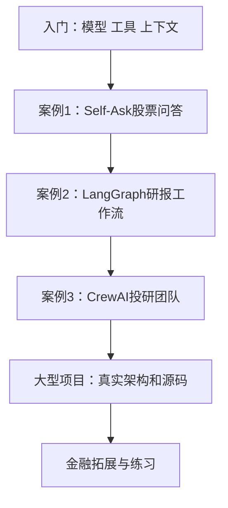

> [!abstract] 适合谁，怎样开始
> 这套教程面向熟悉金融业务、尚未接触大模型应用的人。按“先看懂闭环 → 股票问答 → 研报流程 → 多角色投研 → 大型项目”学习；每个例子解释业务、输入输出、代码路径、金融口径与实际材料边界。

## 先知道本教程做到了哪一步

这里是依据课堂原代码和大型项目当前材料编写的学习教程。原课堂与原项目均保留不动；本轮没有启动服务、训练模型、调用付费推理或执行交易。虚构演练均明确标记，源码事实与改进建议分开。

## 学习路线

## 入门

- [[金融 AI 应用实战/00-入门/01-把大模型放进金融工作流|01-把大模型放进金融工作流]]
- [[金融 AI 应用实战/00-入门/02-读代码需要的最小Python知识|02-读代码需要的最小Python知识]]
- [[金融 AI 应用实战/00-入门/03-遇到术语时查这里|03-遇到术语时查这里]]

## 股票问答

- [[金融 AI 应用实战/01-股票问答/01-业务与一轮手动演练|01-业务与一轮手动演练]]
- [[金融 AI 应用实战/01-股票问答/02-代码逐段拆解|02-代码逐段拆解]]
- [[金融 AI 应用实战/01-股票问答/03-金融口径与误判|03-金融口径与误判]]

## 研报工作流

- [[金融 AI 应用实战/02-研报工作流/01-为什么需要计划与状态|01-为什么需要计划与状态]]
- [[金融 AI 应用实战/02-研报工作流/02-三个金融工具与指标口径|02-三个金融工具与指标口径]]
- [[金融 AI 应用实战/02-研报工作流/03-逐节点读代码与故障演练|03-逐节点读代码与故障演练]]

## 多Agent投研

- [[金融 AI 应用实战/03-多Agent投研/01-四个岗位与任务交接|01-四个岗位与任务交接]]
- [[金融 AI 应用实战/03-多Agent投研/02-工具与数据缺口|02-工具与数据缺口]]
- [[金融 AI 应用实战/03-多Agent投研/03-报告与质量验收|03-报告与质量验收]]

## 大型项目

- [[金融 AI 应用实战/04-大型项目/00-项目究竟做了什么|00-项目究竟做了什么]]
- [[金融 AI 应用实战/04-大型项目/01-真实架构与各层职责|01-真实架构与各层职责]]
- [[金融 AI 应用实战/04-大型项目/02-主流水线与状态工作底稿|02-主流水线与状态工作底稿]]
- [[金融 AI 应用实战/04-大型项目/03-分析师如何获取材料并生成报告|03-分析师如何获取材料并生成报告]]
- [[金融 AI 应用实战/04-大型项目/04-多空辩论与研究主管|04-多空辩论与研究主管]]
- [[金融 AI 应用实战/04-大型项目/05-交易员生成的是计划而非成交|05-交易员生成的是计划而非成交]]
- [[金融 AI 应用实战/04-大型项目/06-三种风险视角与风险经理|06-三种风险视角与风险经理]]
- [[金融 AI 应用实战/04-大型项目/07-总结、结构化字段与最终信号|07-总结、结构化字段与最终信号]]
- [[金融 AI 应用实战/04-大型项目/08-历史记忆、Embedding 与反思|08-历史记忆、Embedding 与反思]]
- [[金融 AI 应用实战/04-大型项目/09-任务提交、队列与进度事件|09-任务提交、队列与进度事件]]
- [[金融 AI 应用实战/04-大型项目/10-数据层：市场、领域、新鲜度与时点|10-数据层：市场、领域、新鲜度与时点]]
- [[金融 AI 应用实战/04-大型项目/11-模型接口、工具循环与成本|11-模型接口、工具循环与成本]]
- [[金融 AI 应用实战/04-大型项目/12-工具、MCP、Skill 与子代理|12-工具、MCP、Skill 与子代理]]
- [[金融 AI 应用实战/04-大型项目/13-前端、后端、数据库与部署边界|13-前端、后端、数据库与部署边界]]
- [[金融 AI 应用实战/04-大型项目/14-贯穿一次虚构研究任务|14-贯穿一次虚构研究任务]]
- [[金融 AI 应用实战/04-大型项目/15-知识清单与源码阅读顺序|15-知识清单与源码阅读顺序]]
- [[金融 AI 应用实战/04-大型项目/16-怎样检验这个项目而不被漂亮报告误导|16-怎样检验这个项目而不被漂亮报告误导]]
- [[金融 AI 应用实战/04-大型项目/17-从看懂到能复述的练习路线|17-从看懂到能复述的练习路线]]

## 金融拓展案例

- [[金融 AI 应用实战/05-金融拓展案例/01-股票技术指标助手|01-股票技术指标助手]]
- [[金融 AI 应用实战/05-金融拓展案例/02-金融专题研究与写作团队|02-金融专题研究与写作团队]]
- [[金融 AI 应用实战/05-金融拓展案例/03-MCP股票查询服务|03-MCP股票查询服务]]
- [[金融 AI 应用实战/05-金融拓展案例/04-审批、权限与审计|04-审批、权限与审计]]

## 大型项目的三个核心问题

- **它干了什么**：先读项目总览，再做虚构研究任务演练。
- **架构是什么**：从真实架构、状态、任务、数据和模型接口依次看。
- **用了哪些知识**：查知识清单，再用复述与字段追踪练习验收。

## 资料与回溯

- [[金融 AI 应用实战/资料/00-资料与源码索引|课堂代码、PDF与源码索引]]
- [[金融 AI 应用实战/资料/01-源码覆盖与材料边界|可读范围、封装文件和核查说明]]
- [[金融 AI 应用实战/金融AI应用-学习地图.canvas|知识地图]]

建议每读完一个案例，就回答：数据由谁提供？模型看到什么？程序执行什么？怎样判断失败？金融结论的口径与证据是什么？
