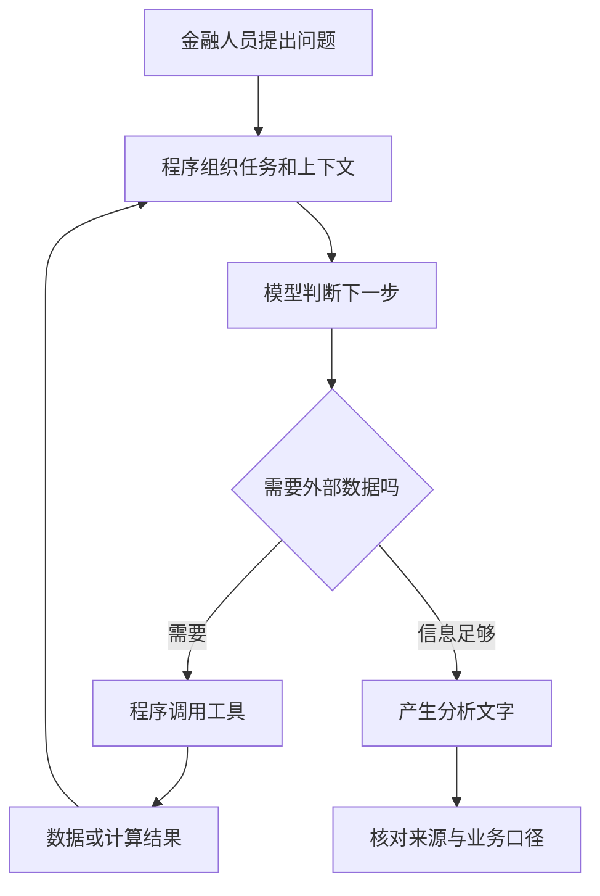

[[金融 AI 应用实战/00-从这里开始|返回学习路线]]

> [!abstract] 先把这件事想清楚
> 本教程研究的是“让软件帮金融人员查资料、组织证据、分析与写报告”。模型、数据接口、计算公式和业务流程各有职责。

## 先从你熟悉的工作开始

假设你接到任务：“比较甲、乙两家公司的经营情况，整理一份研究说明。”你不会立刻凭印象写结论，而会确认研究时点、找到财报和行情、计算指标、分析差异、审阅并交付。金融 AI 应用把这条过程的一部分交给软件。

其中，大语言模型（LLM）可以理解文字需求、把任务拆开、阅读材料和组织表达。它不是行情数据库，也不是必然正确的计算器。模型即使流畅地写出“最新净利润”，若没有实际获取对应资料，这个数字仍没有可核验来源。

| 工作 | 在例子中由谁负责 | 为什么这样分工 |
| --- | --- | --- |
| 理解“比较两家公司” | 大模型 | 能处理自然语言与省略表达 |
| 获取行情和报表 | 数据接口与程序工具 | 数据应有明确来源、时点和字段 |
| 计算区间涨跌幅 | Python 等确定性程序 | 输入、公式、结果可以复核 |
| 组合分析文字 | 大模型 | 擅长把多项材料组织成说明 |
| 判断证据是否充分 | 业务规则与人工复核 | 输出流畅并不证明结论成立 |

## 一次模型调用到底发生什么

应用把任务说明与材料送给模型服务，服务返回文字或工具调用请求。API 就是程序访问另一套服务的接口；SDK 是把接口包装成方便使用的代码库。服务地址告诉程序“去哪里”，模型名告诉服务“调用谁”，凭证说明“谁有权使用”。

请求中的 messages 是消息序列。system 提供总体任务规范，user 表达需求，assistant 表示模型此前的输出，tool 表示程序执行工具后的结果。不是把名字写成“分析师”，软件就真的聘请了一位分析师；这些角色主要用于组织一次模型交互。

Token 是模型处理文字的单位，不固定等于一个汉字。上下文是这次请求让模型看到的信息，包含规则、历史、问题、证据和工具结果。模型没有在本次输入中看到的文件，不能因为文件躺在电脑里就自动读到。

## Prompt、Tool、Agent、工作流分别是什么

**Prompt** 是给模型的任务与材料；**Tool** 是程序可以实际执行的能力，例如查询公司报表；**工作流** 说明这些步骤怎样连接；**Agent** 在规定范围内根据目标和反馈决定下一步动作。

第一个案例只用一个循环让模型决定“继续查还是结束”。第二个案例把规划、执行、总结显式连接。第三个案例分成多个岗位。最后的大型项目再加入可配置角色、数据层、任务状态、报告展示和模型适配。

## 学这四个例子，不需要先训练模型

调用已有模型是“使用现有能力”；训练或微调是“根据数据更新模型参数”。在这几个课堂应用里，重点是前者以及数据和流程连接。多写几个角色、改变提示词、把过去报告检索出来，都不等于训练出了新模型。

RAG 让模型先找证据再回答，记忆让应用把过往信息带进本次请求，LoRA 才属于参数更新方法之一。后面会只在项目实际用到的地方展开，避免一开始被名词淹没。

## 你应带着什么标准看输出

每看到一句金融结论，问四件事：数字来自哪里？是哪个时间和口径？计算过程是什么？现有证据支持到哪一步？例如“收入增长”不能单独推出“股票会涨”，模型的自信语气也不是置信区间。

> [!question]- 自测：把 PDF 放在文件夹中，模型就能使用吗？
> 不会。程序必须读取 PDF、提取相关内容，并通过上下文或检索把证据交给模型。文件位置和模型可见内容是两回事。

下一篇：[[金融 AI 应用实战/00-入门/02-读代码需要的最小Python知识|读代码需要的最小 Python 知识]]。

<!-- learning-sequence -->

下一篇：[[金融 AI 应用实战/00-入门/02-读代码需要的最小Python知识|02-读代码需要的最小Python知识]]
