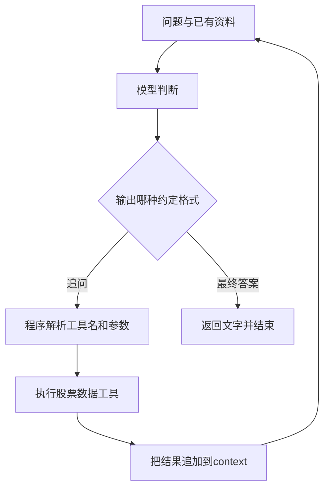

[[金融 AI 应用实战/00-从这里开始|返回学习路线]]

> [!abstract] 这个例子做什么
> 用户提出两只股票的比较问题，一个模型反复判断还缺什么资料，程序按它的要求查询数据，资料够了再生成文字答案。原课堂入口是《43-Agent、ReAct 与 Self-Ask》。

## 从金融业务翻译成程序任务

课堂问题是比较贵州茅台和宁德时代的“短期投资性价比”。对程序来说，至少包含两个股票身份、需要的数据和最终比较。这个表达本身没有定义风险偏好、投资期限或评价标准，所以数据收集与投资判断之间仍有一层需要明确的业务约定。

老师把行情、净利润率和近 30 条日线的涨跌幅包装在一个 get_stock_info 工具中。模型不用自己发送请求，只需要输出工具名与股票代码。程序把工具结果记下来，再把问题和已有资料一起发给模型。

Self-Ask 可以译为“先向自己提出需要解决的子问题”。本例里的“追问”主要是向工具查数据，不是把每个小问题重新抛给用户。

## 谁在做决定，谁在真正干活

| 角色 | 实际工作 |
| --- | --- |
| 用户 | 说明想比较什么 |
| LLM | 判断还缺哪家公司的资料，或者是否结束 |
| Python 循环 | 识别模型输出、限制轮次、派发工具 |
| get_stock_info | 访问数据接口、取字段、计算指标 |
| context 字符串 | 保存已经得到的观察结果 |

程序并没有训练一个选股模型，也没有优化投资组合。它更接近一个会查询资料的问答助手。

## 手动走一遍，不需要运行代码

以下是**教学演练，使用虚构的甲乙公司，不是实际行情或已执行日志**。

1. 用户问：“比较甲公司和乙公司的经营表现。”初始 context 为空。
2. 模型输出约定文字 `追问：get_stock_info|甲公司的代码`。
3. Python 根据工具名找到函数，函数返回甲公司的数据与时点。
4. 程序把这段结果追加到 context，第二次调用模型。
5. 模型发现乙公司资料缺失，输出乙公司的查询请求。
6. 工具返回乙公司数据，程序再次追加上下文。
7. 模型输出 `最终答案：...`，程序返回文字并停止。

你应该注意：第 2、5 步的选择由模型提出；第 3、6 步的数据与计算由程序完成；第 7 步的比较则仍然要受证据和金融标准约束。

## 它为什么比一次性问模型更有意义

直接问模型时，它未必掌握实时行情和你的研究时点。这个循环提供了获取外部资料的入口，也留下每轮工具结果，便于核对答案。但是“用了工具”不表示所有关键证据都已齐全：如果工具本身没有所需财务字段，模型不能靠多追问几轮创造它们。

## 你应能说清的输出边界

这个例子可以展示股票资料查询、任务拆分和问答闭环。不能据此声称验证了选股有效性、短期收益或专业投资判断。判断短期投资价值通常需要比课堂几个字段更明确的框架；本教程把它当作工程案例，而不是对课堂问题给投资结论。

原代码：[[金融 AI 应用实战/资料/课堂代码/案例1-SelfAsk原文.py|查看原始 Python 文件]]。详细讲解见下一篇。

> [!question]- 为什么第二轮要重新发送 context？
> 模型普通请求不会自动读取 Python 变量。程序必须把此前结果放进新请求，模型才看得到；变量存在电脑内存里并不等于模型有记忆。

<!-- learning-sequence -->

上一篇：[[金融 AI 应用实战/00-入门/03-遇到术语时查这里|03-遇到术语时查这里]] · 下一篇：[[金融 AI 应用实战/01-股票问答/02-代码逐段拆解|02-代码逐段拆解]]
