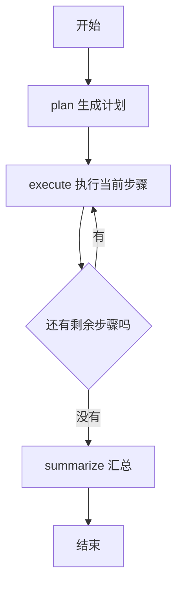

[[金融 AI 应用实战/00-从这里开始|返回学习路线]]

> [!abstract] 这个例子比第一个多了什么
> 第一个例子边问边查；这个例子先提出执行计划，再按步骤调用工具，最后总结。原课堂入口是《45-金融研报：LangGraph 规划与工具执行》。

## 把研究流程画出来

用户可能只问实时股价，也可能要行情、基本面与走势的组合。程序提供三个工具，规划节点选择要做哪些步骤。不是每次都必须调用三个工具，原提示词明确要求只取用户真正需要的内容。

课堂使用 LangGraph 定义 plan、execute、summarize 三个节点，execute 可以回到自己。因此“图”不是一张装饰图片，而是程序可执行的步骤与转移规则。

## 状态可以理解为项目工作底稿

如果一份研报要交给多人处理，大家需要知道原问题、当前计划、已完成步骤和证据放在哪里。程序中的 State 就承担这类工作底稿的作用。

| 字段 | 含义 | 例子 |
| --- | --- | --- |
| messages | 消息与工具交互记录 | 用户问题、模型请求、工具结果 |
| plan | 编号步骤列表 | 查询行情、查询财务、综合说明 |
| step_index | 下一步处理的位置 | 0 表示第一步 |
| tool_result | 保存的工具结果文本 | 每次查询得到的资料 |

状态不是模型权重，也不是自动永久记忆。它主要是本次流程中的程序数据；是否持久化，要看是否另有保存机制。这个课堂片段没有展示数据库或持久化 checkpointer。

## 节点返回的是更新，不是整张图

plan_node 返回计划和初始位置；execute_node 返回新消息、更多工具结果和递增位置；summarize_node 返回总结消息。LangGraph 根据字段的更新规则合并到状态，再沿边决定下一步。

messages 使用 add_messages 作为合并规则，适合合并消息。tool_result 没有这个声明，代码显式写“旧列表 + 本步结果”。如果误以为所有列表都会自动累加，就可能覆盖此前证据。

## 手工走一次三步计划

教学设定：计划有“查行情、查财务、综合结论”三步。step_index 起初为 0，执行完行情后变 1，执行财务后变 2，遇到综合步骤时只递增为 3，不再查工具。路由发现 3 已达到计划长度，进入真正的 summarize 节点。

所以计划中的“综合结论”与最终汇总节点存在一次功能上的重复表示：前者是被跳过的计划标签，后者才真正请求模型生成总结。

## 为什么这对金融业务有用

显式流程便于说明“为什么调用了这个接口”“现在进行到哪一步”“缺的是资料还是分析”。如果把研究报告做成服务，状态还可以用于进度展示与排错。

它仍然不会自动保证研究严谨。规划器可能漏掉重要步骤，执行器可能失败，汇总可能扩大结论。因此计划、证据和输出要分别检查，不能只看图走到了 END。

> [!question]- 如果 plan 是空列表，会怎样？
> 原代码随后仍进入 execute，并读取 plan[0]，会出现越界问题。应在计划生成后检查是否有效，或提供明确失败出口；提示词要求“输出编号”并不保证解析一定成功。

[[金融 AI 应用实战/02-研报工作流/02-三个金融工具与指标口径|下一篇：三个金融工具]]

<!-- learning-sequence -->

上一篇：[[金融 AI 应用实战/01-股票问答/03-金融口径与误判|03-金融口径与误判]] · 下一篇：[[金融 AI 应用实战/02-研报工作流/02-三个金融工具与指标口径|02-三个金融工具与指标口径]]
