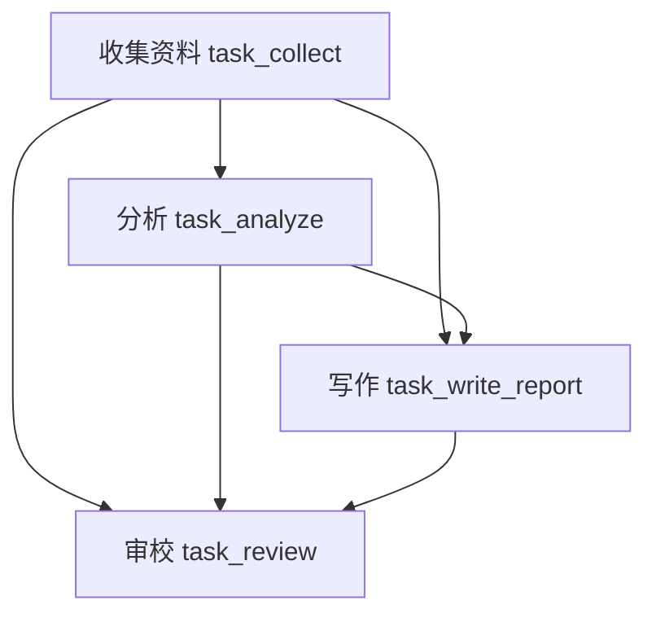

[[金融 AI 应用实战/00-从这里开始|返回学习路线]]

> [!abstract] 这个例子做什么
> 模拟数据收集、行业分析、报告写作与风险审校四个岗位，用 CrewAI 按顺序完成一份投研报告。原课堂入口是《48-CrewAI 金融分析项目与系统评估》。

## 为什么要从一个助手变成一支团队

金融报告同时包含事实取证、数值计算、业务解释和文字交付。把它们拆成岗位，有助于分别规定输入、输出和检查责任。但四个角色若共享同一错误数据，也可能一起写错；角色数量不是可靠性的证明。

课堂四个 Agent 使用同一模型配置。可以把 Agent 理解为“模型 + 岗位说明 + 可用工具 + 本次任务上下文”，不需要为每个角色单独训练四个模型。

| 岗位 | 应接收什么 | 应交付什么 | 原代码的工具权限 |
| --- | --- | --- | --- |
| 数据收集员 | 股票代码与取数要求 | 原始资料及缺失说明 | FINANCE_TOOLS |
| 行业分析师 | 收集结果 | 基本面、估值与风险分析 | FINANCE_TOOLS |
| 报告撰写员 | 资料与分析 | Markdown 初稿 | 未配置该工具集 |
| 风控审核员 | 原始资料、分析与初稿 | 终稿、修改对比和审校说明 | 未配置该工具集 |

未配置工具集的写作与审校角色主要阅读上游文本，不能据此认为它们会独立联网核验原始来源。

## Agent、Task、Crew、Process 四个词

Agent 规定“谁”；Task 规定“这一次要做什么以及交付标准”；Crew 把人和任务组起来；Process.sequential 指定按顺序执行。`.kickoff()` 才是启动任务团队。

role 和 backstory 帮助模型进入岗位语境，但“多年研究经验”只是提示词中的角色设定，不是模型履历。expected_output 描述目标产物，也不是自动实现的验收测试。

## context 是显式交接材料

分析 Task 的 context 包含收集 Task；写作 Task 包含收集与分析；审校 Task 包含此前三个任务。它们定义结果依赖，不等于所有角色随时共享全部内部状态。

阅读这张图时，箭头表示材料依赖，不表示这些任务在课堂中并行运行。实际 process 是 sequential。

## 手工演练一次交接

假设数据员只能拿到行情，没有财务。它应明确缺失 PE 与增速。分析师应保留这一限制，不能为了完成估值段落编数字。写作员应把限制放进报告，审核员应检查它是否被省略。

如果每一步都只是补齐“看起来完整”的格式，最后反而可能把最初的不确定性隐藏起来。团队的价值在于约束与核验，而不只是更多文字。

> [!question]- 四个 Agent 都使用同一个模型，有没有意义？
> 可以有：岗位、权限和输入不同，会影响处理过程。但独立性有限，需要对照单模型基线与固定工作流，用证据判断多角色是否值得额外成本。

[[金融 AI 应用实战/03-多Agent投研/02-工具与数据缺口|下一篇：工具与数据缺口]]

<!-- learning-sequence -->

上一篇：[[金融 AI 应用实战/02-研报工作流/03-逐节点读代码与故障演练|03-逐节点读代码与故障演练]] · 下一篇：[[金融 AI 应用实战/03-多Agent投研/02-工具与数据缺口|02-工具与数据缺口]]
