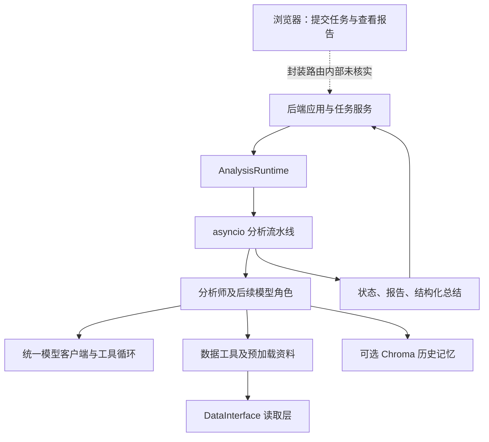

[[金融 AI 应用实战/00-从这里开始|返回学习路线]]

## 先区分业务架构与技术架构

业务架构告诉你谁先研究、谁审阅；技术架构告诉你浏览器、服务、数据库、模型和工具怎样连接。同一个“分析师报告”会经过界面展示、后端保存和模型上下文三个位置，不能把它们当作三份不同业务分析。

虚线表示当前材料存在封装边界，不是已经逐行证实的调用。图中的每层是职责划分，不一定独立运行成一个服务器。

## 各层用金融工作作类比

**界面**像研究任务工单，负责输入与展示；**任务服务**像项目台账，记录谁发起、状态如何；**引擎**像研究流程协调员，决定先后与并发；**模型客户端**像统一对外沟通接口；**数据层**像统一资料室；**记忆**像可检索的历史复盘。

这个类比是帮助理解，不能把程序角色等同于真正岗位的专业责任和授权。

## 为什么把模型接口单独隔一层

业务节点不应都手写不同厂商的消息格式。项目使用自己的 Message、ToolDef、ChatResponse 等表示，再由适配器对接具体协议。这样可以给分析和辩论选择不同连接配置，也可以集中处理限流、重试和 Token 记录。

这不保证任何模型都支持同样的工具能力。接口统一以后，底层模型的上下文长度、参数和输出行为仍需验证。

## 为什么还要有数据层

数据源格式和权限不同。若每个分析师各自按字符串下标读取所有接口，修改与核对非常困难。统一数据读取入口可以集中处理市场、领域、字段与新鲜度，但不能仅凭统一类名认定数据已齐全或没有错误。

## 这不是一个纯聊天机器人

聊天机器人只要回复文字；这套应用还需要任务、用户、状态、报告与数据管理。反过来说，附带这些工程功能，也不意味着投研结论已经可靠。应用完整性与金融有效性应分别评价。

> [!question]- 数据层与模型层谁提供净利润？
> 正式资料应该由数据来源与字段读取流程提供；模型可以解释和组织，但不能因为擅长写作就被当作财务数据源。

## 本篇源码证据

- [[金融 AI 应用实战/资料/大型项目源码/app/engine/runtime-源码|app/engine/runtime.py]]，第 69–144 行。
- [[金融 AI 应用实战/资料/大型项目源码/app/engine/orchestrator/agents-源码|app/engine/orchestrator/agents.py]]，第 60–120 行。
- [[金融 AI 应用实战/资料/大型项目源码/app/engine/orchestrator/agents-源码|app/engine/orchestrator/agents.py]]，第 122–230 行。
- [[金融 AI 应用实战/资料/大型项目源码/app/llm/core/types-源码|app/llm/core/types.py]]，第 1–90 行。

<!-- learning-sequence -->

上一篇：[[金融 AI 应用实战/04-大型项目/00-项目究竟做了什么|00-项目究竟做了什么]] · 下一篇：[[金融 AI 应用实战/04-大型项目/02-主流水线与状态工作底稿|02-主流水线与状态工作底稿]]
