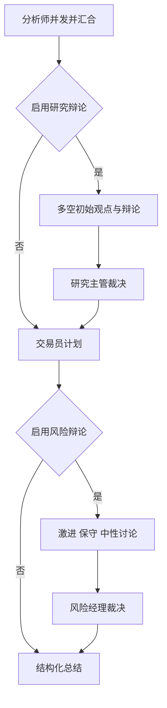

[[金融 AI 应用实战/00-从这里开始|返回学习路线]]

## 先记住真实顺序

当前 run_pipeline 的主线是：分析师并发 → 可选研究辩论与主管 → 交易员 → 可选风险辩论与经理 → 总结。研究和风险阶段由配置开关控制，交易员与总结在正常主路径中继续执行。

## 状态不是玄学，就是一份不断更新的字典

PipelineState 保存 company_of_interest、trade_date、task_id、user_id、messages、reports、两组 debate_state、交易计划和最终决定。金融上可以把它当作带版本阶段的研究工作底稿。

company_of_interest 的函数参数名字有时写 company_name，但实际使用时也可能传股票代码，因此读代码要检查值的实际身份，不要被名称误导。

## 合并规则直接决定资料会不会丢

_merge_state_update 对 reports 做字典合并，对 messages 做列表追加，其余字段直接赋新值。它是项目自己写的规则，不是 LangGraph reducer。

如果两个分析师写相同 report_key，后合并的值可能覆盖前者；如果计划字段被误用，也可能把研究意见与交易计划混在一起。数据字段的名字是模块之间的契约。

## 并发不是一边生成一边随意改同一底稿

分析师通过 gather 并发执行，结果返回后主循环逐个合并。辩论并发还有专门的轮次合并逻辑。需要注意，节点内部仍可能拿到浅复制对象，不能仅凭表面复制就声称完全没有共享状态风险。

## 进度条怎样算

compute_total_units 按分析师个数、各方发言轮数、主管、交易员与总结估计工作单元。它用于进度展示，不是模型质量分数。并发节点耗时相加也可能大于墙钟总时间，不能把各阶段百分比机械当作不重叠时间占比。

> [!question]- 到达总结节点是否表示前面的所有研究都成功？
> 不一定。节点可能捕获异常并返回失败文字，主流程仍可继续。任务验收要检查内容状态、errors 与占位报告，不能只看流程走完。

## 本篇源码证据

- [[金融 AI 应用实战/资料/大型项目源码/app/engine/orchestrator/state-源码|app/engine/orchestrator/state.py]]，第 42–55 行。
- [[金融 AI 应用实战/资料/大型项目源码/app/engine/orchestrator/state-源码|app/engine/orchestrator/state.py]]，第 201–244 行。
- [[金融 AI 应用实战/资料/大型项目源码/app/engine/orchestrator/pipeline-源码|app/engine/orchestrator/pipeline.py]]，第 73–84 行。
- [[金融 AI 应用实战/资料/大型项目源码/app/engine/orchestrator/pipeline-源码|app/engine/orchestrator/pipeline.py]]，第 189–204 行。
- [[金融 AI 应用实战/资料/大型项目源码/app/engine/orchestrator/pipeline-源码|app/engine/orchestrator/pipeline.py]]，第 472–586 行。

<!-- learning-sequence -->

上一篇：[[金融 AI 应用实战/04-大型项目/01-真实架构与各层职责|01-真实架构与各层职责]] · 下一篇：[[金融 AI 应用实战/04-大型项目/03-分析师如何获取材料并生成报告|03-分析师如何获取材料并生成报告]]
