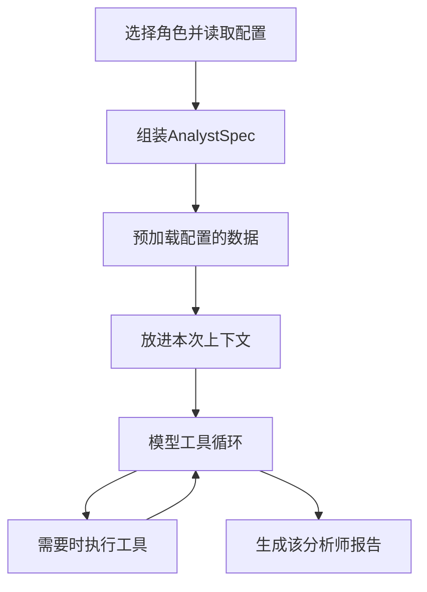

[[金融 AI 应用实战/00-从这里开始|返回学习路线]]

## 分析师不是代码里固定的一排人名

build_analyst_specs 根据 selected_analysts 查配置，把 slug 转成 internal_key，再组装 AnalystSpec。Spec 保存角色名、system_prompt、预加载数据工具、可调用工具、Skill 与子代理开关、最大交互轮数。

因此“支持几个分析师”要区分配置中有多少、用户本次选了多少、哪些成功装配与哪些实际完成。未找到配置的角色会跳过，全部无效才抛出错误。

## 当前配置里的六类分析师

| 角色 | 配置的数据方向 | 你应核对的边界 |
| --- | --- | --- |
| 财经新闻 | news | 新闻实体、来源与时间 |
| 中国市场 | 行情、资金、龙虎榜、大宗交易等 | 是否适用于本次市场与标的 |
| 市场技术 | 日线、分时、报价、指标 | 窗口、复权与指标定义 |
| 舆情与情绪 | sentiment、news | 文本覆盖和情绪解释 |
| 基本面 | 财务、指标、基本信息等 | 财报期、披露日、币种与单位 |
| 短线资金 | 资金、杠杆和交易行为资料 | 数据权限、时效与可验证性 |

这是配置中的角色与 data_tools 方向，不表示六个都在每次运行中启用，也不表示资料均已成功取得。“量化专家”等角色描述不是实证能力证明。配置原文见 [[金融 AI 应用实战/资料/大型项目源码/config/agents/phase1_agents_config-源码|阶段1配置]]。

## 获取资料有两条路

**预加载**：程序根据配置先运行 data_tools，把结果放进模型 history。模型一开始就能看到，不需要先自己选择调用。

**运行中调用**：模型通过可调用工具继续取资料或计算。工具定义包括名称、说明、参数和 handler，真正执行发生在 runner。

## 每份报告怎样命名

run_analyst 将 internal_key 加 `_report` 形成字段，同时写顶层和 reports 字典，追加一条 assistant 消息。字段名称决定后续模块怎样找到资料，不能只看界面中文标题是否相同。

## 时间参数是一个特别需要核对的点

模型上下文包含股票、分析日期和当前 UTC 时间。预加载参数里，有的 start_date 按“当前 UTC 减若干天”计算。于是即使用户给历史 trade_date，也不能自动保证所有接口遵守历史可用时点。

这意味着把系统当历史回测研究器之前，要逐个数据工具核对查询窗口与披露日。显示了一个分析日期，不等于已经消除了未来信息。

## 并发怎样控制

pipeline 用 Semaphore 限制同时运行的分析师，再叠加模型级 alimit。前者控制这一层同时执行几个角色，后者控制模型相关额度。两个限制可能同时生效，不能只按选了六个角色就认定会同时发出六个模型请求。

## 报告失败会怎样

run_analyst 内部捕获异常，可能返回以“分析失败”开头的报告；空响应也会变成占位说明。后续模块会收到这些字符串，因此质量验收必须识别失败报告，不能以“字段里有文字”判断成功。

> [!question]- 为什么“提前提供数据”和“允许模型调工具”要分开配置？
> 前者决定起始证据，后者决定运行中能做的动作。提前给齐资料可减少无效调用，工具能力则处理动态缺口；二者的成本和可控性不同。

## 本篇源码证据

- [[金融 AI 应用实战/资料/大型项目源码/app/engine/orchestrator/agents-源码|app/engine/orchestrator/agents.py]]，第 15–26 行。
- [[金融 AI 应用实战/资料/大型项目源码/app/engine/orchestrator/agents-源码|app/engine/orchestrator/agents.py]]，第 28–53 行。
- [[金融 AI 应用实战/资料/大型项目源码/app/engine/orchestrator/agents-源码|app/engine/orchestrator/agents.py]]，第 60–120 行。
- [[金融 AI 应用实战/资料/大型项目源码/app/engine/orchestrator/agents-源码|app/engine/orchestrator/agents.py]]，第 122–239 行。
- [[金融 AI 应用实战/资料/大型项目源码/app/engine/orchestrator/agents-源码|app/engine/orchestrator/agents.py]]，第 308–405 行。
- [[金融 AI 应用实战/资料/大型项目源码/app/engine/orchestrator/pipeline-源码|app/engine/orchestrator/pipeline.py]]，第 423–477 行。

<!-- learning-sequence -->

上一篇：[[金融 AI 应用实战/04-大型项目/02-主流水线与状态工作底稿|02-主流水线与状态工作底稿]] · 下一篇：[[金融 AI 应用实战/04-大型项目/04-多空辩论与研究主管|04-多空辩论与研究主管]]
