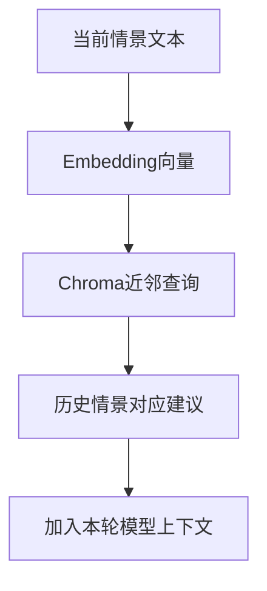

[[金融 AI 应用实战/00-从这里开始|返回学习路线]]

## 记忆保存的是什么

FinancialSituationMemory 用 Chroma 集合保存 situation 文本和 recommendation 元数据，并为 situation 生成向量。查询时把当前情景向量化，找近邻，再把过去建议交给角色参考。

Embedding 是把文本转成向量表示；相似检索找到的是“表示空间里接近的历史情景”，不是已经证明经济状态相同，也不是因果规律。

## 一次读取怎样发生

交易员、研究员或经理把当前材料交给 fetch_memory_brief；它在线程中调用 get_memories，返回建议文字，随后放进本次模型请求。只有进入请求的部分才是模型这次实际看见的记忆。

## 写入与调用不是一回事

add_situations 接收情景和建议配对，计算向量后写集合。Runtime 的 reflect_and_remember 接收 returns_losses，调用 Reflector 为不同岗位生成反思并写记忆。

正常 propagate 中并没有直接调用 reflect_and_remember。因此不能说每次生成报告都会自动根据真实交易盈亏学习；调用方是否安排该动作、returns_losses 是否真实，需要另外验证。

## 它不是微调

记忆读写改变数据库内容和本次上下文，不修改生成模型参数。这里没有因为 Chroma 增加一条记录就训练出一个更懂金融的模型。它与 RAG 有相似的“检索后注入”思想，检索对象是历史情景建议。

## 失败与空间一致性

Embedding 不可用或文本过长时，代码可能返回固定长度零向量；查询发现全零会返回空结果。不同模型向量维数、集合状态和备用客户端都需要匹配，不能把“有备用”当作无条件可靠。

默认集合名按角色设定，不能仅从 user_id 出现在其他日志中就认定记忆已按用户隔离。持久化程度还取决于 Chroma 客户端配置与降级路径。

> [!question]- 历史建议与当前问题相似，为什么仍要核查？
> 相似文本可能来自不同市场、时期和风险条件；过去建议也可能有错。应保留时间、来源与验证结果，不把检索近邻当作决策依据本身。

## 本篇源码证据

- [[金融 AI 应用实战/资料/大型项目源码/app/engine/agents/utils/memory-源码|app/engine/agents/utils/memory.py]]，第 83–129 行。
- [[金融 AI 应用实战/资料/大型项目源码/app/engine/agents/utils/memory-源码|app/engine/agents/utils/memory.py]]，第 284–356 行。
- [[金融 AI 应用实战/资料/大型项目源码/app/engine/agents/utils/memory-源码|app/engine/agents/utils/memory.py]]，第 371–384 行。
- [[金融 AI 应用实战/资料/大型项目源码/app/engine/runtime-源码|app/engine/runtime.py]]，第 51–63 行。
- [[金融 AI 应用实战/资料/大型项目源码/app/engine/runtime-源码|app/engine/runtime.py]]，第 301–337 行。

<!-- learning-sequence -->

上一篇：[[金融 AI 应用实战/04-大型项目/07-总结、结构化字段与最终信号|07-总结、结构化字段与最终信号]] · 下一篇：[[金融 AI 应用实战/04-大型项目/09-任务提交、队列与进度事件|09-任务提交、队列与进度事件]]
