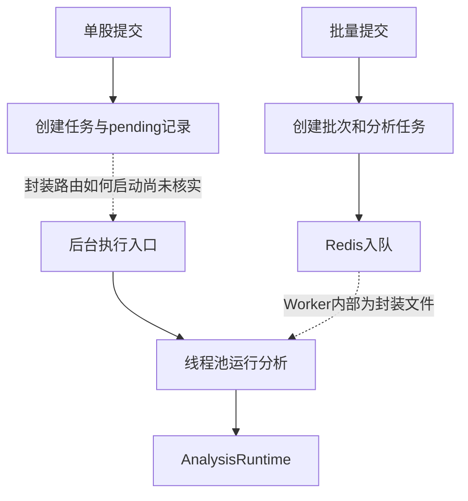

[[金融 AI 应用实战/00-从这里开始|返回学习路线]]

## 为什么分析任务要有独立编号

股票分析可能等待多次网络请求，不能只靠浏览器页面的一次临时变量保存。task_id 让程序关联任务状态、模型调用、报告和错误，user_id 用于记录所属用户。batch_id 再把多个股票任务分到同一批次。

这些 ID 的名字类似，但不能混用。可读队列服务会生成自己的队列 task_id，批量任务参数又携带原分析 task_id；Worker 怎样映射二者，需要查它的实现。当前 Worker 是封装文件，所以教程不虚构这段内部细节。

## 单股提交与批量提交不是同一条已证实路径

submit_single_analysis 直接调用 create_analysis_task。后者创建内存任务，并尝试向 MongoDB analysis_tasks 写 pending 记录，返回“任务已创建，等待执行”。这一段本身不启动模型，也没有显示 Redis 入队。

批量 submit_batch_analysis 则明确创建批次与股票任务，再调用 queue_service.enqueue_task。可读 execute_analysis_background 及辅助函数另外提供后台执行路径，_execute_analysis_sync 用线程池运行同步函数。

## Redis 队列在可读代码中怎样运转

enqueue_task 把状态写到 Redis Hash，再 lpush 到 ready 列表；dequeue_task 用 rpop 取任务，并通过 Lua 检查与登记用户并发。它还设置可见性超时，处理完成后 ack_task 标记成功或失败。

这类似“待办箱—领取—处理—确认”的工单机制。确认不是报告内容的专业验收，只是队列消费状态。

## 进度不是模型的正确率

引擎 EventSink 发出 agent_start、agent_end、report_ready、progress 等事件。text_delta 可以展示模型文字增量。界面看到 70% 表示程序估计的工作进度，不表示报告有 70% 可信度。

SSE 是服务端持续向浏览器推送消息的方式，WebSocket 支持双向通信。项目 README 和文件结构包含这些机制，但部分路由被封装；教程只把可读事件发射与代理配置作为已证实部分，不声称逐条验证了浏览器端订阅实现。

> [!question]- 收到 pending 响应，是否说明模型已经开始分析？
> 不代表。它只确认任务记录已创建；还需要实际执行入口启动、数据与模型连接成功，以及状态更新。

## 本篇源码证据

- [[金融 AI 应用实战/资料/大型项目源码/app/services/analysis_service-源码|app/services/analysis_service.py]]，第 525–579 行。
- [[金融 AI 应用实战/资料/大型项目源码/app/services/analysis_service-源码|app/services/analysis_service.py]]，第 779–898 行。
- [[金融 AI 应用实战/资料/大型项目源码/app/services/queue_service-源码|app/services/queue_service.py]]，第 41–166 行。
- [[金融 AI 应用实战/资料/大型项目源码/app/engine/orchestrator/pipeline-源码|app/engine/orchestrator/pipeline.py]]，第 110–139 行。
- [[金融 AI 应用实战/资料/大型项目源码/app/llm/events-源码|app/llm/events.py]]，第 89–167 行。

<!-- learning-sequence -->

上一篇：[[金融 AI 应用实战/04-大型项目/08-历史记忆、Embedding 与反思|08-历史记忆、Embedding 与反思]] · 下一篇：[[金融 AI 应用实战/04-大型项目/10-数据层：市场、领域、新鲜度与时点|10-数据层：市场、领域、新鲜度与时点]]
