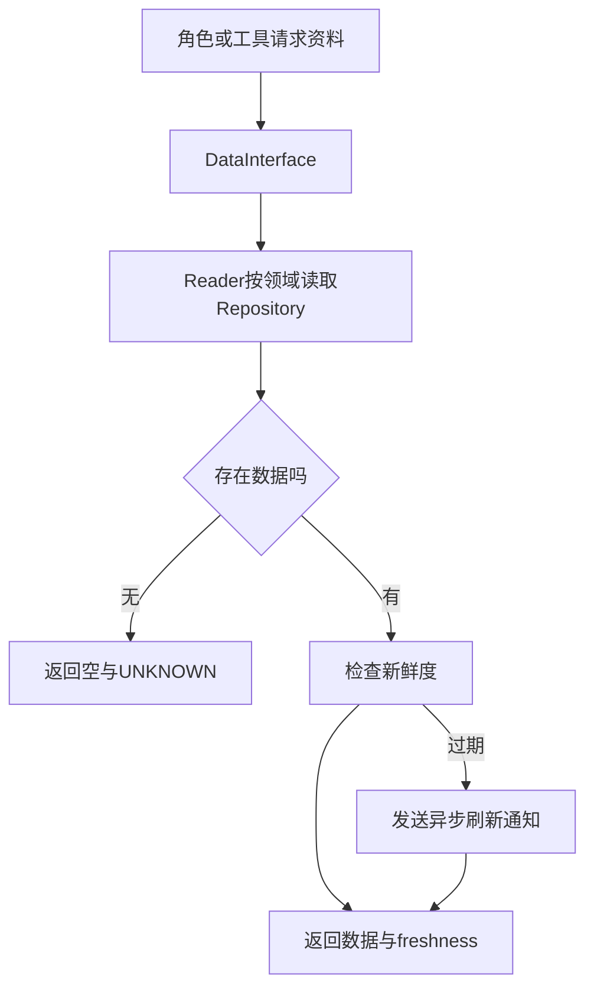

[[金融 AI 应用实战/00-从这里开始|返回学习路线]]

## 为什么不能让每个角色随便取一份数据

大型项目要处理 A 股、港股、美股，以及基本信息、日线、财务和新闻等领域。不同源的字段、代码格式与更新频率不同，需要一个统一入口向上提供“这是什么数据、属于谁、是否新鲜”。

DataInterface.read 接收 market、domain、symbol、起止日期和 filters，返回 data、freshness、market、symbol、domain。它把资料内容与资料状态分开，比只有一段文字更利于检查。

## read 并不等于立即访问外部接口

当前 read 调用 Reader.get_data，后者按 domain 选择 repository，读取本地保存的数据。没有数据就返回 UNKNOWN；发现过期并有 symbol 时，会发出异步刷新通知，再返回当前数据和状态。

因此不能说“每个 read 都拉取了最新行情”。缓存、存储与刷新之间存在时间差。模型如果只收到正文而没收到 freshness，就可能把旧数据当新数据使用。

## 领域不是所有市场共有的一套完整字段

Reader 中有 daily_quotes、financial_data、news、money_flow、dragon_tiger 等分支，说明读取层认识这些数据类别。具体哪个市场、哪个源提供哪些能力，应再看 capability registry 与 provider；分支存在不等于数据库已装满或用户拥有权限。

刷新通过 DataRefreshService 及能力、优先级配置组织。即使存在多源配置，也不能无测试地说自动降级在每种数据和错误上都成功。

## 新鲜度与历史可用时点不同

新鲜度回答“相对于现在是否过期”；回测可用时点回答“在历史研究时点是否已公开”。一份今天很新的财报，可能在三个月前根本不存在。历史分析还需要披露日、修订版本和复权处理。

这也是为什么为模型注入 trade_date 只是第一步。数据查询、预加载起始日期、缓存版本和财务可用期都必须遵守同一个时点。

## 你可以怎样核对一次取数

把每个结果列成 symbol、market、domain、source、as_of、period、unit、freshness、status。若两个角色使用不同更新时点，应在汇总前标记，而不是等最终报告出现矛盾再猜原因。

> [!question]- 返回非空 data，能否忽略 freshness？
> 不应该。非空只说明有资料，新鲜度可能过期或未知；有效性、适用时间与业务可比性还需要另外判断。

## 本篇源码证据

- [[金融 AI 应用实战/资料/大型项目源码/app/data/core/interface-源码|app/data/core/interface.py]]，第 16–68 行。
- [[金融 AI 应用实战/资料/大型项目源码/app/data/core/interface-源码|app/data/core/interface.py]]，第 133–143 行。
- [[金融 AI 应用实战/资料/大型项目源码/app/data/core/reader-源码|app/data/core/reader.py]]，第 81–218 行。
- [[金融 AI 应用实战/资料/大型项目源码/app/engine/orchestrator/agents-源码|app/engine/orchestrator/agents.py]]，第 28–53 行。

<!-- learning-sequence -->

上一篇：[[金融 AI 应用实战/04-大型项目/09-任务提交、队列与进度事件|09-任务提交、队列与进度事件]] · 下一篇：[[金融 AI 应用实战/04-大型项目/11-模型接口、工具循环与成本|11-模型接口、工具循环与成本]]
