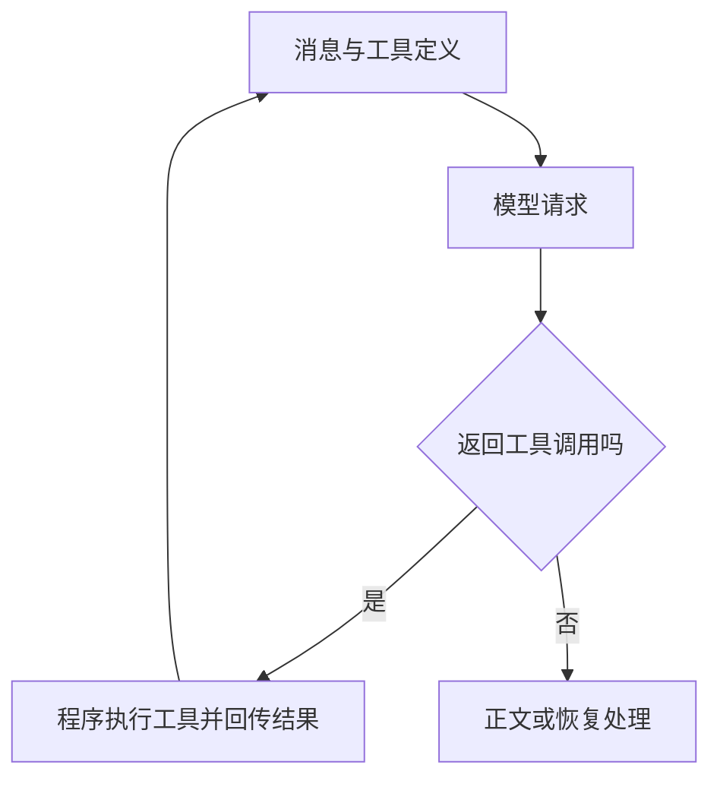

[[金融 AI 应用实战/00-从这里开始|返回学习路线]]

## 大型项目不用每个角色直接写 SDK

项目定义统一 Message、ToolDef、ChatResponse 与 Usage 等类型，再通过 Provider 配置建立客户端。protocol 表示接口协议，provider 表示配置中的厂商或连接来源，model 表示要调用的模型名称，三者不是同一个字段。

当前协议分支包括 OpenAI 风格和 Anthropic 风格。这里在解释项目的接口抽象，并不表示所有厂商、参数与模型都已经实际连通。

## 分析和辩论可以配置不同连接

get_engine_clients 为 analyst 与 debate 两类角色创建 EngineClientBundle，包含 primary、可选 fallback、输出上限、温度、上下文窗口与并发限制。Runtime 还可以按任务配置覆盖。

这样可以在不同任务层面选择成本与能力，但不能仅凭默认模型名认定当前运行用的是哪一个。数据库和环境回退会影响最终选择。

## runner 怎样执行一轮模型工具交互

1. 加入用户任务与历史，按需附加 Skill 清单。
2. 检查上下文预算，必要时压缩。
3. 调用客户端流式接口，把文字和事件向外发送。
4. 记录 Usage；若返回工具调用，按 handler 执行并回传 ToolResultBlock。
5. 继续下一轮；没有工具且有正文时返回，或者达到轮次限制停止。

“max_tool_calls”在分析师配置中传入 runner 的 max_turns，实际约束的是交互轮次，不是严格的工具个数；一轮可能返回多个工具请求。成本估算不能只把两者当同一个数字。

## 还有三种额外调用来源

重试会增加请求；输出截断恢复可能重发或继续；上下文压缩若使用模型也可能带来额外工作。token_usage_recorder 的调用证明主响应有计量入口，不能据此声称所有辅助调用成本都已被完整统计。

with_retry 采用指数退避，对认证类错误不重试；连续限流达到条件时可能切 fallback。备用模型一次成功不代表质量等价，输出行为仍需记录与验收。

## 工具结果和模型解释分开保留

runner 用 ToolResultBlock 关联工具调用 ID，记录工具返回和耗时。工具错误被转换为文字后，模型仍可能继续回答；因此需要显式失败状态，而不是依靠模型自己推断错误严重性。

> [!question]- 开六个角色是否一定要六个不同模型？
> 不需要。角色是任务上下文与能力配置，多个角色可以共用一个客户端；实际请求次数由轮次、工具与重试决定。

## 本篇源码证据

- [[金融 AI 应用实战/资料/大型项目源码/app/llm/core/types-源码|app/llm/core/types.py]]，第 1–90 行。
- [[金融 AI 应用实战/资料/大型项目源码/app/llm/providers-源码|app/llm/providers.py]]，第 21–63 行。
- [[金融 AI 应用实战/资料/大型项目源码/app/llm/providers-源码|app/llm/providers.py]]，第 252–308 行。
- [[金融 AI 应用实战/资料/大型项目源码/app/llm/providers-源码|app/llm/providers.py]]，第 389–414 行。
- [[金融 AI 应用实战/资料/大型项目源码/app/llm/runner-源码|app/llm/runner.py]]，第 67–320 行。
- [[金融 AI 应用实战/资料/大型项目源码/app/llm/retry-源码|app/llm/retry.py]]，第 21–59 行。

<!-- learning-sequence -->

上一篇：[[金融 AI 应用实战/04-大型项目/10-数据层：市场、领域、新鲜度与时点|10-数据层：市场、领域、新鲜度与时点]] · 下一篇：[[金融 AI 应用实战/04-大型项目/12-工具、MCP、Skill 与子代理|12-工具、MCP、Skill 与子代理]]
